# 안저 사진 뷰어 (Fundus Viewer)

Windows 10 / 11용 안저카메라 전용 뷰어입니다. **감시 폴더에 사진 파일이 떨어지면** 파일에서
환자 ID·이름 등 환자 정보를 추출해 뷰어 데이터베이스로 가져오고, 2D로 보거나 **광각 사진을
실제 안구처럼 입체(3D) 모델**로 돌려 볼 수 있습니다. Mac용은 0.13.13에서 멈췄고 새로 만들지 않습니다.

**버전 0.13.20** — [변경 내역](docs/release_notes.md)

우선 회사 초광각 모델 **SYSEYE RetiCam 3100 Plus (1회 176° · 몽타주 220°)** 에 맞춰
만들었고, **Microclear APOLLO (WA 135° / UWA 165°)**, **Kowa VK-2 / VK-2s** (nonmyd·VX
시리즈) 출력과 일반 안저카메라 파일도 읽습니다.
병원 전산과는 DICOM으로 이어집니다 — **워크리스트**에서 그날 예약된 환자를 열고, 사진을 **PACS로 전송**합니다
([아래](#dicom-전송-pacs--워크리스트)).

| Detail (큰 사진 · 황반 · 시신경 유두) | 3D 안구 — 간단히 |
|---|---|
| 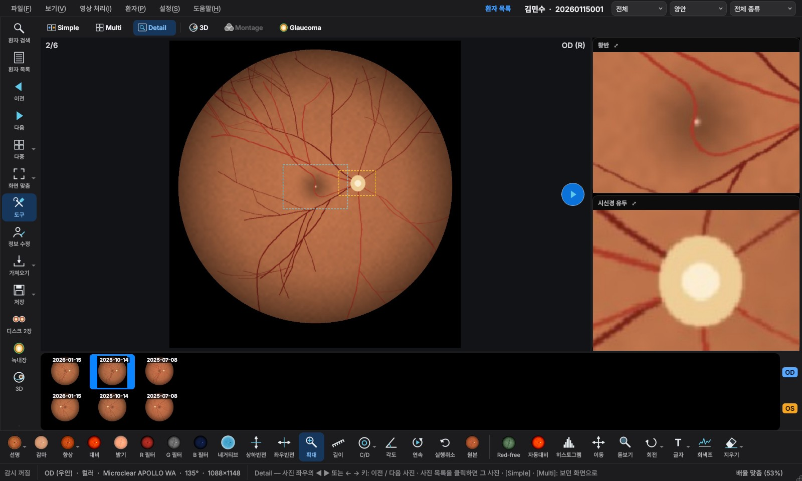 | 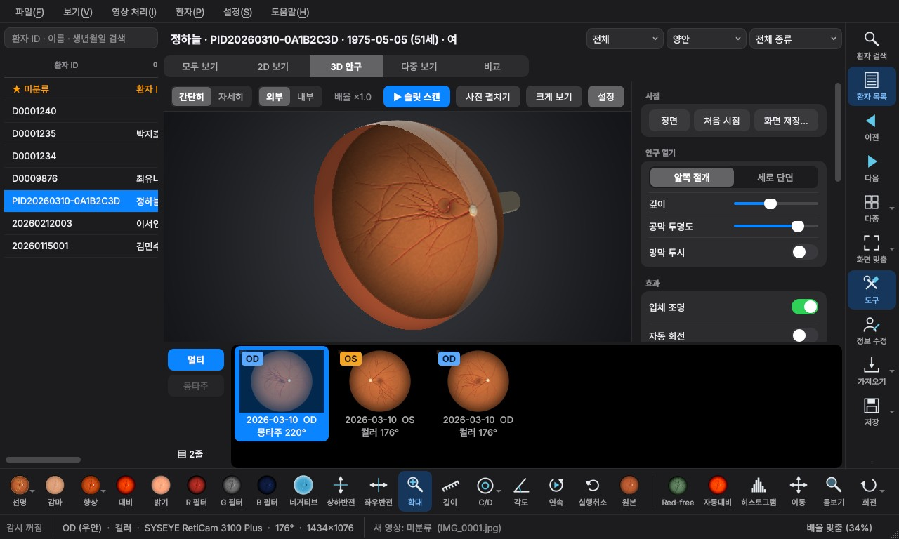 |
| **3D 안구 — 자세히 (절개 보기)** | **3D 안구 — 자세히 (닫힌 안구)** |
|  | 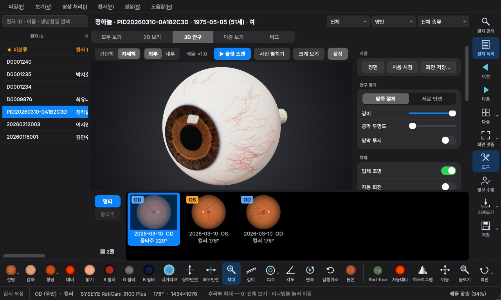 |
| **3D 안구 — 내부(망막 시점)** | **2D — 후극부 확대와 미니맵** |
|  | 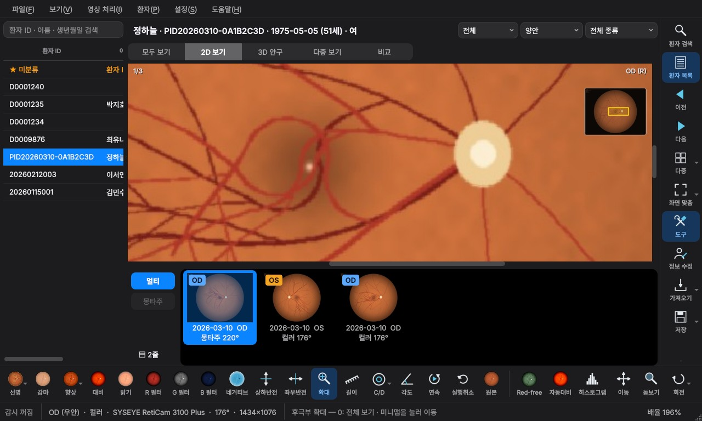 |

**슬릿 스캔** — 안구를 옆에서 반으로 자른 단면에 화각(안구 중심각)을 보이고, 슬릿이 사진을 위에서 아래로
(또는 아래에서 위로) 훑는 동안 빛이 동공을 지나 같은 망막 위치에 닿는 모습을 보여 준 뒤, 사진을 입힌 3D 안구로
돌아갑니다. 좌우 방향은 앞을 연 안구의 망막 위로, **상하좌우**는 네 방향을 차례로 보여 줍니다
([아래](#슬릿-스캔--세로-단면--망막-투시)).


**자세히** 보기는 실제 해부 구조대로 그립니다.

| 각막·홍채 (굴절·반사광) | 앞쪽 절개 70 — 섬모체 돌기·소대·수정체 |
|---|---|
|  |  |
| **안구벽 단면 — 공막·맥락막·RPE·망막층** | **외안근 부착부와 시신경** |
| 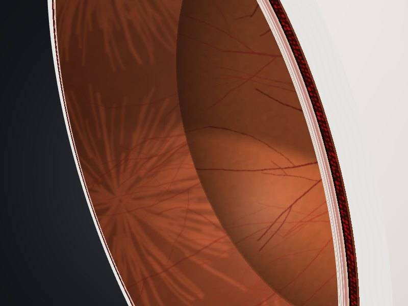 |  |

> 화면의 사진과 환자는 모두 `fundusview/demo.py`가 만든 **합성(가상) 데이터**입니다.

## 빠른 시작

```bat
pip install -r requirements.txt
python run_viewer.py --demo
```

`--demo`는 빈 라이브러리에 가상 환자 사진(RetiCam·APOLLO·VK-2·DICOM 형식)을 넣어 바로 써 볼
수 있게 합니다. `--home D:\FundusViewer`를 주면 설정과 라이브러리를 그 폴더 하나에 둡니다(휴대용).

**내려받기 (Windows 10 / 11):**
https://github.com/kukje1980/Image-capture/releases/download/fundus-viewer-latest/FundusViewer-windows.zip
— 로그인 없이 받아지며 항상 최신 빌드입니다. 압축을 풀고 `FundusViewer\FundusViewer.exe`를 실행합니다
("Windows의 PC 보호" 창이 뜨면 **추가 정보 → 실행**).

**Mac용**은 0.13.13이 마지막 빌드이고 새로 만들지 않습니다 — 내려받기와 설치 방법은 [변경 내역](docs/release_notes.md)에 있습니다.

**직접 빌드:** Windows는 `build_windows.bat` 실행 → `dist\FundusViewer\FundusViewer.exe` (폴더째 복사해
사용). GitHub Actions(`fundus-viewer` 워크플로)가 커밋마다 Linux에서 시험(3D 안구 OpenGL 렌더링 포함)하고 Windows exe를
빌드·시험하며, 기본 브랜치(`fundus-viewer`)의 빌드만 위 주소(릴리스 `fundus-viewer-latest`)에 올립니다(다른
브랜치·PR은 빌드·시험만). Mac 앱은 워크플로에서 빌드하지 않습니다 — Mac에서 `./build_mac.sh`를 실행하면
`dist/FundusViewer.app`과 dmg가 만들어지고, 앱의 최소 macOS(Info.plist `LSMinimumSystemVersion`)는 `macos_bundle.py`가
앱에 들어간 라이브러리에서 읽어 정합니다.

**3D 안구 미리보기 (웹 페이지):** `web3d/eye3d.html` 하나를 브라우저(Chrome·Edge·Safari·Firefox)로 열면 프로그램의
3D 안구를 설치 없이 돌려 볼 수 있습니다. 새 3D 기능은 여기서 먼저 확인한 뒤 프로그램에 넣습니다. 자세한 내용은
[아래](#3d-안구-미리보기-웹-페이지).

## 사용 흐름

사진 가져오기는 **설정 없이 자동**입니다. 프로그램을 켜면:

* **가져오기 폴더** `문서\안저사진 가져오기`를 만들고 감시합니다. 여기에 넣은 사진은 라이브러리로
  **옮겨지므로** 폴더가 비면 모두 들어간 것입니다.
  다른 폴더(예: 바탕화면이나 USB·NAS의 폴더)를 쓰려면 **설정 → 일반 → 가져오기 폴더**에서 고릅니다.
  **확인**을 누르면 다시 시작하지 않아도 바로 새 폴더를 감시하고, 예전 폴더는 감시 목록에서 빠집니다
  (나중에 다시 그 폴더로 바꿔도 됩니다). 라이브러리 폴더 안은 고를 수 없습니다.
* 모든 드라이브(네트워크 드라이브 포함)에서 촬영 프로그램 폴더를 찾아 알맞은 카메라 프로필로
  감시 목록에 넣습니다. 장비 폴더는 **복사**만 하고(원본 유지), 네트워크 드라이브는 폴링합니다.

  | 장비 | 찾는 폴더 |
  |---|---|
  | SYSEYE RetiCam 3100 Plus | `X:\reticam`, `X:\RetiCam`, `X:\레티캠`, `X:\SYSEYE` |
  | Microclear APOLLO | `X:\MicroClearClient\ImageData`, `X:\MC\Cro\PatientCapture`, `%USERPROFILE%\MicroClearClient\ImageData` |

* 감시가 바로 시작됩니다. 새 파일은 쓰기가 끝날 때까지 기다린 뒤 가져오고, 프로그램이 꺼져 있던
  동안 들어온 파일도 시작할 때 찾아냅니다.

다른 위치(예: 장비 PC의 공유 폴더 `\\<장비 IP>\D\reticam`)는 **설정 → 감시 폴더 → 폴더 추가**로
넣습니다. 설정에서 지운 폴더는 다시 자동으로 추가되지 않으며, **설정 → 일반**에서 자동 찾기를 끄거나
**지금 장비 폴더 다시 찾기**를 누를 수 있습니다.

### 사진 가져오기 — 환자 정보 확인

**사진 가져오기**(환자 목록 창의 버튼 · `가져오기 ▾` 메뉴의 파일 / 폴더 · 창에 끌어다 놓기)로 직접 고른 사진은
가져오기 전에 **확인 창**이 먼저 뜹니다. 사진에서 읽은 환자 정보를 **환자별로 한 줄씩** 보여 줍니다.

| 열 | 내용 |
|---|---|
| 환자 ID · 이름 · 생년월일 · 성별 | 사진(DICOM · 장비 데이터 · 부속 파일 · 파일 / 폴더 이름)에서 읽은 값. **칸을 눌러 고칠 수 있습니다.** |
| 사진 · 검사일 · 파일 | 그 환자의 사진 수, 검사일, 들어 있던 폴더와 파일 이름 |
| 상태 | **새 환자로 등록됩니다** · **등록된 환자** · **이름이 다릅니다**(사진의 이름 ≠ 등록된 이름) · **환자 정보 없음** |

* **환자 정보가 없는 사진**(`IMG_0001.jpg` 같은 이름)은 폴더별로 한 줄로 모입니다. 환자 ID 칸에 번호를 적으면
  그 환자의 사진으로 들어가고(등록된 번호면 이름 · 생년월일 · 성별이 채워짐), 비워 두면 **미분류**로 들어갑니다.
* 줄 끝의 **← 이름 (ID)** 를 누르면 한 번에 지정됩니다. 환자 목록에서 **선택해 둔 환자**, 또는 사진에서 이름만
  읽혔을 때 **그 이름으로 등록된 환자가 한 명뿐이면 그 환자**가 나옵니다.
* 이미 가져온 사진은 건너뜁니다. 다만 **미분류에 있는 사진을 다시 골라 환자를 지정하면** 사진을 새로 넣지 않고
  그 사진에 환자만 지정합니다. 읽을 수 없는 파일(손상 · 사진이 아닌 파일)은 아래에 따로 알려 줍니다.
* 직접 고른 사진은 **위쪽 폴더 이름도** 읽습니다: `…\12345_홍길동\2026-03-01\IMG_0001.jpg`, `홍길동(12345)` 폴더를
  통째로 고른 경우 등. 폴더 이름에서 읽은 환자는 상태에 **폴더 이름에서 읽음**이라고 나오니 확인하세요.
* **가져오기**를 누르면 그대로 가져옵니다. 감시 폴더로 들어오는 사진은 창 없이 자동으로 들어옵니다.

0. 프로그램을 켜면 **환자 목록 창**이 먼저 뜹니다([아래](#환자-목록-창-vk-2-open-list)). 환자를 찾아 **두 번 누르면**
   (또는 Enter · **사진 보기**) 환자 목록 창이 닫히며 그 환자의 **최신 OD | OS 두 장**이 나란히 열립니다(**Simple**).
   환자 목록 창은 명령 툴바의 **[환자 목록]** · 보기 → 환자 목록 · Ctrl+0 으로 다시 엽니다.
1. 새 사진이 들어오면 환자 목록 창이 떠 있더라도 그 환자와 사진이 바로 열립니다(파일 → 새 영상 자동 표시).
2. 작업 화면: **왼쪽 명령 툴바**에 보기를 고르는 **[Simple] · [Detail] · [3D]** 와 **[Montage] · [Glaucoma]** 가
   있고, 큰 사진 화면 아래에 사진 목록(위 줄 OD · 아래 줄 OS, 최신 사진부터 — 사진 위에 날짜, 줄 왼쪽에 **OD / OS**)이
   있습니다. 환자 이름 · ID는 **아래 상태 줄**에 나옵니다. **Simple**은 최신 OD | OS 두 장에서 시작해, 사진 목록을
   **클릭**하는 대로 더해지고(번호) 고른 장수에 맞게 화면이 나뉩니다(1장 · 2장 · 4칸 · 6칸 …). 사진 목록의 사진이나
   Simple의 큰 사진을 **더블클릭**하면 **Detail**에서 크게 열리고(다시 더블클릭: Simple로), 사진 좌우 끝의 **◀ ▶** 나
   **← → 키**로 이전 / 다음 사진을 봅니다([아래](#보기-고르기)). 같은 눈의 사진 **두 장을 클릭해 고르고**
   **[Glaucoma]**(또는 ▾ 스테레오 보기)를 누르면 두 사진을 스테레오로 보고, 그 안에서 두 사진의 시신경 유두만 확대한
   보험 청구용 한 장도 만듭니다([아래](#디스크-2장-보험-청구용)).
   같은 눈을 여러 방향으로 찍은 사진을 골라 **[Montage]** 를 누르면 한 장으로 합쳐 3D에서도 봅니다
   ([아래](#몽타주-여러-장을-한-장으로--3d)).
3. 환자 ID를 찾지 못한 사진은 **★ 미분류**로 들어갑니다. 사진을 고르고 오른쪽 **정보 수정** 버튼으로
   환자를 지정합니다. 잘못된 환자로 잘못 들어가는 것보다 미분류가 안전하므로 추측하지 않습니다.

창에 파일·폴더를 끌어다 놓아도 가져오며, 같은 내용의 파일(SHA-256)은 한 번만 들어갑니다.

## 데이터베이스 관리 (백업 · 점검 · 되돌리기)

환자 목록과 사진 정보(환자 지정 · 직접 지정한 유두 · 황반 위치 · 메모)는 라이브러리 폴더의 `fundus.db` 한 파일에 들어 있습니다.
사진 파일은 다시 가져올 수 있지만 손으로 고친 정보는 그렇지 않으므로, 이 파일을 따로 지킵니다.

* **자동 백업**: 프로그램을 켜는 날마다 한 번, `라이브러리\backups\fundus-날짜-시각.db`로 백업합니다. 최근 14개를 보관하고
  오래된 것부터 지웁니다. 사진 파일 자체는 백업에 들어가지 않습니다(크기가 커서) — 라이브러리 폴더 전체는 병원의 백업
  방식으로 따로 보관하세요.
* **파일 → 데이터베이스 관리 (백업 · 점검)…**
  * **지금 점검**: 데이터베이스 파일이 온전한지, 없는 환자를 가리키는 사진이 있는지, 사진 파일이 제자리에 있는지 확인합니다.
  * **지금 백업** · **백업 폴더 열기**
  * **고른 백업으로 되돌리기…**: 목록에서 백업(날짜 · 환자 수 · 사진 수)을 골라 되돌립니다. 프로그램을 **다시 시작할 때**
    적용되고, 지금의 데이터베이스는 지우지 않고 옆에 `fundus.db.before-restore-날짜`로 보관합니다. 되돌리기 전에 지금
    상태도 한 번 더 백업합니다. 다시 시작하기 전이면 **되돌리기 취소**를 누를 수 있습니다.
* **켤 때 데이터베이스가 손상되어 있으면**(정전 · 디스크 오류) 읽을 수 있는 가장 최근 백업으로 되돌릴지 묻습니다.
  손상된 파일도 지우지 않고 옆에 보관합니다.
* 서버에 연결해 쓰는 컴퓨터(공유)에서는 이 메뉴를 쓸 수 없습니다 — 서버 컴퓨터에서 관리합니다.

## 여러 컴퓨터에서 함께 쓰기 (공유)

한 컴퓨터(**서버**)가 데이터베이스와 사진을 갖고, 다른 컴퓨터는 병원 안 네트워크로 그 자료를 함께 봅니다.
데이터베이스 파일을 여는 것은 서버 컴퓨터 한 대뿐이라, 여러 대가 동시에 써도 데이터베이스가 깨지지 않습니다
(라이브러리 폴더를 공유 폴더에 두고 여러 컴퓨터가 직접 여는 방식은 SQLite가 깨질 수 있어 쓰지 않습니다).

**1. 서버 컴퓨터** (보통 장비 PC나 사진이 모이는 PC): 설정 → **공유** → `서버 — 이 컴퓨터의 자료를 다른 컴퓨터와 함께 사용`
→ 확인. 상태 줄에 **● 공유 중 http://192.168.0.10:8765** 처럼 주소가 나오고, 마우스를 올리면 **접속 암호**가 보입니다
(암호를 비워 두면 여섯 자리 숫자로 자동으로 만듭니다). 처음 켤 때 Windows 방화벽이 물으면 **액세스 허용**을 누릅니다.
사진 자동 가져오기(감시 폴더)는 이 컴퓨터가 합니다. 서버의 뷰어가 켜져 있는 동안 다른 컴퓨터가 접속할 수 있습니다.

**2. 다른 컴퓨터 — 뷰어로** (모든 기능): 같은 뷰어를 설치하고 설정 → **공유** → `서버에 연결`, **서버 주소**
(`192.168.0.10:8765`)와 **접속 암호**를 넣고 [연결 시험] → 확인 → 프로그램을 다시 시작. 상태 줄에 **● 서버 연결**이 나옵니다.

* 환자 목록 창 · Simple · Detail · 3D · 녹내장 분석 · 디스크 2장 · 몽타주가 서버의 자료로 그대로 동작합니다.
* **편집한 내용은 서버에 저장**됩니다: 환자 정보, 메모, 눈(OD/OS), 황반 · 유두 표시, 환자 합치기, 편집 영상 · 몽타주 ·
  디스크 2장 · 녹내장 분석 저장. 파일 가져오기(끌어다 놓기)로 넣은 사진도 [환자 정보 확인](#사진-가져오기--환자-정보-확인)을
  거쳐 확인한 환자로 서버에 보내 서버 라이브러리에 저장합니다.
* 다른 컴퓨터에서 바꾼 내용과 새로 찍힌 사진은 몇 초 안에 목록에 나타납니다.
* 사진은 처음 볼 때 한 번 받아 이 컴퓨터에 보관하므로(최대 4 GB, 오래 안 본 것부터 지움) 두 번째부터는 바로 열립니다.
* 서버가 꺼져 있으면 시작할 때 [다시 시도] / [이 컴퓨터의 자료로 열기] / [끝내기]를 묻습니다. 쓰는 중에 연결이 끊기면
  상태 줄에 알리고, 그동안 바꾼 내용은 저장되지 않습니다.

**3. 다른 컴퓨터 — 웹 브라우저로** (설치 없이, 태블릿 · 휴대폰도): 주소창에 `http://192.168.0.10:8765` 를 넣고 접속 암호로
들어갑니다. 환자 검색, 검사일별 사진, 큰 화면(휠 · 두 손가락 확대, 끌어서 이동), **환자 정보 수정**과 **사진 메모**가 됩니다.
3D · 몽타주 · 녹내장 분석 같은 도구는 뷰어 프로그램에 있습니다.

| | 뷰어로 연결 | 웹 브라우저 |
|---|---|---|
| 설치 | 뷰어 설치 | 없음 |
| 보기 · 검색 | ○ | ○ |
| 환자 정보 · 메모 수정 | ○ | ○ |
| 3D · 몽타주 · 녹내장 · 디스크 2장 · 영상 처리 | ○ | — |

**백업**은 서버 컴퓨터의 라이브러리 폴더(기본 `문서\FundusViewerLibrary`) 하나만 정기적으로 복사하면 됩니다.
창 없이 서버만 돌리려면 `FundusViewer.exe --serve` (또는 `python run_viewer.py --serve`)로 실행합니다.

> 접속은 암호 하나로 지키는 **병원 내부망용**(암호화하지 않은 HTTP)입니다. 인터넷에 직접 열지 마세요 — 병원 밖에서
> 쓰려면 VPN을 거치세요. 두 컴퓨터가 같은 항목을 동시에 고치면 나중에 저장한 값이 남습니다.

## DICOM 전송 (PACS) · 워크리스트

| 워크리스트 — 그날 예약된 검사 | DICOM 전송 — 사진마다 환자 · 검사 · 결과 |
|---|---|
| 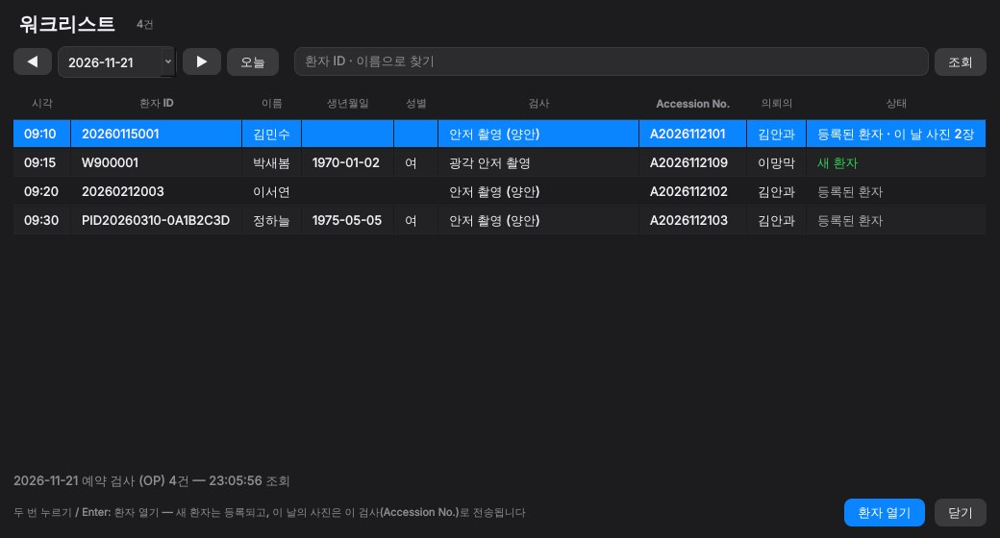 | 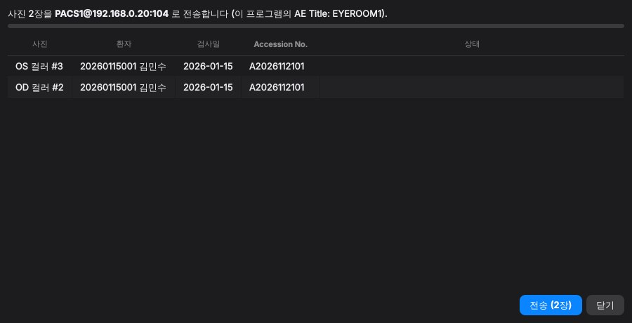 |

병원 전산과 DICOM으로 이어집니다: **워크리스트**에서 그날 예약된 환자를 골라 열고, 찍은 사진을 **PACS로 전송**합니다.

**1. 설정 → DICOM** — 한 번만 합니다.

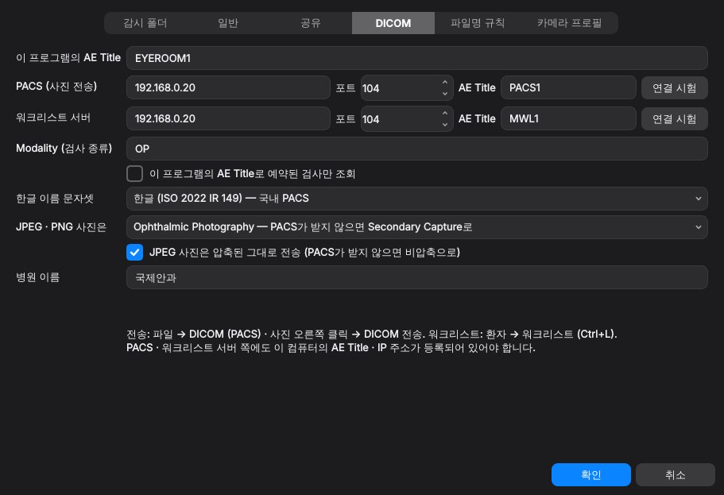

* **이 프로그램의 AE Title**(예: `EYEROOM1`, 16자까지)과 **PACS** · **워크리스트 서버**의 주소 · 포트 · AE Title을 적고
  **[연결 시험]** 을 누릅니다. PACS · 워크리스트 서버 쪽에도 이 컴퓨터의 AE Title과 IP 주소가 등록되어 있어야 합니다
  (PACS 담당자에게 요청). 연결되지 않으면 그 까닭(주소 · 포트 · AE Title 거부)이 나옵니다.
* **Modality**: 워크리스트에서 이 종류의 검사만 조회하고, 보내는 사진에도 적습니다(처음 설정 `OP`, 비우면 모든 검사).
  병원 전산이 안저 촬영을 다른 값(`XC` · `OT`)으로 예약한다면 그 값을 적습니다.
* **한글 이름 문자셋**: 국내 PACS는 보통 `ISO 2022 IR 149`(처음 설정)입니다. 이름이 깨져 보이면 UTF-8로 바꿔 봅니다.

**2. 워크리스트** — 환자 → **워크리스트** (Ctrl+L) 또는 환자 목록 창의 **[워크리스트]**.

* 그날 예약된 검사가 시각 순으로 나옵니다. ◀ ▶ · 달력 · **[오늘]** 로 날짜를 바꾸고, 환자 ID · 이름으로 찾습니다. **[조회]**(F5)는
  서버에서 다시 읽습니다.
* 환자를 **두 번 누르면**(Enter · [환자 열기]) 그 환자가 열립니다. 처음 보는 환자는 ID · 이름 · 생년월일 · 성별이 그대로
  등록됩니다. 이미 등록된 환자는 등록된 정보가 그대로 남고, 이름이 다르면 목록에 "이름이 다릅니다"라고 나옵니다.
* 환자 정보가 없는 사진(RetiCam의 `IMG_0001.jpg` …)을 **[사진 가져오기]** 로 넣으면 확인 창이 방금 연 환자를 권합니다 —
  한 번 눌러 그 환자의 사진으로 가져옵니다.
* 워크리스트에서 연 환자의 **그날 사진**은 그 검사의 **Accession No. · Study Instance UID**로 전송됩니다. PACS에서 사진이
  처방(오더)과 바로 묶입니다. 워크리스트 없이 보낸 사진은 환자 ID와 검사일로 묶입니다(같은 환자 · 같은 날 = 한 검사).

**3. DICOM 전송** — 파일 → **DICOM (PACS)** → **PACS로 전송…**, 또는 사진을 **오른쪽 클릭 → DICOM 전송 (PACS)…**.

* 전송 창의 **보낼 범위**에서 보고 있는 사진 / 고른 사진 / 이 검사일의 사진 / 이 환자의 사진 모두 가운데 고릅니다.
* 전송 창에서 **[전송]** 을 누르면 사진마다 결과가 나옵니다(전송됨 · 실패한 까닭). 실패하거나 **[중지]** 한 사진만
  **[다시 전송]** 할 수 있습니다. 전송 기록은 파일 → 가져오기 기록에도 남습니다.
* **무엇이 가는가**
  * DICOM 파일로 들어온 사진(VK-2 …): **그 파일 그대로**. 뷰어에서 환자 ID · 이름을 고쳤거나 워크리스트의 검사가 있을 때만
    환자 · 검사 항목을 바꿔 보냅니다(보관함의 파일은 바뀌지 않습니다).
  * JPEG · PNG 사진: 환자 정보 · 검사일 · 시각 · 눈(OD → R, OS → L) · 장비 · 화각을 넣은 **Ophthalmic Photography 8 Bit**
    영상. JPEG은 다시 압축하지 않고 그대로 넣습니다(JPEG Baseline). PACS가 Ophthalmic Photography나 JPEG을 받지 않으면
    저절로 **Secondary Capture** · **비압축**으로 바꿔 보냅니다(설정에서 처음부터 그렇게 정할 수도 있습니다).
  * 뷰어가 만든 사진(몽타주 · 디스크 2장 · 녹내장 분석 · 편집 영상): Secondary Capture.
* **미분류**(환자가 지정되지 않은) 사진은 보내지 않습니다. 같은 사진을 다시 보내도 PACS에는 한 장으로 남습니다
  (사진마다 늘 같은 SOP Instance UID).
* 파일 → DICOM (PACS) → **DICOM 파일로 저장**: 보낼 내용 그대로를 `.dcm` 파일로 저장합니다(PACS 없이 확인할 때).
* 서버에 연결한 뷰어(공유)에서도 됩니다 — 그 컴퓨터가 직접 PACS · 워크리스트 서버에 접속하므로, 그 컴퓨터의
  설정 → DICOM을 채우고 PACS에 그 컴퓨터의 AE Title을 등록합니다.

> 전송은 암호화하지 않은 DICOM(병원 내부망용)입니다. 자동 전송(가져오면 바로 보내기)과 PACS에서 사진 받아 오기
> (Query/Retrieve)는 아직 없습니다 — 보낼 사진을 확인하고 직접 보냅니다.

## 환자 목록 창 (VK-2 OPEN LIST)

| 환자 목록 창 — 환자를 누르면 그 환자의 검사 목록 | 주 화면 — Simple: 최신 OD \| OS |
|---|---|
| 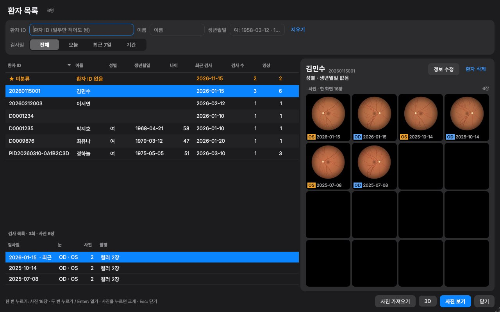 | 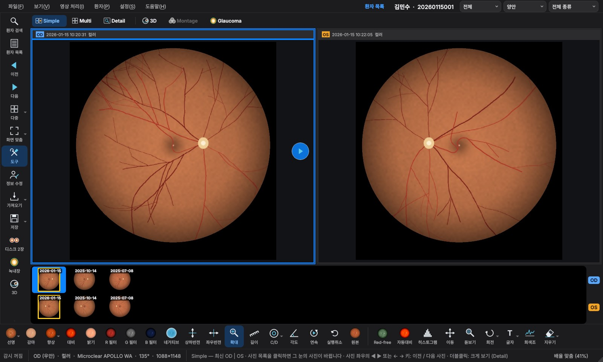 |

프로그램을 켜면 먼저 뜨는 **따로 된 창**입니다. VK-2의 OPEN LIST(환자 ID 목록)처럼 모든 환자를 **환자 ID 순**으로
보여 주고, 환자 ID · 이름 · 날짜로 찾습니다.

* **검색 조건**(위): **환자 ID** · **이름** · **생년월일**(`1958-03-12` · `19580312` · `1958` 어떻게 적어도 됨) — 적는 대로
  바로 찾고, Enter를 누르면 맞는 환자가 한 명일 때 그 환자가 골라집니다. **검사일**: 전체 / 오늘 / 최근 7일 /
  **기간**(시작일 ~ 끝일) — 그 기간에 촬영한 환자. **[지우기]** 로 조건을 모두 지웁니다.
* **환자 표**(창 너비 전체): 환자 ID · 이름 · 성별 · 생년월일 · 나이 · 최근 검사 · 검사 수 · 영상. 처음에는 환자 ID 순이고,
  **열 제목을 누르면 그 열로 정렬**, 한 번 더 누르면 반대로 정렬합니다(최근 검사 · 검사 수 · 영상은 처음 누르면 큰 것부터).
  환자 ID를 찾지 못한 사진이 있으면 맨 위에 **★ 미분류**가 나옵니다. 오른쪽 클릭: 사진 보기 · 3D · 정보 수정 · 환자 삭제.
* 그 아래 **검사 목록**: 검사일마다 한 줄(최신부터) — 눈(OD · OS), 사진 수, 촬영 종류별 장수(`컬러 3장 · Red-free 1장`).
  검사를 고르면 **[사진 보기]** · **[3D]** 가 그 검사의 사진을 엽니다. 사진이 아직 없는 환자는 그 자리에 사진 가져오는
  방법을 알려 줍니다.
* 사진 썸네일은 이 창에 없고, 사진은 주 화면에서 봅니다. **[정보 수정]** · **[환자 삭제]** 는 아래 단추 줄과 오른쪽 클릭 메뉴에 있습니다.
* 환자를 **한 번 누르면** 주 화면도 그 환자로 바뀝니다. **두 번 누르거나 Enter · [사진 보기]**:
  환자 목록 창이 닫히고 주 화면에 고른 검사의 **최신 OD | OS 두 장**(Simple)이 나옵니다. 고른 검사에 한쪽 눈만
  있으면 다른 눈은 그 전 검사의 최신 사진으로 채우고, 눈을 알 수 없는 사진만 있는 환자(미분류 등)는 **Detail**(크게 보기)로
  열립니다. **[3D]**: 고른 검사의 사진을 3D로. **[사진 가져오기]**: 파일 고르기 →
  [환자 정보 확인](#사진-가져오기--환자-정보-확인). 이 창에 파일 · 폴더를 끌어다 놓아도 가져옵니다.
* **닫기** · Esc 로 닫고, 명령 툴바의 **[환자 목록]**(VK-2 OPEN LIST) · 보기 → 환자 목록 ·
  **Ctrl+0** 으로 다시 엽니다. **환자 검색**(Ctrl+F)은 이 창을 열고 환자 ID 칸에 커서를 둡니다.
* 키보드 ↑ ↓ 로 환자를 옮겨 다니면 멈춘 환자의 검사 목록과 주 화면 사진이 나옵니다(지나가는 환자마다 사진을 읽지 않음).
* 환자가 아직 없으면 사진이 어떻게 들어오는지(감시 폴더 · 사진 가져오기 · 끌어다 놓기) 안내가 나옵니다.

## 화면 구성 (Kowa VK-2 방식)


VK-2 캡처 화면처럼 만들었습니다.

**어두운 화면** — 사진을 보는 프로그램이라 화면 전체가 어둡습니다(아이폰의 다크 모드와 같은 방식). 바탕은 거의
검정이고 앞으로 나올수록 한 단계씩 밝아지며(창 → 카드 → 버튼), 지금 고른 것과 주 버튼만 **파란색** 하나로 표시합니다.
글자는 세 단계 밝기, 모서리는 둥글고 구분선은 가늘게. 켜고 끄는 항목은 **스위치**(미끄러지며 초록으로),
둘 중 하나를 고르는 항목은 **나란한 단추**(고른 쪽으로 밝은 판이 미끄러짐)이고, 탭을 바꾸면 화면이 겹쳐 넘어갑니다.
Windows에서는 창 제목 표시줄도 어둡게 맞춥니다.

* 검은 영상 화면과 **왼쪽 명령 툴바**, **아래쪽 영상 처리 툴바**로 되어 있습니다. 사진 화면이 가장 크게 나오도록
  화면 위에 탭 줄과 환자 줄을 두지 않았습니다.
* 환자 이름 · ID · 생년월일은 **아래 상태 줄**에 나옵니다. 환자 목록 창은 명령 툴바의 **환자 목록**(Ctrl+0)으로 엽니다.
* **명령 툴바**(왼쪽)에 보기를 고르는 **[Simple] · [Detail] · [3D]**(지금 보기가 켜져 있음)와 **[Montage](몽타주) ·
  [Glaucoma](녹내장 분석, ▾ 스테레오 보기 · 시간별 비교)** 가 있습니다([아래](#detail-크게-보기)의 표).
  Simple일 때 메뉴 옆에 **화면 분할**(1·2·4·6·9·16장) · **황반 · 디스크** · 고른 장수 · **선택 해제**가 나옵니다.
  단축키는 Simple Ctrl+1 · 3D Ctrl+3 · Detail Ctrl+5, 환자 목록 창 Ctrl+0, 질환 샘플과 비교 Ctrl+D, 질환 설명 그림 Ctrl+Shift+D 입니다.
* **창이 낮을 때**(노트북 · 배율 125 ~ 150 %): 명령 툴바의 버튼이 모두 보이도록 **단계별로 작아집니다** — 그림이 작아지고, 더 모자라면
  이름 없이 그림만 나옵니다(이름은 툴팁에). 아래쪽의 Glaucoma · 인쇄 · 설정 · 종료가 **»** 뒤로 숨지 않습니다.
* **명령 툴바 옮기기**: 툴바 맨 위의 **점 손잡이**를 끌어 **오른쪽**이나 **화면 위쪽**(가로로 한 줄)에 놓습니다. 툴바를
  오른쪽 클릭해 **왼쪽에 · 오른쪽에 · 화면 위쪽에 · 큰 사진 아래에**를 골라도 되고(보기 → **명령 툴바 위치**도 같음), 놓은
  자리는 다음에 켤 때도 그대로입니다(보기 → 툴바 기본 위치로: 왼쪽). **큰 사진 아래에**는 큰 사진과 아래 사진
  목록 사이에 가로 한 줄로 놓는 자리로, 메뉴로만 고릅니다(거기서는 손잡이로 끌 수 없음).
* **아이콘 모양**: **보기 → 아이콘 모양**에서 두 툴바의 아이콘을 여덟 가지 중에 고릅니다(누르는 즉시 바뀌고 기억됨).
  처음 설정은 **모노 라인 + 포인트 색** — 색 타일 없이 밝은 회색 선으로 그림만 크게 그리고, **뜻이 있는 곳에만**
  색을 넣습니다: 사진 · 망막은 **망막색**, 고른 것 · 보는 곳 **파랑**, 측정 **노랑**, 디스크 선 **초록** · 컵 **노랑**,
  종료 · 지우기 **빨강**. 그 밖에 **기능별 색 라인**(그림 전체를 기능별 색으로: 탐색 · 파일 회색, 보기 파랑, 분석 초록, 측정 주황,
  영상 처리 보라, 반전 · 회전 청록, 종료 · 지우기 빨강) · **모노 라인**(모두 밝은 회색) · **컬러 라인**(그림마다 제 색) ·
  **어두운 타일 + 컬러 그림** · **옅은 색 타일 + 컬러 그림** · **단색 타일 + 큰 흰 그림** · **컬러 타일 (이전 모양)** 이 있습니다.
* 사진 화면 **아래**에는 [사진 목록](#사진-목록)만 화면 폭 전체에 나옵니다.
* 사진 위에는 구석에 작은 글자 두 개만 나옵니다. 왼쪽 위에 사진 번호(`1/2`), 오른쪽 위에 눈(`OD (R)`). 환자 이름·ID·날짜는
  사진 위에 쓰지 않습니다(아래 상태 줄과 사진 목록에 있음). 보기 → 화면 글자 표시로 끕니다.
* 상태 표시줄에는 자동 가져오기 상태, 영상 정보(눈 · 촬영 종류 · 장비 · 화각 · 크기), 측정 결과가 나옵니다.
  영상 정보에 마우스를 올리면 값마다 **어디서 읽었는지**(RetiCam 데이터 / 파일 이름 / DICOM …)가 보입니다.
* 영상 처리 툴바도 끌어서 옮길 수 있고, 보기 → 툴바 기본 위치로 되돌립니다. ▾ 표시가 있는 버튼은 화살표를
  누르면 추가 기능이 나옵니다. 이 툴바에 둘 버튼은 **설정 → 화면 · 툴바**에서 고릅니다 — 체크를 끈 버튼은 툴바와
  **영상 처리** 메뉴에서 빠집니다.

### Detail (크게 보기)


아래 사진 목록의 사진이나 Simple의 큰 사진을 **더블클릭**하거나 명령 툴바의 **[Detail]** 을 누르면 나오는 화면입니다(Ctrl+5). 왼쪽에
**큰 사진**(모든 영상 처리 · 측정 도구를 여기서 씀), 오른쪽에 확대 화면 둘이 있습니다.

* **이전 / 다음 사진**: 큰 사진의 **왼쪽 · 오른쪽 끝에 마우스를 대면 ◀ ▶** 가 나오고, 누르면 사진 목록의 이전 / 다음
  사진으로 넘어갑니다(첫 사진에는 ◀, 마지막 사진에는 ▶ 가 없음). 키보드 **← →** 도 같습니다.

* **황반**: 사진에서 찾은 황반(중심와)을 중심으로 확대합니다. 큰 사진 위의 **하늘색 틀**이 이 화면에 보이는 곳입니다.
* **시신경 유두**: 시신경 유두를 더 가깝게 확대합니다. 큰 사진 위의 **노란 틀**이 이 화면에 보이는 곳입니다.
* 확대 크기는 그 사진의 황반–유두 거리에 맞춰 정하므로 45° 사진이나 초광각 사진이나 같은 범위가 보입니다.
  황반이나 유두를 찾지 못한 사진은 제목에 `(찾지 못함 — 사진 가운데)`가 붙고 사진 가운데를 보여 줍니다.
  위치가 틀리면 큰 사진에서 **오른쪽 클릭 → 황반 / 시신경 유두로 지정**으로 고칩니다.
* 확대 화면에서도 휠로 배율을, 드래그로 위치를 바꿀 수 있습니다. Red-free·대비 같은 처리는
  큰 사진과 똑같이 적용됩니다. 틀은 화면에만 보이고 복사·저장·인쇄되는 영상에는 들어가지 않습니다.
* 확대 화면의 제목(**⤢**)이나 화면을 누르면 큰 사진이 그곳으로 확대됩니다. `0` 키(또는 화면 맞춤)를 누르면 다시 전체가 보입니다.
  큰 사진을 **다시 더블클릭하면 Simple**로 갑니다(고른 사진은 그대로). **[Detail]을 다시 누르면** Detail이
  닫히고 보던 화면(Simple · 3D)으로 돌아갑니다.
* Detail에서 아래 사진 목록의 **다른 사진을 클릭**하면 Detail에 머물지 않고 **Simple의 여러 장 고르기**로 갑니다 —
  크게 보던 사진과 방금 누른 사진이 나란히 나오고(고정해 둔 사진이 있으면 그 사진들도 함께), 더 클릭하면 더해지고 다시
  클릭하면 빠집니다. 다른 사진을 Detail에서 크게 보려면 그 사진을 **더블클릭**하거나 사진 좌우의 ◀ ▶ · ← → 키를 씁니다.
* 큰 사진과 확대 화면 사이의 경계를 끌어 크기를 바꿀 수 있습니다.

**왼쪽 명령 툴바** (위에서 아래로 — 맨 위의 점 손잡이로 오른쪽 · 화면 위쪽에 옮길 수 있음)

| 버튼 | VK-2 | 기능 |
|---|---|---|
| 환자 목록 | OPEN LIST | [환자 목록 창](#환자-목록-창-vk-2-open-list) 열기/닫기 (Ctrl+0) — 환자 검색(Ctrl+F)도 이 창에서 |
| 이전 / 다음 | PREV / NEXT | 이전·다음 사진 (PageUp / PageDown) — 사진 좌우 끝의 ◀ ▶ 와 같음: Simple에서는 고른 칸에 같은 눈의 이전 / 다음 사진 |
| Simple | | 최신 OD \| OS 두 장, 사진 목록을 클릭하면 더하기 · 빼기 (Ctrl+1, [아래](#보기-고르기)) |
| Multi (옵션을 켰을 때) | MULTI | 16장 보기에서 고른 사진만 — 다시 누르면 16장 보기로 (Ctrl+2, [아래](#16장-보기--multi-옵션을-켰을-때)) |
| Detail | | 사진 한 장을 크게 + 황반 · 시신경 유두 확대 (Ctrl+5) — 다시 누르면 보던 화면으로 |
| 화면 맞춤 ▾ | SCALE | 화면 맞춤 · 100~800% · **확대 위치**: 후극부, 위·아래·코·귀쪽 주변부 |
| 도구 | TOOLS | 영상 처리 툴바 보이기/숨기기 |
| 3D | (DDV 자리) | 3D 안구 모형 (Ctrl+3, 다시 누르면 보던 화면으로 — Simple에 두 장이면 두 장 3D, 여러 장 골라 두었으면 한 장 / 모두를 물어봄) |
| Montage | | 고른 사진(같은 눈 2장 이상)으로 몽타주 ([아래](#몽타주-여러-장을-한-장으로--3d)) |
| Glaucoma ▾ | | 녹내장 분석: 디스크 C/D · 유두 3D 입체 · 광각 RNFL · 스테레오 보기 · 경과 비교(깜빡임) ([아래](#녹내장-분석)) — 같은 눈의 사진 두 장을 클릭해 골라 두면 그 두 장으로 · ▾ **스테레오 보기** (고른 두 사진 — 보험 청구용 한 장도 그 안에) · **시간별 비교** (같은 눈의 유두 사진 여러 장) |
| 인쇄 | PRINT | 화면 영상 + 환자 정보 머리말 (Ctrl+P) |
| 설정 · 종료 | EXIT | |

환자 검색 · 정보 수정 · 가져오기 · 저장은 메뉴에 있습니다 — **환자 → 환자 검색**(Ctrl+F) ·
**환자 → 정보 수정** · **파일 → 파일 가져오기 · 폴더 가져오기 · 감시 폴더 지금 검사** · **파일 → 파일로 저장 · 환자 기록에
새 사진으로 저장 · 클립보드로 복사**(Ctrl+C).

**아래쪽 영상 처리 툴바** (VK-2 Image Processing Toolbar 순서)

버튼 그림은 VK-2처럼 **작은 안저 사진에 그 효과를 적용한 모습**입니다. 사진에 적용 중인 처리는
버튼이 켜진 색으로 표시되고, 툴바에 마우스를 올리면 적용 순서가 보입니다.

| 버튼 | VK-2 | 기능 |
|---|---|---|
| 선명 ▾ | SHARPEN | 선명하게 (누를 때마다 누적, ▾ 약·강) |
| 감마 · 대비 · 밝기 | GAMMA · CONTST · BRIGHT | 버튼 옆에 슬라이더가 열림, 초기화 버튼. **감마는 X–Y 그래프**(가로: 사진의 밝기 · 세로: 화면의 밝기)로 열립니다 — 그래프를 **클릭하거나 끌면** 곡선이 그 점을 지나도록 감마가 바뀝니다(대각선 위: 어두운 부분이 밝게 · 아래: 어둡게 · 더블클릭: 1.00). 아래 슬라이더로 미세 조정 |
| 향상 ▾ | ENHANCE | 국소 대비 향상(미세 혈관·병변), ▾ 히스토그램 평활화 · 노이즈 감소 |
| R · G · B 필터 | RED · GREEN · BLUE FILTER | 한 색 성분만. 켜진 필터를 다시 누르면 컬러 · **G 필터는 녹색 성분만**(흑백 — 강화된 그림은 Red-free 버튼) |
| 네거티브 | NEGATIVE | 반전 영상 |
| 상하반전 · 좌우반전 | FLIP VRT · FLIP HRZ | |
| 길이 | LENGTH | px와 **망막 각도·mm** |
| 각도 | ANGLE | 세 점(가운데 점이 꼭짓점) |
| 병변 핀 ▾ | | 사진을 클릭한 곳에 핀 — 시계 방향과 유두에서의 거리가 붙음, ▾ 메모 · 지우기 ([아래](#병변-핀)) |
| 실행취소 · 원본 | UNDO · ORIGINAL | 마지막 처리 되돌리기 (Ctrl+Z) · 모든 처리·측정 해제 |
| Red-free · 자동대비 | | **레드프리**: 녹색 성분에 국소 대비를 높여 신경섬유층(RNFL) · 혈관 · 출혈이 잘 보이게 — 녹내장 분석 → 광각 분석의 레드프리 · RNFL 대비 강화 **0.9**와 같은 그림 · 밝기 범위 자동 맞춤 |
| 회전 ▾ · 글자 ▾ | | 90° 회전 · 글자 / 화살표+글자 |

툴바에 둘 버튼은 **설정 → 화면 · 툴바**에서 고릅니다(체크를 끈 버튼은 툴바와 **영상 처리** 메뉴에서 빠짐). 휠 확대 ·
드래그 이동은 늘 켜져 있고, 마지막 측정은 **Delete** 키로 지우며, 연속 · 히스토그램 · 돋보기 · 회색조는 메뉴 막대의
**영상 처리** 메뉴에 있습니다. 켜진 도구 버튼(길이 · 각도 · 글자)을 **다시 누르면** 확대(휠 · 드래그 이동)로 돌아갑니다.
**C/D**는 [녹내장 분석 → 디스크 C/D](#디스크-cd--경계-맞추기와-측정)에서 잽니다.

**마우스 조작**
* **확대·축소는 휠로만**: 휠을 굴리면 커서 위치를 중심으로 확대·축소됩니다. 보고 싶은 곳(시신경 유두, 황반)에
  커서를 두고 휠을 올리면 됩니다. 드래그로는 배율이 바뀌지 않습니다.
  큰 사진 · 확대 화면 · Simple 의 칸 모두 같습니다.
* **왼쪽 드래그로 사진 이동**: 커서가 손 모양이고, 왼쪽 버튼으로 끌어 확대한 사진을 옮깁니다.
  전체 사진으로 돌아가려면 `0` 키(또는 화면 맞춤)를 누릅니다.
* **더블클릭**: Simple의 큰 사진이나 아래 사진 목록의 사진을 더블클릭하면 Detail에서 크게 열리고, Detail의 큰 사진을
  **다시 더블클릭하면 Simple로** 갑니다(3D에서도 Simple로). 돋보기는 **영상 처리** 메뉴의 **돋보기**를 고르고
  누르는 동안 나오며(누른 채 휠로 배율), 배율은 오른쪽 클릭 메뉴 → **돋보기 배율**에서도 바꿉니다.
* 다른 도구(길이·각도 등)를 쓰는 중에도 **휠**로 확대·축소하고 **가운데 버튼 드래그**로 이동합니다.
* **오른쪽 클릭**: 메뉴 (시신경 유두 · 황반 위치 지정, 화면 맞춤, 돋보기 배율, 미니맵)
  * **Simple 화면의 큰 사진**에서는 그 사진이 선택되고, 메뉴 맨 위에 **3D**(이 사진 / 화면의 사진 모두) · **Montage** ·
    **녹내장 분석…** · **스테레오 보기…** · **시간별 비교…** · **Detail** · 정보 수정 · DICOM 전송이 나옵니다.
    녹내장 분석 · 스테레오 보기는 화면에 두 장이 있으면 다른 한 장과, 아니면 ② 사진과 함께 엽니다.
* **사진 좌우 끝의 ◀ ▶**: 이전 / 다음 사진 (Detail) · Simple의 칸에서는 그 칸에 같은 눈의 이전 / 다음 사진
* **키보드**: `+` / `−` 확대·축소(커서 위치) · `0` 화면에 맞춤 · `1` 100% · `←` / `→` 이전 / 다음 사진

**확대해서 보기 (광각 사진)**

* 원본 해상도 그대로 최대 40배까지 확대합니다.
* **미니맵**: 확대하면 오른쪽 위에 전체 사진이 나오고 지금 보는 곳이 노란 틀로 표시됩니다.
  미니맵을 누르거나 끌면 그곳으로 이동합니다(오른쪽 클릭 메뉴에서 끌 수 있음).
* **확대 위치**: 화면 맞춤 ▾ 또는 상태 표시줄 오른쪽의 **[배율]** 버튼에서 후극부(황반·시신경)와
  위·아래·코·귀쪽 주변부로 바로 확대합니다. 코쪽은 시신경 유두 쪽(OD 오른쪽, OS 왼쪽)이고,
  촬영 원이 화면 틀보다 큰 광각 사진에서도 사진 안으로 맞춥니다.
* 돋보기 도구는 누르는 동안 커서 아래만 2~10배로 보여 줍니다.

**처리와 측정 동작 방식**
* 처리는 화면에서만 적용되며 저장된 원본 사진은 바뀌지 않습니다.
* 다른 사진으로 넘어가면 선명·향상 같은 처리 단계는 초기화됩니다. 감마·대비·밝기·필터는 유지됩니다.
* 길이는 그 영상의 화각·투영(3D와 같은 안구 모형)으로 **망막 위 실제 거리**로 바꿔 보여 줍니다. 초광각 사진은 주변부일수록 화소당 거리가 달라서 화소 길이만으로는 비교할 수 없기 때문입니다.

### 보기 고르기

환자를 열면 **Simple**이 나옵니다 — 위에는 **최신 OD | OS 두 장**, 아래에는 [날짜 책갈피로 나뉜 사진 목록](#사진-목록).
여러 장을 보는 화면은 Simple 하나이고, 나머지 보기는 명령 툴바의 단추로 고릅니다(켜져 있는 단추가 지금 보기).
아래 사진 목록이 먼저 보여 줄 날짜 책갈피는 **설정 → 일반 → 환자를 열면 사진 목록은**에서 고릅니다 — **최신 검사**(가장 최근 검사일, 처음 설정) 또는 **전체**.

| 단추 | 보이는 것 | 사진 목록을 클릭하면 |
|---|---|---|
| (환자를 열면) **Simple** (Ctrl+1) | **최신 OD \| OS 두 장**을 크게 나란히 (OD 왼쪽 · OS 오른쪽) — 사진을 고정하면 고정한 사진들 | **고정**(번호) · 다시 클릭하면 **빼기** — 마우스만 올리면 Dock처럼 커지는 **미리 보기** |
| **Detail** (Ctrl+5) | 사진 한 장을 크게 + 황반 · 시신경 유두 확대 ([위](#detail-크게-보기)) | Simple에서 그 사진과 함께 보기 (더블클릭: 그 사진을 크게) |
| **3D** (Ctrl+3) | 보고 있는 사진을 [3D 안구](#3d-안구-모델)로 — 한 번 더 누르면 보던 화면으로 | 그 사진을 3D로 |

**더블클릭**: 사진 목록의 사진이나 Simple의 큰 사진을 더블클릭하면 **Detail**에서 크게 열리고, Detail의 큰 사진 · 3D 안구
(· Multi · 16장 보기)에서 더블클릭하면 **Simple**로 갑니다(고른 사진은 그대로).

**Multi · 16장 보기**는 처음에는 꺼져 있습니다. **설정 → 화면 · 툴바 → Multi · 16장 보기 사용**을 체크하면 명령 툴바에
**[Multi]**(Ctrl+2)가 생기고, **설정 → 일반 → 환자를 열면**에서 **16장 보기**를 고를 수 있습니다
([아래](#16장-보기--multi-옵션을-켰을-때)).

**Simple** (고른 사진을 칸마다 한 장씩 보여 주는 화면)
* Simple을 누르면 열려 있는 날짜 책갈피(검사)의 **최신 OD와 OS 사진** 두 장이 나옵니다 — OD 왼쪽, OS 오른쪽(마주 본 환자
  방향), OD 칸이 선택됨, 사진 목록에는 노란 테두리(번호 없음 — 보여 주는 것일 뿐 고정한 것이 아님). 컬러 사진을 먼저 고르고,
  눈 · 촬영 종류 고르기는 그대로 따릅니다. 한쪽 눈 사진만 있으면 그 한 장이 크게 나옵니다. 책갈피를 넘기거나 환자 목록에서
  다른 검사를 고르면(고정한 사진이 없으면) 그 검사의 OD | OS로 바뀝니다.
* 사진 목록에 **마우스를 올리면 Mac의 Dock처럼** 사진들이 커집니다(마우스가 목록에 들어오거나 이미 목록 위에 있으면
  움직이지 않아도 바로): **마우스 아래 사진이 가장 크게**(처음 설정 2배),
  양옆 사진은 멀어질수록 조금씩 작게 — 마우스를 옆으로 움직이면 커지는 자리가 따라옵니다. 사진은 줄의 바닥에 붙은 채 위쪽으로
  커지며, 위의 메인 화면과 사진 칸은 그대로이고, 마우스가 목록을 벗어나면 원래 크기로 돌아옵니다. 가장 큰 사진의 배율은
  **보기 → 미리 보기 배율**에서 고릅니다(1.5배 · 2배 · 2.5배 · 3배, 기억됨). 이미 고정한 사진도 같은 식으로 크게 확인할 수 있고,
  Detail에서도 됩니다. (보기 → 사진 목록에 마우스를 올리면 미리 보기로 끌 수 있습니다.) 사진 목록의 사진은 모서리가 둥급니다.
* 맞는 사진이면 **클릭** — 노란 테두리와 번호(1, 2 …)가 붙고 그 사진이 위에 **고정됩니다**. 화면은 고정한
  장수에 맞게 저절로 나뉩니다 — 1장 · 2장(나란히) · 3~4장 4칸 · 5~6장 6칸 · 7~9장 9칸 · 16칸(최대 16장).
  다른 날짜 책갈피의 사진도 함께 고정할 수 있습니다.
* 칸의 **제목(번호 · OD / OS · 날짜 · 종류)은 사진 왼쪽 위에 겹쳐** 나옵니다.
  반투명한 어두운 바탕이라 망막 위에서도 읽히고, 사진이 칸의 높이를 다 씁니다. 제목 위를 눌러도 사진을 누른 것과 같습니다.
* 고정한 사진을 **다시 클릭하면 빠지고** 화면도 줄어듭니다.
  모두 빼거나 메뉴 옆의 **선택 해제**를 누르면 **최신 OD | OS 두 장**으로 돌아옵니다.
* **칸 좌우의 ◀ ▶**: 칸의 왼쪽 · 오른쪽 끝에 마우스를 대면 나오고, 누르면 **그 칸에 같은 눈의 이전(더 최근) / 다음(더 전)
  사진**이 들어옵니다(번호 · 자리는 그대로, 다른 칸에 나와 있는 사진은 건너뜀). 칸을 누른 뒤 **← →** 도 같습니다.
  사진 목록에서의 ← → 와 [이전] · [다음]은 나와 있는 사진 사이를 옮겨 다닙니다.
* **황반 · 디스크**(메뉴 옆, 켜 둔 것은 기억): 사진마다 **아래에 황반과 시신경 유두를 확대**해서 보여 줍니다 — Detail의
  확대 화면과 같은 범위(유두–황반 거리로), 원본 해상도에서 잘라 그 사진의 보정(Red-free · 대비 …)을 그대로. 찾지 못했으면
  사진 가운데를 보여 주고 제목에 그렇게 씁니다. 확대 화면도 휠 · 드래그로 움직이고, 더블클릭하면 화면 맞춤입니다. 화면 분할
  4장 이하일 때 나옵니다.
* **칸을 누르면 그 사진만** 아래 영상 처리 툴바(감마 · 대비 · 밝기 · Red-free · R/G/B 필터 · 선명 · 향상 ·
  자동 대비 · 네거티브)로 보정됩니다 — 마지막에 누른 칸의 사진으로, 그 칸은 **파란 테두리**로 둘립니다. 다른 칸은 그대로이고,
  사진마다 실행 취소(Ctrl+Z) · 원본이 따로 있습니다.
  보정한 사진을 Detail로 열어도 같은 보정이 보입니다.
* 칸마다 휠로 따로 확대·축소하고 드래그로 옮길 수 있습니다. **확대하기 전**(사진 전체가 보일 때)에는 **왼쪽 버튼을 누르고
  있는 동안 그 자리에 돋보기**가 나옵니다(누른 채 휠: 돋보기 배율 · Detail의 큰 사진도 같음). 마우스만 올려도 나오게 하려면
  보기 → **큰 사진에 마우스를 올리면 돋보기**를 체크합니다(처음에는 꺼짐). Simple에 두 장일 때 **[3D]** 를 누르면 두 사진이 함께 3D로 나오고,
  세 장 이상이면 한 장 / 모두를 묻습니다([여러 장 3D](#두-장-3d--여러-장-3d)).
  **[Montage]** 는 고른 사진(같은 눈 2장 이상)으로 만듭니다.
* 새 사진이 들어오면(새 영상 자동 표시) Simple은 최신 OD | OS가 다시 나옵니다 — 사진을 손으로 바꾸지 않았을 때. 바꿨으면
  새 사진은 Detail에서 크게 나옵니다.

| Simple — 황반 · 디스크 켬 |
|---|
|  |

### 사진 목록
* 사진 목록은 화면 **아래쪽**에 화면 폭 전체로 나옵니다. **사진이 칸을 꽉 채우고** 사진 아래에 설명 줄이 없어서
  사진은 크고 목록은 낮습니다.
* **눈별로** 나옵니다 — **위 줄은 OD, 아래 줄은 OS**(OU 사진이 있으면 셋째 줄), 줄마다 **최신 사진부터**. 눈은 사진마다
  쓰지 않고 **줄 왼쪽에 한 번만** 색 글자로 나옵니다 — **OD**(파랑) · **OS**(주황) · **OU**(보라).
* **날짜**는 사진 위(왼쪽 위)에 겹쳐 나옵니다. **보기 → 사진 목록 표시**(또는 설정 → 일반)에서 고릅니다(기억됨):
  **날짜**(처음에 켜짐) · **종류**(컬러 · 몽타주 · Red-free … 처음에 꺼짐, 켜면 사진 왼쪽 아래에) ·
  **눈별로 두 줄**(끄면 모든 사진을 한 줄로 — OD 다음 OS, 이때는 사진마다 눈 표시가 붙음).
* 눈을 모르는 사진(**미상**)은 목록에 나오지 않습니다. 위쪽 눈 고르기에서 **미상**을 고르면 그 사진만 보이고,
  [정보 수정]으로 눈을 정하면 OD · OS 줄로 들어갑니다. 환자의 사진이 모두 미상이면(빈 목록 대신) 그대로 보입니다.
  화각 · 장비는 아래 상태 줄에, 검사 일시 · 파일 이름은 사진에 마우스를 올리면 나옵니다.
* **날짜 책갈피**: 목록 위에 검사일마다 책갈피가 있고(**전체**가 맨 왼쪽, 그다음 최근 날짜부터 · 사진 수가 적혀 있음),
  목록에는 **열려 있는 책갈피의 날짜 사진만** 나옵니다. 환자를 열면 가장 최근 날짜가 열립니다. 책갈피를 누르거나
  **사진 목록 위에서 마우스 휠**을 굴리면 넘어갑니다 — 뒤로 굴리면 이전 검사일, 앞으로 굴리면 더 최근 검사일(가장 최근 날짜에서 한 번 더: 전체).
  그 날짜에서 고정한 사진이 있으면 책갈피에 `✓2`처럼 나옵니다.
* 줄이 화면보다 길면 **Shift+휠**이나 스크롤 막대로 **옆으로** 넘깁니다(두 줄이 함께 움직입니다). 한쪽 눈 사진만 있는
  날짜는 한 줄만 차지합니다(목록 높이는 그대로). Detail에서 이전 / 다음은 그 책갈피 안에서 OD 줄을 지나 OS 줄로 갑니다.
* 고정한 사진은 노란 테두리와 번호, Simple의 처음 두 장(최신 OD | OS)은 노란 테두리만, 두 번째 사진은 ② 입니다. 지금 보고 있는 사진에 따로
  파란 표시는 하지 않습니다(고른 표시와 헷갈려서).

| 날짜 책갈피 · 2장 고정 — 목록의 사진에 마우스를 올리면 Dock처럼 커지는 미리 보기 |
|---|
| 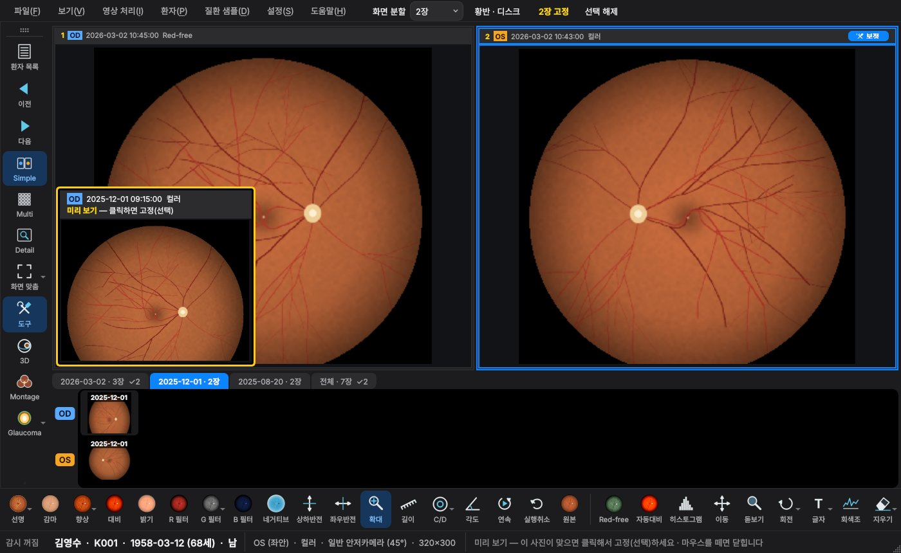 |

| Simple (4장) | Red-free (VK-2 사진) |
|---|---|
|  |  |

### 16장 보기 · Multi (옵션을 켰을 때)

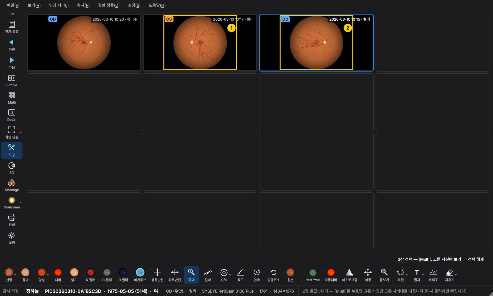

**설정 → 화면 · 툴바 → Multi · 16장 보기 사용**을 체크했을 때만 쓰는 VK-2 방식의 화면입니다(처음에는 꺼져 있고, 여러 장은
Simple에서 봅니다). 켜면 명령 툴바에 **[Multi]** (Ctrl+2)가 생기고, 누르면 그 환자의 사진이 **한 화면에 16장**
(4 × 4, 최신 사진부터) 나옵니다 — VK-2의 MULTI 화면입니다. **설정 → 일반 → 환자를 열면**에서 **16장 보기**를 고르면
환자를 열 때 Simple 대신 이 화면이 나옵니다(아무것도 고르지 않은 채로).

16장 보기에서는:

* 사진마다 왼쪽 위에 눈(**OD** 파랑 · **OS** 주황)이 나옵니다. 테두리는 고른 사진(노란색)에만 있습니다.
* 사진을 **클릭**하면 노란 테두리와 번호(1, 2, 3 …)가 붙어 골라지고, 다시 클릭하면 빠집니다. 아래 줄 오른쪽에 고른 장수가
  나옵니다(`3장 선택 — [Multi]: 고른 사진만 보기`).
* 명령 툴바의 **[Multi]** (Ctrl+2)를 누르면 **고른 사진만** 모여 한 화면에 나옵니다(장수에 맞게 1 · 2 · 4 · 6 · 9 · 16칸,
  칸마다 따로 보정, [Multi]가 켜짐). **[Multi]를 다시 누르면 16장 보기로** 돌아오고, 고른 사진은 번호 그대로 남아 있어
  더 고르거나 빼고 다시 [Multi]를 누를 수 있습니다. **선택 해제**는 모두 빼기. 고른 사진이 없으면 [Multi]는 먼저 고르라고 알려 줍니다.
* [Simple]이 넣은 최신 OD | OS 두 장은 고른 사진으로 치지 않아, Simple에서 [Multi]를 누르면 아무것도 고르지 않은 16장 보기가 됩니다.
* **더블클릭**하면 Simple로 갑니다(사진을 크게: 누르고 [Detail]). **Ctrl+클릭**은 두 번째 사진(②), 오른쪽 클릭은 사진 메뉴입니다.
* 사진이 16장보다 많으면 아래 줄의 **◀ 이전 16장 · 다음 16장 ▶** 이나 마우스 휠로 넘깁니다. PageUp / PageDown(이전 · 다음
  사진)으로 움직이면 그 사진이 있는 16장이 나옵니다.
* 사진의 날짜 · 시각(· 촬영 종류)은 칸의 오른쪽 위에 나옵니다.
* 이 화면에서는 16장이 곧 사진 목록이라 아래 줄의 작은 사진 목록은 감추고, 그 자리에 쪽 넘기기와 고른 장수가 나옵니다
  (날짜 책갈피 없이 모든 날짜의 사진).
* 고른 사진(번호)은 16장 보기 · Multi · Simple이 함께 씁니다. Multi의 칸은 Simple의 칸과 같습니다(칸마다 따로 보정 ·
  ◀ ▶ · 황반 · 디스크). 사진을 2장 이상 골라 두고 **[3D]** 를 누르면 한 장 / 모두를 묻습니다.

## 병변 핀

망막의 한 곳을 표시하고 **"11시 · 유두에서 9.2 mm"** 처럼 말해 주는 핀입니다. 열공 · 격자변성 · 레이저 자리처럼
"몇 시 방향, 얼마나 떨어진 곳"으로 기록하고 환자에게 보여 줄 때 씁니다.

* **꽂기**: 아래 툴바의 **병변 핀**을 누르고 큰 사진(Detail)을 클릭합니다. 번호가 붙은 분홍 점과 글자가 나오고,
  상태 줄에 자세한 값(유두에서 · 중심와에서 몇 mm, 몇 도)이 나옵니다.
* **3D에서**: 3D 화면 위 막대의 **병변 핀**을 켜고 망막을 누르면 같은 사진의 그 자리에 핀이 꽂힙니다(안구를 열었거나
  내부에서 볼 때 — 닫힌 안구의 공막을 누르면 꽂히지 않습니다). 2D에서 꽂은 핀도 3D 안구의 망막 위에 같은 번호로 보입니다.
* **지우기 · 메모**: 핀을 다시 클릭하면 지워집니다. 병변 핀 ▾ 에서 **마지막 핀에 메모…**(예: 열공) ·
  **마지막 핀 지우기** · **이 사진의 핀 모두 지우기**.
* 핀은 **사진과 함께 저장**되어 다음에 열어도 그대로 있고(측정 지우기 · 원본으로는 지워지지 않음), 저장 · 인쇄한 사진에도 나옵니다.
  한 사진에 30개까지.
* **시계 방향**은 검사자가 보는 안저(사진 그대로) 기준입니다 — 12시가 위, 3시가 사진의 오른쪽(우안 · 좌안 같음). 황반(중심와)을
  중심으로 세고, 황반을 못 찾은 사진은 유두로 미루어 본 황반 자리, 둘 다 없으면 사진 가운데를 기준으로 합니다(그렇다고 표시).
* **거리**는 사진의 화각 · 투영으로 얹은 12 mm 안구 모형 위에서 잰 값입니다. 길이 도구 · 3D와 같은 모형이며, 보정된
  계측이 아니므로 **참고용**입니다.

## 환자용 요약 (한 장)

**파일 → 환자용 요약 (한 장)…** (Ctrl+Shift+P)은 보고 있는 사진으로 환자가 가져갈 **안내문 한 장**을 만듭니다.
왼쪽에 인쇄될 모습이 그대로 보이고, 오른쪽에서 넣을 것을 고릅니다.

| 넣는 것 | 내용 |
|---|---|
| 머리말 | 병원 이름(설정 → DICOM의 기관 이름이 처음 값, 창에서 고칠 수 있음) · 환자 이름 · ID · 검사일 |
| 사진 | 보고 있는 사진 — **두 눈 사진을 함께**를 켜면 반대쪽 눈 사진(같은 검사일 것부터 자동)을 OD 왼쪽 · OS 오른쪽으로 |
| 촬영 장비 | 장비 이름과 화각 — 초광각 사진이면 한 번에 담은 범위를 한 문장으로 |
| 표시한 곳 | 사진의 [병변 핀](#병변-핀)과 "11시 · 유두에서 9.2 mm" 목록 (메모 포함) |
| 시야에서는 어디쯤인지 | 핀 자리가 시야의 어디에 해당하는지 풍경 그림 위에 번호로 — **설명용 그림** (아래) |
| 질환 설명 | 고른 질환 · 단계의 설명 그림과 "이렇게 보일 수 있습니다", 어떤 병인가 · 증상 · 치료와 관리 |
| 의사 소견 | 창에 적은 글 — 비워 두면 손으로 쓸 빈 칸 |

* **인쇄…** · **PDF로 저장…** · **그림으로 저장…** · **복사**. A4 세로 한 장에 맞추며, 넣은 것이 많아 길어지면 한 장에 들어가게 줄여 인쇄합니다.
* **시야 그림**은 "표시한 곳이 시야의 어디쯤인가"를 보여 줍니다 — 망막의 위쪽은 시야의 아래쪽, 좌우는 그대로(유두 = 귀쪽의
  맹점)이고, 중심와에서의 각도를 시각으로 바꿔 놓습니다. 주변부 핀이면 그림이 시야의 더 넓은 범위를 나타냅니다. 핀은 위치만
  알려 줄 뿐 그곳이 실제로 안 보인다는 뜻이 아니므로, 안내문에도 **설명용 그림이며 시야검사를 대신하지 않는다**고 적힙니다.
  황반을 찾은 사진에 핀이 있을 때만 켤 수 있습니다.
* 안내문 아래에는 "진단서가 아니며 위치와 거리는 참고용 추정값"이라는 문구가 들어갑니다.

## 질환 샘플과 비교


메뉴 **질환 샘플 → 질환 샘플과 비교…** (Ctrl+D): 보고 있는 환자 사진(주 화면에 보이는 대로 — 보정 포함)과 **망막 질환의
샘플 사진**을 나란히 놓고 봅니다.

* 왼쪽에 **질환 목록**(샘플 장수) — 처음에는 정상 안저 · 당뇨망막병증 · 나이관련 황반변성 · 녹내장(시신경 유두) ·
  망막정맥폐쇄 · 망막동맥폐쇄 · 고혈압망막병증 · 망막박리 · 황반원공 · 황반전막 · 중심장액맥락망막병증 · 병적 근시 ·
  시신경 유두부종 · 망막색소변성. **[+ 질환]** · **[이름 바꾸기]**(더블클릭도) · **[삭제]**(그 질환의 샘플도 함께)로 바꿉니다.
* 가운데 왼쪽이 **환자 사진**, 오른쪽이 고른 질환의 **샘플**, 그 아래에 그 질환의 샘플들(◀ ▶)과 **설명**(샘플마다 메모).
* **함께 확대 · 이동**(처음에 켜짐): 한쪽을 휠로 확대하거나 끌어 옮기면 다른 쪽도 사진의 같은 부분을 보여 줍니다.
* **샘플 등록**: **[사진 추가…]**(사진 파일 여러 장 · 창에 끌어다 놓아도 됨) 또는 **[보고 있는 사진을 샘플로]** — 주 화면의
  사진을 보이는 대로 저장합니다. 메뉴 **질환 샘플 → 보고 있는 사진을 질환 샘플로 등록…** 도 같습니다(질환을 고르거나 새 이름을 적음).
* 샘플은 질환 이름과 번호로 저장되고(`당뇨망막병증_003.jpg`) 원래 파일 이름은 남기지 않습니다. 환자 사진을 샘플로 할 때는
  **사진 원 밖을 검게** 저장합니다 — 카메라가 그곳에 환자 이름 · ID · 날짜를 찍어 두는 경우가 있어서입니다.
* 샘플은 라이브러리 폴더의 **`질환 샘플\`** 에 질환마다 폴더로 들어갑니다(`index.json`에 질환 순서와 설명). 메뉴 **질환 샘플 →
  보관 폴더 열기**. 그 폴더를 다른 컴퓨터에 복사하면 같은 샘플을 씁니다. 여러 컴퓨터에서 함께 쓸 때 샘플은 컴퓨터마다 따로입니다.

### 프로그램 기본 샘플

* 처음 열 때 **프로그램에 들어 있는 샘플 사진**이 질환별로 들어갑니다 — 모두 **자유 이용이 허락된 실제 안저 사진**으로,
  위키미디어 공용(Wikimedia Commons)의 퍼블릭 도메인 · CC0 · CC BY · CC BY-SA 사진과, 중국 산터우 국제안과센터(JSIEC)가
  "어떤 목적으로든 자유롭게 쓸 수 있다"며 Zenodo에 공개한 안저 사진 1000장 가운데 고른 사진입니다. 사진마다 설명과 함께 아래에
  **출처(만든 사람 · 라이선스)** 가 나옵니다. 목록과 원본 주소, 바꾼 점(크기 줄임 · 잘라 냄)은
  [`fundusview/sample_photos/CREDITS.md`](fundusview/sample_photos/CREDITS.md)에 있습니다.
* 지금 들어 있는 기본 샘플: 31장 — 정상 안저 2 · 당뇨망막병증 3 · 나이관련 황반변성 3 · 녹내장 (시신경 유두) 2 · 망막정맥폐쇄 2 · 망막동맥폐쇄 2 ·
  고혈압망막병증 1 · 망막박리 2 · 황반원공 2 · 황반전막 2 · 중심장액맥락망막병증 2 · 병적 근시 3 · 시신경 유두부종 2 · 망막색소변성 3.
* 기본 샘플도 다른 샘플처럼 지우거나 설명을 고칠 수 있고, 지운 것은 다시 들어오지 않습니다. 메뉴 **질환 샘플 → 프로그램 기본
  샘플 다시 넣기**로 지운 기본 샘플을 되살립니다.
* 병원에서 찍은 사진은 **[보고 있는 사진을 샘플로]** 로 더해 가면 됩니다(위 설명대로 환자 정보는 남지 않습니다).
* CC BY · CC BY-SA 사진을 인쇄물 · 홈페이지 등 밖으로 쓸 때는 나오는 출처를 함께 적어 주세요.

### 환자 설명 그림

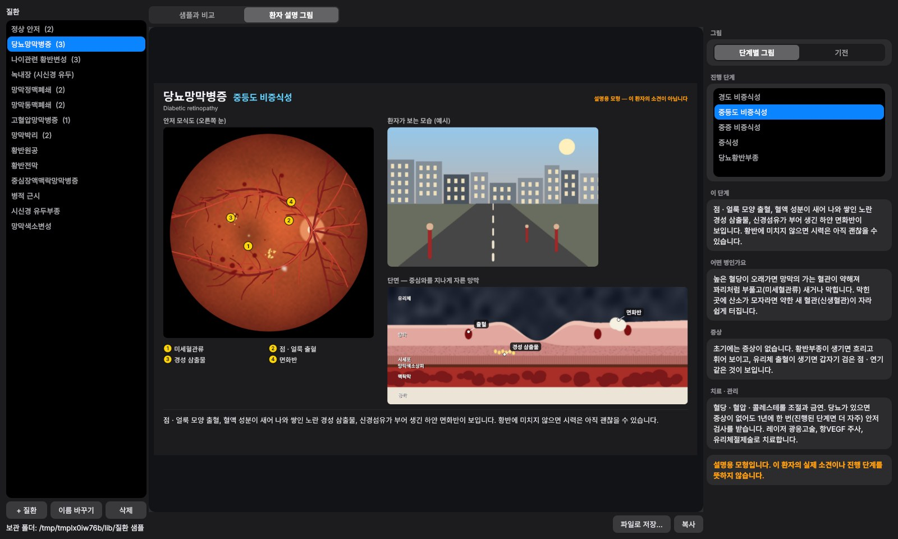

질환 샘플 창 위쪽의 **[샘플과 비교 | 환자 설명 그림]** 에서 **환자 설명 그림**을 누르거나, 메뉴 **질환 샘플 → 질환 설명
그림…** (Ctrl+Shift+D). 왼쪽에서 고른 질환을 **단계별 그림**으로 환자에게 설명합니다(녹내장 분석의 **환자 설명** 탭과 같은 방식).

* **안저 모식도 (오른쪽 눈)**: 그 단계의 소견을 그린 안저 그림에 번호(①②③…)를 붙이고 아래에 이름을 적습니다 — 예: 당뇨망막병증
  중등도 → ① 미세혈관류 ② 점 · 얼룩 출혈 ③ 경성 삼출물 ④ 면화반. 녹내장 · 시신경 유두부종은 유두를 크게 보여 주는 확대 창이 붙습니다.
* **단면**: 망막을 옆에서 자른 모습(유리체 · 망막 · 시세포 · 망막색소상피 · 맥락막 · 공막)에 병이 생긴 자리 —
  망막 밑 액체(중심장액 · 망막박리), 구멍(황반원공), 막(황반전막), 드루젠 · 신생혈관(황반변성), 함몰(녹내장) 등.
* **환자가 보는 모습 (예시)**: 거리 풍경이 그 병에서 어떻게 보이는지 — 가운데가 어둡거나 휘어 보임, 커튼처럼 가려짐, 터널 시야,
  날파리 · 번쩍임 등. 황반 질환(황반변성 · 황반원공 · 황반전막 · 중심장액 · 당뇨황반부종 · 근시성 황반변성)은 **암슬러 격자**로 본
  모습도 함께 나옵니다. 환자가 보는 쪽은 안저 그림을 위아래로 뒤집은 자리입니다(위쪽 망막의 병 → 아래쪽 시야).
* 오른쪽에 **진행 단계**와 **이 단계 · 어떤 병인가요 · 증상 · 치료 · 관리**가 쉬운 말로 나옵니다.
* 오른쪽 위 **그림: [단계별 그림 | 기전]** 에서 **기전**을 고르면 **그 병이 어떻게 생기는지**를 3 ~ 4단계 그림으로 보여 줍니다
  (정상 안저는 "눈은 어떻게 보나요"). 단계마다 번호 · 제목 · 그림 · 설명이 있고 화살표로 이어집니다.

  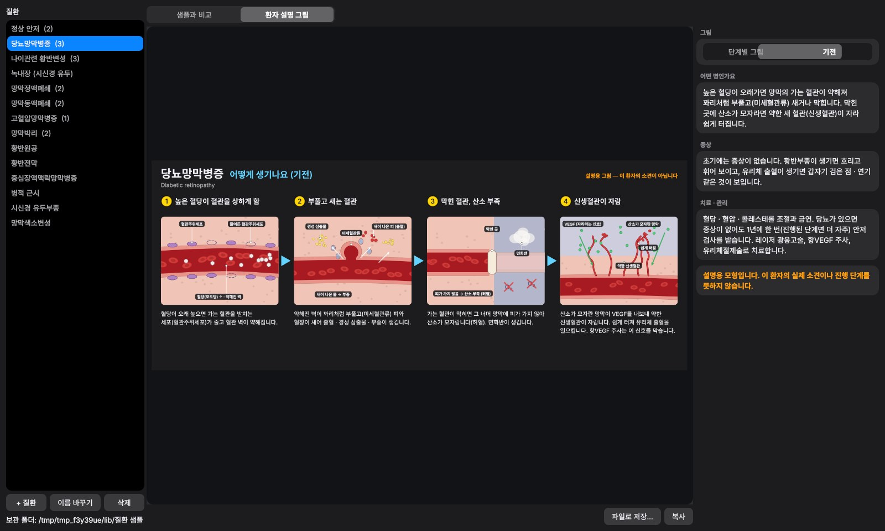

  | 질환 | 기전 그림 |
  |---|---|
  | 정상 안저 | 빛이 망막에 맺힘 → 시세포가 신호로 바꿈 → 시신경을 따라 뇌로 |
  | 당뇨망막병증 | 높은 혈당이 혈관을 상하게 함 → 부풀고 새는 혈관 → 막힌 혈관 · 산소 부족 → 신생혈관 (VEGF) |
  | 나이관련 황반변성 | 드루젠이 쌓임 → 세포가 없어짐 (건성) → 신생혈관이 브루크막을 뚫고 자람 (습성) |
  | 녹내장 | 방수가 빠지지 못해 안압이 오름 → 시신경 유두가 눌림 → 신경섬유가 줄고 함몰이 커짐 |
  | 망막정맥폐쇄 | 굳은 동맥이 교차 부위에서 정맥을 누름 → 혈전 · 피가 고임 → 황반부종 · 허혈 |
  | 망막동맥폐쇄 | 경동맥 · 심장에서 색전이 떨어짐 → 망막 동맥이 막힘 → 안쪽 망막이 하얗게 붓고 기능을 잃음 |
  | 고혈압망막병증 | 동맥 벽이 두꺼워짐 → 교차 부위에서 정맥을 누름 → 혈관이 새고 터짐 |
  | 망막박리 | 유리체가 떨어짐 → 당겨서 망막이 찢어짐 → 물이 들어가 망막이 들뜸 |
  | 황반원공 | 유리체가 중심와를 당김 → 중심와가 갈라짐 → 구멍이 뚫림 |
  | 황반전막 | 표면에 막이 생김 → 막이 쪼그라듦 → 망막이 주름짐 |
  | 중심장액맥락망막병증 | 맥락막 혈관이 넓어짐 → 색소상피로 액체가 샘 → 망막 밑에 물집 |
  | 병적 근시 | 눈이 길어짐 → 망막 · 맥락막이 얇아짐 → 래커 균열 · 신생혈관 |
  | 시신경 유두부종 | 뇌압이 오름 → 시신경 집을 따라 압력이 전해져 축삭 수송이 막힘 → 유두가 붓고 솟음 |
  | 망막색소변성 | 시세포 유전자 이상 → 막대세포가 먼저 줄어듦 → 원뿔세포까지 줄어듦 · 색소 이동 |

  | 질환 | 단계 |
  |---|---|
  | 정상 안저 | — |
  | 당뇨망막병증 | 경도 비증식성 · 중등도 비증식성 · 중증 비증식성 · 증식성 · 당뇨황반부종 |
  | 나이관련 황반변성 | 초기 (드루젠) · 건성 (지도모양 위축) · 습성 (신생혈관) |
  | 녹내장 (시신경 유두) | 정상 · 초기 · 중기 · 말기 |
  | 망막정맥폐쇄 | 분지 정맥폐쇄 · 중심 정맥폐쇄 |
  | 망막동맥폐쇄 | 분지 동맥폐쇄 · 중심 동맥폐쇄 (체리빛 반점) |
  | 고혈압망막병증 | 1 ~ 4단계 (Keith–Wagener–Barker) |
  | 망막박리 | 망막 열공 · 박리 (황반 붙음) · 박리 (황반 떨어짐) |
  | 황반원공 | 초기 (부분 원공) · 전층 원공 |
  | 황반전막 | 경도 (셀로판 반사) · 진행 (황반 주름) |
  | 중심장액맥락망막병증 | 급성 · 만성 · 재발 |
  | 병적 근시 | 근시성 안저 · 근시성 황반변성 |
  | 시신경 유두부종 | 초기 · 진행 · 만성 (위축) |
  | 망막색소변성 | 초기 · 중기 · 말기 |

* **[파일로 저장…]** · **[복사]** 로 보이는 그림 한 장(단계별 그림 또는 기전 그림, 1600 px)을 저장하거나 붙여 넣습니다. 그림마다
  **"설명용 모형 — 이 환자의 소견이 아닙니다"** 가 적혀 있고, **환자 기록에는 넣지 않습니다.**
* 질환 이름을 바꾸어도(예: `당뇨망막병증 (DR)`) 원래 이름이나 흔한 약자가 들어 있으면 같은 그림이 나옵니다. 직접 더한 질환은
  설명 그림이 없다고 알려 줍니다.
* 그림은 모두 프로그램이 그린 것이라(사진이 아님) 언제 그려도 같고, 따로 파일이 필요 없습니다.

## 디스크 2장 (보험 청구용)

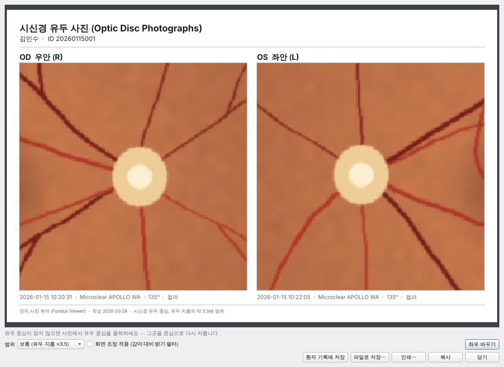

두 사진의 **시신경 유두 부분만 확대해 한 장**으로 만듭니다. 녹내장 등의 보험 청구에 붙이는 유두 사진용입니다.

1. 사진 목록에서 사진 **두 장을 차례로 클릭**해 고릅니다(몽타주처럼 — 번호가 붙고, 다시 클릭하면 빠집니다).
   Ctrl+클릭(②)은 하지 않아도 됩니다.
2. 명령 툴바의 **[Glaucoma] ▾ 스테레오 보기**(또는 사진 오른쪽 클릭 → **스테레오 보기…**, 파일 메뉴)를 누르면 녹내장 분석 창이
   **스테레오 보기** 탭으로 열립니다(같은 눈 두 장이면 [Glaucoma]만 눌러도 됩니다). 오른쪽 **보험 청구용 →
   [청구용 한 장 (흰 종이)…]** 을 누릅니다.
3. 미리 보기 창에서 확인하고 **환자 기록에 저장**(사진 목록에 `디스크 2장` 종류로 추가, 원본은 그대로) ·
   **파일로 저장**(JPEG/PNG) · **인쇄**(A4 가로) · **복사** 중 하나를 고릅니다.

* **배치**: 우안 OD가 왼쪽, 좌안 OS가 오른쪽입니다(마주 본 환자 방향). 같은 눈 두 장은 먼저 찍은 사진이 왼쪽이며,
  **좌우 바꾸기**로 바꿀 수 있습니다.
* **머리말**에 환자 이름·ID·생년월일(검사일 기준 나이)·성별이 들어가고, 사진마다 눈, 아래에 검사 일시·장비·화각이
  들어갑니다.
* **유두 위치**: 가져올 때 검출했거나 큰 사진에서 오른쪽 클릭으로 지정한 위치를 씁니다. 찾지 못한 사진은 예상
  위치(중심와에서 코쪽 4.5 mm)로 자르고 경고를 보여 줍니다. 미리 보기에서 **유두 중심을 클릭하면** 그곳을 중심으로
  다시 자르며, 그 위치는 그 사진의 유두 위치로 저장됩니다(3D 시신경에도 반영).
* **범위**: 한 칸의 너비를 **유두 지름의 배수**로 정합니다 — 가깝게 ×2.5 · 보통 ×3.5(기본) · 넓게 ×5. 화소가 아니라
  각 사진의 화각·투영으로 유두 크기(1.8 mm)를 계산하므로 45° 사진과 초광각 사진도 같은 망막 범위로 잘립니다.
* 색은 **원본 그대로**입니다. **화면 조정 적용**을 켜면 큰 사진의 감마·대비·밝기·필터를 함께 적용합니다.
* 미분류 사진, 서로 다른 환자의 사진, 전안부 사진은 쓸 수 없습니다.

## 녹내장 분석


명령 툴바의 **[Glaucoma]** (또는 파일 메뉴 · 사진 오른쪽 클릭 → **녹내장 분석…**)을 누르면 보고 있는 사진으로
녹내장 분석 창이 열립니다. 사진 목록에서 **같은 눈의 사진 두 장을 클릭해 골라** 두면(또는 두 번째 사진을 Ctrl+클릭(②)해 두면) 두 장을 쓰는 탭도 함께 열립니다.
오른쪽 클릭 메뉴의 **녹내장 분석…** 은 사진 한 장만 있어도 어느 사진에서나 열립니다(디스크 C/D · 3D 입체 · 광각 분석) — 같은 눈의 사진을 한 장 더 골라 두었거나 ② 사진이 있으면 스테레오 · 경과 비교도 같은 창에 나옵니다. **스테레오 보기…** 는 두 장이 있을 때(화면의 다른 한 장, 아니면 ② 사진) 나옵니다.

| 탭 | 쓰는 사진 | 하는 일 |
|---|---|---|
| **디스크 C/D** | 보고 있는 사진 | 사진을 시신경 유두 주변(유두 지름의 2.5 · 3.5 · 5배)으로 잘라 보여 줍니다. 초록 선(디스크 경계)과 노란 선(컵 경계)이 **사진에서 찾은 자리에서 시작**합니다 — 디스크는 밝기가 망막 쪽으로 꺾이는 곳, 컵은 추정한 모양의 **등고선**. 선마다 **점 8개를 끄는 대로** 옮겨 다듬으면 **수직 · 수평 C/D**(길이 방식) · **면적 C/D · 림 면적**(면적 방식), **림 두께(8방향)** · **ISNT** · **가장 얇은 림과 DDLS 단계**, 디스크 크기와 그 크기의 정상 평균 C/D가 나옵니다 ([아래](#디스크-cd--경계-맞추기와-측정)) |
| **광각 분석** | 보고 있는 사진 | **레드프리 + RNFL 대비 강화**로 신경섬유층을 강조하고, 유두 둘레에 **Garway-Heath 구역**과 **시야검사 24-2 격자**를 겹칩니다. 사진을 눌러 소견(RNFL 결손 · 디스크 출혈)을 표시하면 **시계 방향 · 구역 · 대응 시야 · 유두에서의 거리(DD)** 가 목록에 나옵니다. 유두와 황반은 가져올 때 찾은 위치가 미리 지정됩니다 |
| **3D 입체** | 보고 있는 사진 (한 장) 또는 두 장 | 시신경 유두를 **돌려 볼 수 있는 입체 표면**으로 보여 줍니다. **한 장**이면 모양을 추정합니다 — 추정 방식은 **밝기**(창백한 곳 = 컵 = 깊은 곳, 림과 혈관은 조금 솟음) · **혈관 꺾임**(혈관이 꺾이는 곳 = 컵 경계) · **하이브리드** 중에서 고르고, **셋 나란히 비교**로 함께 돌려 봅니다 ([아래](#3d-입체--한-장-추정-방식)). **두 장**(같은 눈을 조금 다른 위치에서)이면 두 사진의 **시차로 계산한 깊이**를 씁니다 — **시차 | 시차 + 혈관 꺾임**(컵 경계는 혈관 꺾임 · [아래](#3d-입체--두-장-스테레오와-혈관-꺾임)). 사진을 끌어 돌리기 · 자동으로 흔들기 · 깊이 과장 · 입체 조명 · 등고선 · 적청 안경, 두 장일 때는 같은 표면 위에서 **두 사진 깜빡임**. 표면에서 기준 깊이보다 깊은 곳을 컵으로 본 **수직 · 수평 · 면적 C/D (추정)** 와 디스크 · 컵 선 — 디스크 경계는 디스크 C/D 탭의 초록 선, 찾은 컵은 **[디스크 C/D 탭에 적용]** 으로 넘겨 다듬기. 두 장이면 사진별 C/D와 평균, **날짜가 다르면 과거 → 최근의 변화**. **[시신경 다발 보기]** 를 켜면 망막 위 신경섬유가 유두로 모여 뒤로 나가는 설명용 그림 — 사진에 결이 보이는 곳은 그 방향을 읽어 초록빛으로 표시 |
| **스테레오 보기** | 두 장 (같은 눈을 조금 다른 위치에서) | 위글(번갈아 보기) · 나란히(평행 / 교차) · 적청 안경 · **깊이 지도**(파랑 = 깊은 곳, 빨강 = 솟은 곳, 누른 높이의 단면 그래프) |
| **경과 비교** | 두 장 (이전 · 이후) | 날짜가 이른 사진이 기준입니다. 깜빡임 · 겹치기 · **변화 지도**(밝기가 달라진 곳을 분홍색으로) |
| **시간별 비교** | 같은 눈의 사진 여러 장 (12장까지) | 이 환자 · 이 눈의 유두 사진을 **시간순으로 한 화면에 나란히** 놓거나 **한자리에 겹쳐** 봅니다 — [아래](#시간별-비교-유두-사진-여러-장) |
| **환자 설명** | (사진을 쓰지 않음) | 환자에게 녹내장을 설명하는 **모형**입니다. **정상 · 초기 · 중기 · 말기**를 고르면 시신경 유두 모식도(함몰이 커짐)와 **환자가 보는 시야 (예시)**, 그 단계의 설명 글이 나옵니다. 이 환자의 실제 진행 단계가 아니므로 환자 기록에는 저장되지 않습니다(파일 저장 · 복사는 됨) |

### 디스크 C/D — 경계 맞추기와 측정

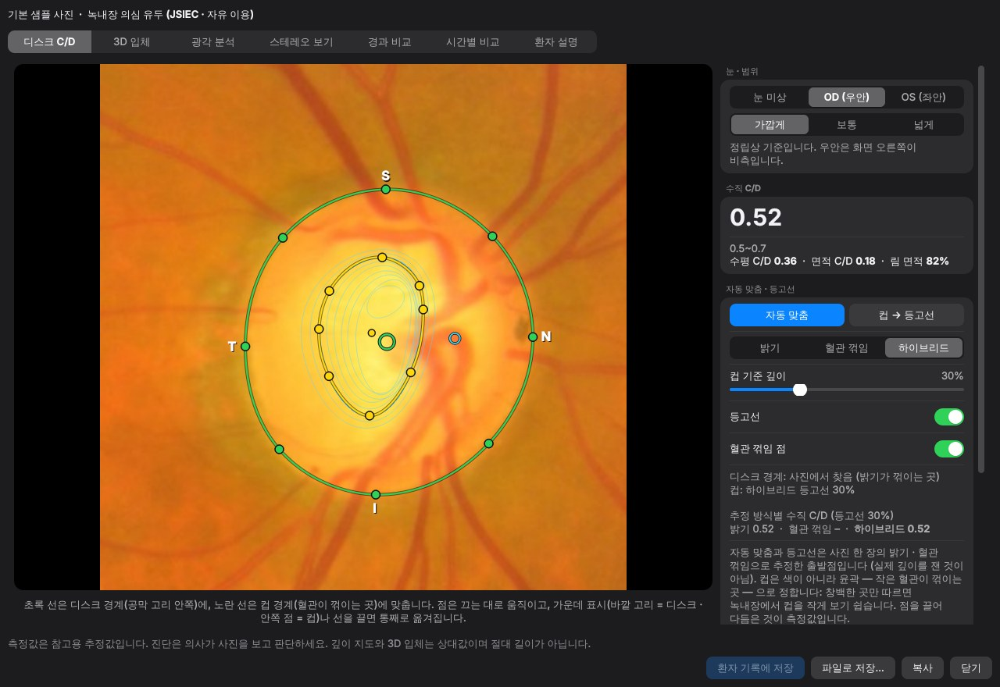

C/D 비는 두 경계선만 정해지면 정확히 계산됩니다. 어려운 것은 **컵 경계를 어디로 볼 것인가**이고, 사진 한 장으로는 전문가끼리도
최대 0.2까지 차이가 납니다. 그래서 이 탭은 사진에서 찾은 경계를 출발점으로 놓고, 임상에서 쓰는 단서를 사진 위에 보여 주며,
검사자가 다듬은 선을 측정값으로 삼습니다 — 측정 방법과 문헌 근거는 **[docs/cd_ratio.md](docs/cd_ratio.md)** 에 있습니다.

* **자동 맞춤** (창을 열 때, 그리고 **[자동 맞춤]**): **초록 선**은 디스크 경계 — 혈관을 지운 밝기가 망막 쪽으로 꺾이는 곳을
  둘레 전체에서 이어 찾습니다. **노란 선**은 컵 — 사진에서 추정한 모양(3D 입체 탭과 같은 **밝기 · 혈관 꺾임 · 하이브리드**)에서
  **컵 기준 깊이**(처음 30%)의 **등고선**을 매끈하게 고른 선입니다. 뚜렷하지 않아 찾지 못하면 그렇게 알리고 그대로 둡니다.
* **등고선** (10%마다 · 기준 깊이는 점선)과 **혈관 꺾임 점**(하늘색 = 혈관마다 가장 바깥 꺾임)이 사진 위에 겹쳐 나옵니다.
  **컵 기준 깊이**를 움직이면 노란 선이 그 등고선으로 옮겨 가고, **[컵 → 등고선]** 은 손으로 옮긴 노란 선을 등고선으로 되돌립니다.
* **점 8개**: 선마다 상 · 하 · 비 · 이측과 그 사이(하이측 · 상이측 …)에 점이 있고, **끄는 대로** 움직입니다(이웃 점을 넘어가지는
  않음). 선은 점들을 지나는 매끈한 닫힌 곡선입니다. **가운데 표시**는 선의 중심을 따라가고 — **바깥 고리 = 디스크, 안쪽 점 = 컵**
  — 끌면 그 선이 통째로 옮겨집니다(선 자체를 끌어도 같음). 범위(가깝게 · 보통 · 넓게)를 바꿔도 맞춘 선은 사진 위 그 자리에 남습니다.
* **C/D — 길이 방식 · 면적 방식** 카드: **수직 · 수평 C/D**(길이 방식)와 **면적 C/D · 림 면적**(면적 방식)이 함께 나옵니다.
  **[직접 맞추기 — 처음부터]** 를 누르면 두 선이 단순한 타원으로 돌아가, 초록 점 8개(디스크)와 노란 점 8개(컵)를 손으로
  경계에 끌어다 놓습니다 — 놓는 대로 바로 계산됩니다.
* **측정값**: 수직 · 수평 C/D(컵 곡선의 높이 · 너비 ÷ 디스크 곡선의 높이 · 너비), 면적 C/D, **림 두께 8방향**(디스크 수직 지름
  대비)과 ISNT, 둘레 360°에서 **가장 얇은 림**(시계 방향 · 림/디스크 비 · 림이 없는 범위)과 그로부터의 **DDLS 단계**(1~10).
  사진의 축척을 알면 **디스크 수직 지름(mm, 추정)** 과 그 크기 디스크의 **정상 평균 C/D**(Garway-Heath 1998)를 함께 보여 줍니다
  — 큰 디스크는 정상에서도 컵이 큽니다.
* **추정 방식별 수직 C/D**: 세 추정 방식의 값을 나란히 보여 주고, 서로 0.1 넘게 다르면 사진만으로는 컵 경계가 뚜렷하지 않다고
  알립니다. 컵은 색이 아니라 **윤곽(혈관이 꺾이는 곳)** 으로 정합니다 — 창백한 곳만 따르면 녹내장에서 컵을 작게 보기 쉽습니다.
* 자동 맞춤은 **출발점**입니다. 정답을 아는 합성 유두에서는 수직 C/D 평균 오차가 0.03 안쪽이었지만, 실제 사진에 대한 전문가 표시와의
  비교 검증은 하지 않았습니다. 스테레오 쌍이 있으면 3D 입체 탭의 시차 깊이로 찾은 컵을 **[디스크 C/D 탭에 적용]** 으로 가져오세요.


* **3D 입체는 사진 그대로를 입힙니다**: 유두의 색과 밝기는 **찍힌 사진 그대로**이고, 정면(**[정면]**)은 원래 사진과
  똑같습니다. 사진은 카메라 쪽에서 비춘 빛으로 찍힌 것이라 그 음영이 이미 사진 안에 있으므로 따로 빛을 덧씌우지 않습니다 —
  창백한 컵은 창백하게 보입니다.
  * **입체 조명**: 돌려 볼 때 보는 쪽으로 향한 경사면만 조금 밝게, 등진 경사면만 조금 어둡게(사진 밝기의 0.75 ~ 1.14배 안에서).
    끄면 사진만 입힙니다.
  * **깊이**: 100%에서 가장 깊은 곳이 유두 지름의 0.4배(깊은 컵 정도, 약 0.7 mm). **깊이 과장**으로 0 ~ 200%까지 바꿉니다.
  * **혈관**은 제 굵기의 절반쯤만, 길이 방향으로 고르게 솟습니다.
  * **원근**: 기울이면 가까운 쪽이 조금 크게 보입니다(카메라가 사진 변 길이의 3배 거리).
* 두 장을 쓰는 탭은 두 사진을 각각 **유두 중심으로 같은 망막 범위**(유두 지름의 5배 · 10배, 또는 사진 전체)로 잘라
  맞춥니다. 화각이 다른 카메라의 사진끼리도 같은 크기로 겹칩니다. **자동 맞춤**은 두 사진의 혈관 점들을 맞춰
  **회전 · 크기 · 좌우 · 상하**를 찾습니다. 좌우 · 상하는 슬라이더로 고칠 수 있습니다.
* **기준점** (스테레오 보기의 위글 · 적청): 사진을 누르면 그곳에서 두 사진을 정확히 겹쳐(0.1 화소 단위) 그 점은 움직이지
  않고 나머지가 깊이만큼 움직입니다 — 유두 테두리의 혈관처럼 무늬가 뚜렷한 곳을 누르세요. 기준점은 화면에 하늘색 십자로
  표시되고(저장하는 그림에는 들어가지 않음), 다른 곳을 누르면 옮겨지고 **맞춤 해제**로 지웁니다.
* 두 사진은 사진 목록에서 **클릭해 고른 두 장**(같은 눈 — 몽타주처럼) 또는 보고 있는 사진과 Ctrl+클릭한 ② 사진입니다.
  검사일이 같으면 스테레오 보기가, 다르면 경과 비교가 먼저 열립니다. **[Glaucoma] ▾ 스테레오 보기**는 늘 스테레오 보기로 엽니다.
* **두 장 깜빡임(플리커)** 은 세 곳에 있습니다: **경과 비교 → 깜빡임**(이전 · 이후 사진, 속도 1~6 Hz), **스테레오 보기 → 위글**
  (같은 날 찍은 두 장), **3D 입체 → 두 사진 깜빡임**(기울인 입체 표면 위에서).
* **3D 입체**의 한 장 추정은 사진에서 만든 **그림**이지 깊이를 잰 것이 아닙니다(아래 [한 장 추정 방식](#3d-입체--한-장-추정-방식)). 두 장 스테레오는 시차가 작으면
  (두 사진을 거의 같은 자리에서 찍었으면) 믿을 만하지 않다고 알려 줍니다. 시선이 다른 두 장처럼 **스테레오 쌍이 아닌 두 장**은
  유두 둘레가 고르게 나오지 않는 것으로 가려내어 한 장 추정으로 열립니다. 컵이 솟아 보이면 **깊이 뒤집기**를 켭니다.
  OD와 OS처럼 서로 다른 눈의 두 장은 스테레오가 되지 않으므로 한 장씩 봅니다.
* 지금 보이는 분석 화면은 **환자 기록에 저장**(사진 목록에 `녹내장 분석` 종류의 새 사진으로, 원본은 그대로) ·
  **파일로 저장** · **복사**할 수 있습니다.
* 측정값은 **참고용 추정값**입니다. 깊이 지도는 상대값이며 길이가 아닙니다. 진단은 의사가 사진을 보고 판단합니다.

### 3D 입체 — 한 장 추정 방식

사진 한 장에는 깊이가 기록되지 않으므로, 한 장의 입체는 사진에 남은 **단서**로 만든 모양입니다. **모양 (깊이)** 카드의
**밝기 | 혈관 꺾임 | 하이브리드** 에서 단서를 고릅니다. 창은 **하이브리드**로 열리며, 처음에 열 방식은 **설정 → 일반 → 3D 입체 한 장 추정**에서 바꿉니다. 두 장 스테레오(시차로 계산한 깊이)를 볼 때는
이 줄 대신 **시차 | 시차 + 혈관 꺾임** 이 나옵니다([아래](#3d-입체--두-장-스테레오와-혈관-꺾임)).

| 방식 | 단서 | 컵 경계 | 바닥 모양 | 잘 맞지 않는 경우 |
|---|---|---|---|---|
| **밝기** | 창백한 곳 = 깊은 곳 | 창백한 부분의 가장자리 | 창백할수록 깊게 | 녹내장에서 함몰이 창백한 부분보다 넓을 때(컵을 작게 읽음), 시신경 위축처럼 창백하지만 얕을 때, 유두주위 위축 |
| **혈관 꺾임** | 혈관이 꺾이는 곳 = 컵 경계 | 유두 위 혈관이 꺾이거나 옆으로 비껴나는(총검 모양) 곳을 이은 선 | 정해 둔 그릇 모양(꺾임은 깊이를 알려 주지 않음) | 경계를 지나는 혈관이 적을 때(특히 귀쪽), 디스크가 작게 찍힌 사진(초광각), 작은 컵(C/D 0.25 이하) |
| **하이브리드** | 둘 다 | 꺾임이 있는 쪽은 꺾임, 혈관이 없는 쪽은 밝기 | 밝기 | 꺾임을 하나도 찾지 못하면 밝기와 같음 |

* **꺾임 점**(혈관 꺾임 · 하이브리드): 찾은 꺾임이 사진 위에 동그라미로 나옵니다 — **하늘색**은 컵 경계로 쓴 곳(혈관마다 가장
  바깥 꺾임 = 벽의 위쪽), **분홍**은 같은 혈관의 안쪽 꺾임(벽을 내려가 바닥에 닿는 곳). 혈관이 아닌 것(유두 둘레 색소처럼 빨강
  에서도 어두운 것, 혈관이 갈라지거나 겹치는 곳, 짧은 조각)은 세지 않습니다.
* 상태 줄에 **꺾임 몇 곳 · 혈관 몇 개 · 경계의 몇 %가 꺾임에 가까운지**가 나옵니다. 꺾임이 없는 쪽의 경계는 이어 그린 것이고,
  하이브리드에서는 그쪽을 밝기로 채웁니다. 혈관 꺾임을 충분히 찾지 못하면 C/D를 내지 않고 알려 줍니다.
* **셋 나란히 비교**: 세 방식의 입체를 나란히 같은 각도로 돌려 보고, 각각의 수직 C/D가 위에 나옵니다(고른 방식은 주황).
  수직 C/D 카드에도 **추정 방식별 수직 C/D**가 함께 나옵니다. 이 화면도 환자 기록 · 파일로 저장됩니다.
* **[디스크 C/D 탭에 적용]** 은 지금 고른 방식의 컵 경계(등고선)를 넘깁니다 — 그 선 위의 점 8개로.
* 어느 방식이든 **참고용 추정값**입니다. 혈관 꺾임은 의사가 컵 경계를 정할 때 쓰는 단서(색보다 윤곽)를 따라 한 것이지만,
  사진의 해상도 · 초점에 따라 놓치거나 잘못 찾을 수 있으니 꺾임 점을 사진과 함께 보세요.

### 3D 입체 — 두 장 스테레오와 혈관 꺾임

같은 날 같은 눈을 카메라만 옆으로 조금 옮겨 찍은 두 장이면 **2장 스테레오**가 두 사진의 **시차**로 깊이를 계산합니다 —
사진에 실제로 담긴 정보라 한 장 추정보다 정확하지만, 시차 지도는 거칠어서 컵의 가장자리가 번집니다. **모양 (깊이)** 카드의
**시차 | 시차 + 혈관 꺾임** 에서 고릅니다(처음에는 **시차 + 혈관 꺾임**). 처음에 열 방식은
**설정 → 일반 → 3D 입체 두 장 스테레오**에서 바꿉니다.

| 방식 | 컵 경계 | 깊이 (바닥 모양) |
|---|---|---|
| **시차** | 시차 깊이에서 기준 깊이보다 깊은 곳 | 시차 |
| **시차 + 혈관 꺾임** | 혈관이 꺾이는 곳 — 두 사진 **모두**에서 꺾임을 찾고, 두 사진이 함께 보여 주는 꺾임일수록 무겁게. 꺾임이 없는 쪽은 시차 그대로 | 시차 (솟은 곳도 시차 그대로) |

* 꺾임을 하나도 찾지 못하면 **시차**와 같은 모양입니다. 시차에서 꺾임 안쪽이 오목하지 않으면(유두가 솟았거나 **깊이 뒤집기**를 켬)
  꺾임을 쓰지 않고 그렇다고 알려 줍니다.
* **꺾임 점** · **둘 나란히 비교**(시차와 시차 + 혈관 꺾임을 같은 각도로) · **깊이 방식별 수직 C/D** 는 한 장 추정과 같습니다.
* 시차는 상대 깊이이고 길이(mm)가 아닙니다. 어느 방식이든 **참고용 추정값**입니다.

### 시간별 비교 (유두 사진 여러 장)

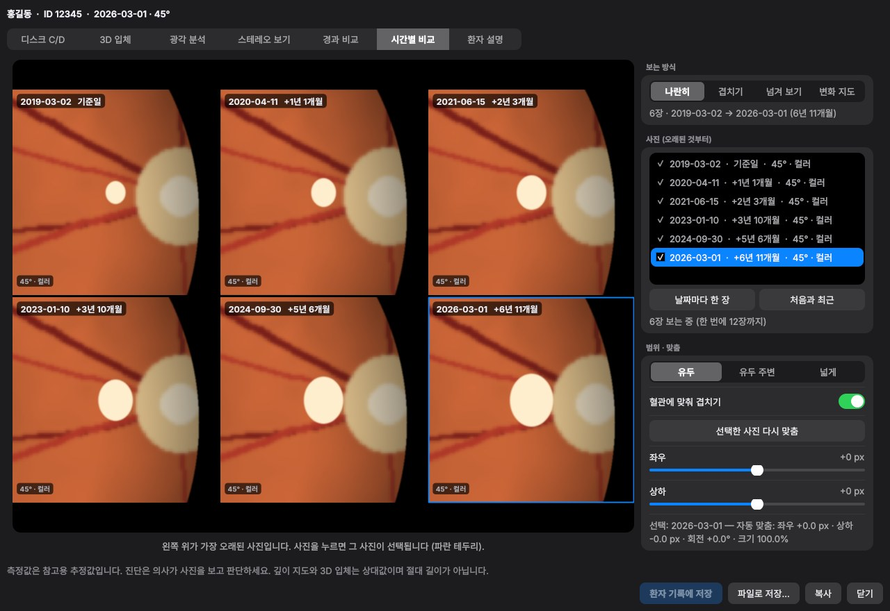

**[Glaucoma] ▾ → 시간별 비교** (사진 오른쪽 클릭 → **시간별 비교…**, 파일 메뉴, 녹내장 분석 창의 **시간별 비교** 탭)는
보고 있는 사진과 **같은 환자 · 같은 눈**의 유두 사진을 여러 장 한꺼번에 봅니다.

| 보는 방식 | 하는 일 |
|---|---|
| **나란히** | 모든 사진을 오래된 것부터 **시간순으로 한 화면에**. 사진마다 검사일과 첫 사진부터 지난 기간(+1년 2개월 …). 사진을 누르면 선택(파란 테두리) |
| **겹치기** | 한자리에 겹쳐 놓고 **시간 슬라이더**로 한 사진에서 다음 사진으로 서서히 넘깁니다. **▶ 자동으로 넘기기**: 처음 ↔ 끝을 저절로 오감. 아래 줄의 점은 검사일(실제 간격대로) |
| **넘겨 보기** | 제자리에서 차례로 바꿔 보기(깜빡임, 1 ~ 6 Hz) — 전체, 또는 **처음 ↔ 선택한 사진 두 장만** |
| **변화 지도** | 처음 사진과 선택한 사진의 밝기가 달라진 곳을 분홍색으로 |

* 사진은 각각 **유두 중심으로 같은 망막 범위**(유두 지름의 3 · 5 · 10배: 유두 · 유두 주변 · 넓게)로 잘라, **가장 오래된
  사진(기준)에 혈관을 맞춰** 회전 · 크기 · 좌우 · 상하를 찾아 겹칩니다. 선택한 사진은 **좌우 · 상하** 슬라이더로 더 옮기거나
  **다시 맞춤**할 수 있고, **혈관에 맞춰 겹치기**를 끄면 자른 그대로 나옵니다.
* 처음에는 **검사일마다 한 장**(보고 있는 사진이 그날의 사진), 12일보다 많으면 처음 · 최근 · 보고 있는 사진을 남기고 고르게
  줄여서 나옵니다. 목록의 **✓** 로 넣고 빼며(한 번에 12장까지), **[날짜마다 한 장] · [처음과 최근]** 으로 한 번에 고릅니다.
  Simple에서 **골라 둔 사진(번호)** 이 두 장 이상 이 눈의 사진이면 그 사진들이 먼저 나옵니다.
* 목록에는 가져올 때 **유두를 찾은** 이 눈의 사진만 나옵니다(전안부 · 몽타주 · 디스크 2장 · 분석 화면 제외). 사진은 탭을 처음 열 때,
  표시한 것만 읽습니다.
* 조명 · 초점 · 카메라가 다르면 사진의 밝기와 색도 달라집니다. 변화 지도의 분홍색은 그런 차이도 잡으므로 겹치기 · 넘겨 보기로
  확인하세요.

### OD · OS 비교 (두 눈의 유두)

녹내장 분석 창의 **OD · OS 비교** 탭은 보고 있는 눈의 유두와 **반대쪽 눈의 유두**를 함께 보여 줍니다. 두 눈의 컵 크기가
다르면(수직 C/D 차이 0.2 이상) 녹내장을 의심하는 단서 중 하나입니다.

* 반대쪽 눈 사진은 따로 고르지 않아도 됩니다 — 같은 환자의 반대쪽 눈 사진 가운데 유두를 찾은 것을, 같은 검사일 것부터
  (없으면 가장 가까운 날짜) 자동으로 가져옵니다. 탭을 처음 열 때 읽습니다.
* **나란히**: 왼쪽 OD · 오른쪽 OS, 찍은 그대로. 두 사진은 유두 지름의 같은 배수로 잘라 유두가 같은 크기로 보입니다
  (디스크 C/D 탭의 범위를 따름).
* **깜빡임 · 겹치기**: 반대쪽 눈을 **좌우로 뒤집어** 코쪽이 같은 쪽에 오게 한 뒤, 같은 자리에서 번갈아 보여 주거나
  반투명하게 겹칩니다(화면 아래에 "좌우 뒤집음"이라고 표시).
* **두 눈의 C/D**: 눈마다 수직 C/D와 면적 C/D, 그리고 수직 C/D 차이. 이 눈의 선은 디스크 C/D 탭에서 맞춘 그대로이고
  반대쪽 눈의 선은 자동 맞춤입니다 — 반대쪽 눈을 고치려면 그 눈의 사진으로 녹내장 분석을 엽니다.
* 반대쪽 눈의 유두 사진이 없으면 그렇다고 표시합니다. 값은 모두 참고용입니다.

## 몽타주 (여러 장을 한 장으로 · 3D)

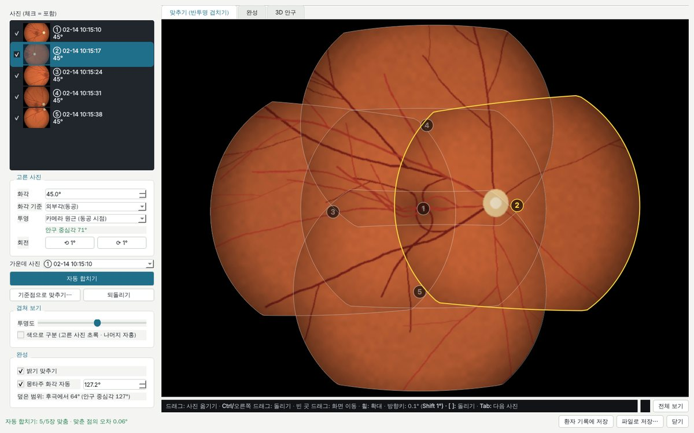

같은 눈을 시선을 바꿔 가며 찍은 사진(45° 5방향, 초광각 2장 등)을 **겹치는 혈관에 맞춰 한 장으로 합치고**,
그 결과를 **3D 안구**에 입혀 봅니다.

1. **Simple**의 사진 목록에서 같은 눈의 사진을 2장 이상 **클릭**해 번호를 붙인 뒤, 명령 툴바의 **[Montage]** 를 누릅니다
   (또는 썸네일 오른쪽 클릭 · 파일 메뉴). 열리면 바로 **자동 합치기**가 실행됩니다.
2. **맞추기 (반투명 겹치기)** 탭에서 결과를 확인하고 필요하면 손으로 고칩니다.
3. **완성** 탭에서 합친 사진을, **3D 안구** 탭에서 안구 위의 모습을 보고 **환자 기록에 저장**(사진 목록에 `몽타주` 종류로
   추가, 원본은 그대로) 또는 **파일로 저장**(PNG/JPEG) 합니다.

**자동 합치기** — 사진마다 혈관이 잘 보이는 초록 채널에서 특징점(SIFT)을 찾아 사진 쌍마다 맞추고, 사진을 평면에서
옮기는 대신 **안구(구면) 위에서 회전**시켜 놓습니다. 그래서 초광각 사진처럼 가장자리가 휘는 사진도 정확히 겹칩니다.
겹치는 사진이 가장 많은 순서로 하나씩 놓은 뒤 모든 사진을 함께 다시 맞추며, 45° 같은 일반 카메라 사진은 화각이
기기 설정과 조금(±15%) 다르면 그것도 고칩니다(목록에 `보정 ×0.90` 처럼 표시). 겹치는 곳을 찾지 못한 사진은 그 자리에
두고 알려 줍니다.
**광각 사진은 화각 그대로, 렌즈 곡선만 사진에서 찾기** — 광각 사진(광각 보정 · 등거리 투영)의 **화각은 카메라의 값
(176°)을 그대로** 씁니다. 몽타주의 각도가 여기서 나오기 때문입니다. 렌즈 곡선(중심이 얼마나 확대되는지)만 겹치는
혈관이 가장 많이 일치하는 것을 그 사진들에서 찾아, 주어진 값보다 일치점이 1.3배 넘게 많을 때만 바꿉니다(아래 줄에
`렌즈 곡선 보정 (화각 176° 그대로, 일치점 139 → 287)` 처럼 표시). 화각은 사진별 화각 칸에서 직접 고칠 수 있습니다.

**반사 · 플레어 가리기** — 눈꺼풀·속눈썹에 번진 밝은 빛(시야 가장자리에 닿은 넓고 하얗게 뜬 곳)과, 시선이 다른 사진들에서
**그림의 같은 자리**에 있는 밝은 점(렌즈 플레어 — 망막이라면 자리가 옮겨졌을 것)은 합칠 때 빼고 다른 사진의 그 자리로
채웁니다. 시신경 유두는 밝아도 망막과 함께 움직이므로 남깁니다. 저장하는 원본 크기 몽타주에도 같이 적용됩니다.

**시간** — 사진이 커도 맞추는 시간은 같습니다(긴 변 1600픽셀 복사본으로 맞춤). 저장할 때 원본으로 다시 그리는 시간만
늘어나는데, **빠르게 저장**을 켜면 몽타주를 최대 2400픽셀(기본 4000)로 그려 절반 아래로 줄어듭니다(다음에도 기억).

흐리거나 잡음이 많고 혈관이 옅은 사진은 **혈관만 남긴 절반 크기 그림**에서 한 번 더 특징점을 찾고, 그래도 안 맞으면
조건을 느슨하게 해 다시 맞춰 봅니다(이때는 서로 일치하는 점을 두 배로 요구해 엉뚱한 사진끼리 붙지 않게 합니다).

**수동으로 맞추기** — 고른 사진(노란 테두리)이 **반투명**하게 위에 놓입니다.

| 조작 | 동작 |
|---|---|
| 사진을 드래그 | 그 사진을 안구 위에서 옮기기 (잡은 곳이 마우스를 따라감) |
| Ctrl+드래그 · 오른쪽 드래그 | 사진 중심을 축으로 돌리기 (⟲ / ⟳ 1° 버튼도 있음) |
| 방향키 · Shift+방향키 | 0.1° · 1° 옮기기 |
| `[` `]` (Shift) | 0.2° (1°) 돌리기 |
| Tab | 다음 사진 고르기 |
| 빈 곳 드래그 · 휠 · 더블클릭 | 화면 이동 · 확대 · 전체 보기 |
| Ctrl+Z / 되돌리기 | 마지막 이동·회전·맞추기 취소 |

* **투명도** 슬라이더로 고른 사진의 비침을 조절하고, **색으로 구분**을 켜면 고른 사진은 초록, 나머지는 자홍으로 보여
  혈관이 정확히 겹친 곳은 회색, 어긋난 곳은 초록·자홍 테두리로 드러납니다.
* 사진마다 **화각 · 화각 기준(외부각/안구 중심각) · 투영**을 고칠 수 있고, 체크를 끄면 그 사진을 몽타주에서 뺍니다.
* **가운데 사진**은 몽타주의 중심(3D에서 각막 맞은편 후극)이 됩니다. 정하지 않으면 자동 합치기 뒤 가운데 있는 사진이
  골라집니다.
* **지도 중심**: 등거리 지도는 중심에서 먼 곳일수록 둘레 방향으로 늘어나므로, **가운데 사진**으로 두면 그
  사진은 원 그대로, 멀리 있는 사진은 바깥쪽이 더 넓어 보입니다(176° 사진 2장을 좌우로 합치면 한쪽만 부풂). **사진들의
  한가운데 (고르게)** 를 고르면 포함한 사진을 모두 둘러싸는 가장 작은 원의 중심이 지도 중심(3D의 후극)이 되어 모든 사진이
  비슷하게 조금씩만 늘어납니다. 사진끼리의 맞춤은 바뀌지 않습니다. 사진을 끌어 옮긴 뒤에는 완성 · 3D 탭을 열거나 저장할 때
  다시 한가운데로 맞춥니다.

**기준점으로 맞추기** — 자동으로 못 맞춘 사진은 **[기준점으로 맞추기…]** 에서 고른 사진(왼쪽)과 이웃 사진(오른쪽)의
**같은 곳(혈관 갈림길·교차점)** 을 차례로 클릭합니다. 2쌍이면 위치와 회전, **4쌍 이상이면 화각까지** 맞춥니다.
왼쪽에 점을 찍으면 오른쪽에 지금 배치로 예상한 위치가 점선 원으로 나오고, 맞춘 뒤 가장 큰 어긋남(°)을 알려 줍니다.

**수동 합치기 (원본 사진 그대로)** — 몽타주 창의 **[수동 합치기 (원본 사진 그대로)…]** 를 누르면 사진을
안구 모양으로 펴지 않고 **찍힌 그대로** 겹쳐 놓는 창이 열립니다(지금 배치 — 자동 합치기 결과 — 에서 시작). **맨 뒤 사진은
불투명**, 그 위의 사진들은 **반투명**(위 사진 투명도)이라 아래 사진의 혈관이 비쳐 보입니다. 위 사진을 **드래그**해 옮기고
**Ctrl/오른쪽 드래그**(또는 `[` `]` · ⟲ ⟳ 버튼)로 돌려 혈관을 맞춥니다 — 방향키는 화면 1픽셀(Shift 10픽셀), 휠은 확대,
빈 곳 드래그는 화면 이동, Ctrl+Z는 되돌리기. **맨 뒤 사진**은 고를 수 있습니다. **완성** 탭에 저장될 모습이 나오고,
**[파일로 저장…]** · **[환자 기록에 저장]** 하면 원본 해상도로 아래의 "자연스럽게 합치기" 방식(밝기 맞추기 + 가장자리를 부드럽게
잇기)으로 이음매 없이 저장됩니다. 환자 기록에 저장한 것은 **다시 편집**하면 이 창으로 열립니다. 사진을 평면에 그대로 놓는
방식이라, 초광각 사진은 가장자리로 갈수록 혈관이 완전히 겹치지 않을 수 있습니다(그런 사진은 자동 합치기가 더 정확합니다).

**자연스럽게 합치기** — 겹친 부분의 밝기를 비교해 사진마다 밝기·색을 맞추고(**밝기 맞추기**), 두 대역으로 섞습니다.
넓은 밝기는 각 사진의 가장자리(촬영 원과 4:3 화면의 잘린 위·아래, 가린 글자까지)로 갈수록 부드럽게 줄어드는 가중치로
섞어 경계선이 보이지 않고, 혈관 같은 세밀한 부분은 그곳을 가장 가운데로 본 사진 한 장에서 가져와(다음 사진으로는 좁은
띠에서만 넘어감) 맞춤이 조금 어긋나도 혈관이 두 겹으로 겹치지 않습니다 — 어긋난 만큼은 이음매에서 혈관이 살짝 끊겨 보입니다.
저장할 때는 원본 해상도 사진으로 다시 그립니다(최대 4000 × 4000).

**각도 · 3D** — 몽타주는 후극(가운데 사진의 중심)에서의 각도가 그대로 거리가 되는 **등거리 지도**로 그려, 3D 안구에
따로 보정 없이 사진이 찍힌 자리에 입힙니다. 이 지도는 모든 사진을 둘러싼 원이라 그 지름(예: 45° 5방향 → 약 127°)은
실제로 찍힌 것보다 큽니다. 그래서 화면에 보이는 각도는 **실제로 사진이 덮은 범위를 대략 잰 값**입니다 — 지도 가운데를
지나는 가로 · 세로 폭을 5° 단위로(예: 176° 사진 2장을 좌우로 → `가로 약 220° · 세로 약 175°`). 3D의 세로 단면에서도
화각 선과 각도가 그 단면에서 사진이 실제로 끝나는 곳에 맞춰집니다(`약 175°`). **몽타주 화각 자동**을 끄면 지도 전체의
각도를 직접 정할 수 있고, 저장한 뒤에도 3D 화면의 화각·투영에서 바꿀 수 있습니다. 저장한 몽타주는 이 기하 정보를 함께 가지므로 2D 측정(° · mm)도 됩니다. 몽타주 썸네일을 오른쪽
클릭하면 **몽타주 다시 편집…** 으로 저장한 배치를 불러와 고칠 수 있습니다.


*왼쪽: 45° 사진 5장을 합친 몽타주를 안구 안에서 본 모습 · 오른쪽: 저장한 몽타주를 3D 화면에서 (안구 중심각 127°, 등거리)*

`FundusViewer --demo` 로 실행하면 데모 환자 `D0001240`(VK-2, 45° 5방향)으로 바로 써 볼 수 있습니다.

## 장비별 폴더와 읽는 정보

| 장비 | 감시할 폴더 | 읽는 정보 |
|---|---|---|
| **SYSEYE RetiCam 3100 Plus** | 장비 PC의 저장 폴더, 예: `D:\reticam`(장비 PC에 설치) 또는 네트워크 공유 `\\<장비 IP>\D\reticam`(**폴링** 체크) | JPEG 안 APP15 JSON(`patientID`, `patientName`/`patientLastName`+`patientFirstName`, `patientBornDate`, `patientSex`, `eyeLaterality`, `modeID`, 몽타주 여부), 파일 이름 `<이름>-od-color-YYYYMMDD-HHMMSS-mmm` |
| **Microclear APOLLO** | 장비 공유 폴더 `…\PatientCapture` (SMB, **폴링** 체크) 또는 PC 뷰어 `MicroClearClient\ImageData` | 폴더 `<ID>_<이름>`, JPEG 주석 `Description:{JSON}`(검사 시각·Eye·FieldAngle·DevModel·ImgType), 케이스 내보내기 `<ID>.json`(생년월일·성별) |
| **Kowa VK-2 / VK-2s** | Kowa Export Tool 출력 폴더, VK-2 DICOM 로컬 저장 폴더 | 파일명 `ID_YYYYMMDD_HHMMSS_R_FUNDUS (COLOR)_1` (VK EXPORT / MDR / JOIA 형식), JOIA `.xml`, DICOM 태그 |
| VK-2 "폴더로 복사" | 그 폴더 (프로필: *파일명 = 환자 ID*) | 파일 이름 = 환자 ID |
| 기타 카메라 | 저장 폴더 | DICOM, EXIF/XMP/JPEG 주석, 같은 이름의 `.txt/.ini/.xml/.json/.csv`, 일반 파일명 규칙 |

**RetiCam 참고**
* 장비의 기본 환자(`#AnonymousID#` / Anonymous / 1980-01-01)로 찍은 사진은 등록되지 않은
  환자이므로 **미분류**로 들어옵니다.
* 촬영 시각은 파일 이름의 시각을 씁니다. JSON의 `dateTime`은 시간대만큼 몇 시간 어긋난 경우가
  있습니다.
* 확장자가 `.jpg`인데 내용이 TIFF인 내보내기 파일도 읽습니다(TIFF 태그에서 JSON을 찾음).
* VK-2와 연동해 "파일 이름 앞 6자리 = 환자 ID"로 내보내도록 설정한 병원은 **설정 → 파일명
  규칙**에 `^(?P<pid>\d{6})`을 추가하세요.
* 사진 왼쪽 위에 이름·ID가 글자로 찍혀 있습니다(장비가 넣는 것). 3D에서는 촬영 원 밖이라
  보이지 않습니다.
* 다른 이름으로 내보내거나 다시 저장해 RetiCam 데이터와 파일 이름이 없어진 사진도 **사진 크기**(5734 × 4300 ·
  5736 × 4304, RetiCam만의 크기)로 RetiCam(176°)으로 알아봅니다. 환자 · 날짜 · 눈은 그런 사진에 없어 미분류 · 파일 날짜 그대로입니다.

VK-2 원본 저장소(`vk_3x\-000512\vk000005.jpg`)의 파일은 이름에 환자 정보가 없어
(환자 연결은 `vk3x.mde` DB에만 있음) **미분류**로 들어옵니다. VK-2 사진은 Export Tool 또는
DICOM 내보내기 폴더를 감시하세요.

### 환자 정보 추출 순서

앞선 출처가 채운 값은 뒤에서 바꾸지 않습니다. 각 값의 출처는 상태 표시줄의 영상 정보에 마우스를 올리면 보입니다.

1. **DICOM 태그**: PatientID, PatientName(한글 이름 그룹 우선; `Specific Character Set`이 없는
   VK-2 파일은 CP949 / ISO 2022 이스케이프를 직접 해석), BirthDate, Sex, Acquisition/Content
   Date·Time, Image Laterality(0020,0062)→Laterality(0020,0060), Horizontal FOV(0022,000C)
2. **장비 데이터**: RetiCam APP15 JSON, APOLLO 폴더·JSON (`Eye` 1=OD 0=OS, `FieldAngle`
   60/90/112 → 90/135/165°)
3. **부속 파일**(sidecar): JOIA XML의 `ID / LastName / FirstName / DOB / Sex / ImageLaterality` 등
4. **이미지 내장 텍스트**: EXIF(Make/Model, DateTimeOriginal, UserComment, Windows XP 태그),
   JPEG 주석, PNG 텍스트, XMP에서 `PatientID=…; Name: …` 형태의 키·값. 사진 속 글은 환자와 상관없는
   경우가 많아(포토샵 · 휴대폰이 넣는 XMP 식별자, `Name: Sunset`, 주소의 `id=5` …) **환자 기록으로 읽힐 때만**
   씁니다: `PatientID` · `환자번호`처럼 분명한 키이거나, 환자 항목이 둘 이상(ID + 이름 등) 있을 때.
5. **파일·폴더 이름**: 프로필 규칙 → 사용자 규칙(설정 → 파일명 규칙, 정규식, 즉석 시험 가능)
   → 일반 규칙(`ID_이름_YYYYMMDD_OD`, `12345678_홍길동`, `12345_홍길동_2024-03-05_OD` …)
   → **이름과 번호 한 쌍**(`홍길동_12345`, `홍길동(12345)`, `OD 12345 홍길동` — 순서 무관)
   → 상위 폴더(`12345_홍길동\20240305\`, `홍길동_12345`).
   환자로 읽지 않는 것: 번호만 있는 이름(`12345.jpg`), 날짜 · 시각(`20240305_101500.jpg`의 `101500`,
   이름 옆의 생년월일 `홍길동_19800101`), 카메라 · 휴대폰 · 메신저 접두어(`IMG_` `DSC` `KakaoTalk_` `Screenshot_` …),
   이름 자리의 낱말(`사진` `우안` `새 폴더` `backup` …), 번호가 둘이라 어느 쪽인지 알 수 없는 이름.
6. 그래도 없으면: 화각은 프로필 기본값, 검사일은 파일 시각, 눈은 시신경 유두 위치로 추정
   (OD는 유두가 오른쪽)

이미 등록된 환자의 이름·생년월일은 가져오기로 덮어쓰지 않습니다(빈 칸만 채움).

## 두 장 3D · 여러 장 3D

**Simple**에 사진이 두 장(OD | OS, 또는 고른 두 장)일 때 **[3D]** 를 누르면 두 사진이 각각 3D 안구가 되어 나란히
나옵니다. 사진을 세 장 이상 골라 두었으면 **[3D]** 를 누를 때 **보고 있는 사진만**(3D 탭) 볼지, **고른 사진 모두** 볼지
묻습니다. 모두를 고르면 사진마다 3D 안구가 2 × 2 · 2 × 3 · 3 × 3으로
나옵니다(한 번에 9장까지 — 더 고르면 앞의 9장). 3D 탭에서 정한 모양(자세히 / 간단히 · 유리 공막 · 안구 열기 …)을 그대로 따릅니다.

* 조작은 3D 화면과 같습니다: 드래그 = 회전, 휠 · + / − · 오른쪽 드래그 = 확대 · 축소, 가운데 / Shift+드래그 = 이동,
  0 = 처음 보기, 더블클릭 = Simple로.
* **함께 움직이기**(처음에 켜짐): 한 안구를 돌리거나 확대하면 다른 안구도 같은 방향 · 같은 배율로 움직입니다. 끄면 따로 움직입니다.
* **깊이 막대 · 배율 막대 (4장까지)**: 안구마다 3D 화면과 같은 두 막대가 있습니다 — 오른쪽 가장자리에
  **깊이 막대**(처음에는 3D 화면의 깊이 · 맨 위 = 닫힌 안구), 왼쪽 위에 **배율 막대**. 끌거나 막대 위에서 휠을 굴려 정합니다.
  함께 움직이기가 켜져 있으면 모든 안구가 같은 깊이 · 같은 배율이 됩니다. 안구 위의 휠은 늘 확대 · 축소입니다.
* **5장 이상**: 안구 위에는 막대가 없습니다. 안구들 위쪽에 가로로 놓인 **깊이 막대 하나**가 모든 안구의
  깊이를 한꺼번에 정합니다.
* [처음 보기] · [정면]은 모든 안구에 함께 적용됩니다. **[3D]** 를 다시 누르면 보던 화면(Simple)으로 돌아갑니다.
* 세 장 이상은 안구가 작아지므로 사진을 줄여(가로 2048 화소까지) 얹습니다 — 메모리를 덜 쓰고 보기에는 같습니다.
* 사진이 한 장만 화면에 있으면(Detail 등) [3D]는 3D 탭을 엽니다(설정 · 슬릿 스캔 · 들어가며 보기는 3D 탭에 있음).

## 3D 안구 모델

반지름 1(≈12 mm)인 구를 안구로 봅니다. 사진은 메시에 붙이지 않고 프래그먼트 셰이더가
망막 표면의 점마다 **안구 중심에서 잰 후극으로부터의 각도 θ**와 방위각 φ를 구해 사진에서 색을
찾습니다. 그래서 화각·투영·회전을 바꾸면 바로 반영되고 확대해도 정확합니다.

* **화각 기준**: 광각 장비는 안구 중심각(내부각)으로, 일반 안저카메라(45°/50°)는 동공에서 잰
  외부각으로 표시합니다. 변환은 동공(절점) 위치 `d = 0.58`(안구 반지름 단위)인 원근 모델로 하며,
  이 값은 "내부 200° ≈ 외부 135°" 관례와 맞습니다. Microclear 규칙(외부각 × 1.5 = 안구 중심각)과도
  일치합니다.
* **투영**: 카메라마다 다음을 기본으로 씁니다. 스테레오그래픽과 정사영도 고를 수 있습니다.
  * **RetiCam 3100 Plus**: **광각 보정(중심 확대)**. 식은 `θ = θmax·((1−c)·ρ + c·ρ³)`,
    `c = 0.2545`, `θmax = 88°`입니다. 같은 176°라도 등거리로 펴면 실제 사진에서 시신경 유두
    (중심에서 영상 반경의 0.32)가 중심와에서 28°에 놓여, 해부학적 위치(약 22°)와 맞지 않습니다.
    이 식은 유두가 22°에 오도록 중심부를 확대합니다. 몽타주는 220°로 둡니다. 2023년형 50°급
    RetiCam 파일은 일반 카메라 원근으로 처리합니다.
    **카메라 각도 보정**(설정 메뉴) — 이 `c`를 병원에 쌓인 사진으로 다시 구합니다. 사진 한 장에서 크기를 아는 것은
    황반–유두 사이(약 4.5 mm, 안구 중심각 21.5°)뿐이고 눈마다 조금씩 다르지만, 같은 카메라로 찍은 여러 환자의
    중앙값은 카메라의 값입니다. 황반과 유두가 모두 표시된 사진을 모아(다른 사진들과 크게 다른 것은 빼고) 그 중앙값이
    21.5°가 되는 `c`를 계산해, 사용한 사진 수 · 사진 사이의 차이 · 지금 값과 새 값을 보여 줍니다. **적용**하면
    이 컴퓨터의 설정에 저장되어 그 카메라의 모든 사진(각도 · mm 측정, 3D, 몽타주)에 쓰이고, **기본값으로**로 되돌립니다.
    사진 가장자리(176°)는 한 장짜리 사진으로는 잴 수 없어 카메라의 값 그대로 둡니다. 5장부터 계산하고 20장
    이상이면 믿을 만합니다. 황반이 잘못 찾아진 사진은 2D에서 황반을 다시 표시한 뒤 **다시 재기**를 누릅니다.
  * **APOLLO**(SLO 스캔): 스캔각이 영상 반경에 비례하므로 **등거리(각도 비례)**를 씁니다.
  * **일반 카메라**: **카메라 원근(동공 시점)**, 즉 `tan α = sin θ / (cos θ + d)`를 씁니다.
  검증: 공급사 UWA 샘플에서 유두가 중심에서 약 250 px(반경 1023 px) 떨어져 있고, 등거리 165°로
  바꾸면 약 20°입니다. 이는 해부학적 중심와–유두 거리(약 4.5 mm / 12 mm)와 일치합니다.
* **보기 방식**: **자세히**(기본) — 아래 [해부학적 묘사](#해부학적-묘사)의 실제 해부 구조 모형으로,
  [3D 안구 미리보기](#3d-안구-미리보기-웹-페이지) 웹 페이지와 같은 그림입니다(같은 셰이더·모형·질감을 씀). 느린 PC는
  3D 탭 위 막대의 **간단히 | 자세히**에서 **간단히**(흰 공막과 단순한 홍채·각막·시신경 위에 사진만 보이는 가벼운 모형, 소프트웨어
  렌더링에서도 빠름)로 바꿀 수 있고, 고른 방식은 저장됩니다.
* **3D 탭의 구성**: 웹 페이지와 같습니다. 위에는 **막대 한 줄** — `간단히 | 자세히` · `외부 | 내부` · 배율과 **확대 바** ·
  **▶ 슬릿 스캔 · 크게 보기 · 설정**. 나머지 설정은 모두 **설정**(막대의 설정 버튼, 또는 메뉴 **설정 → 3D 보기 설정…**)을
  눌러야 오른쪽에 열리는 **설정 패널**에 웹 페이지와 같은 순서로 있습니다(처음에는 닫혀 있고, 열어 둔 것은 다음에도 그대로).
* **깊이 막대 · 배율 막대**: 3D 화면 위에 **반투명**하게 떠 있고(마우스를 올리면 진해짐) **제자리에 고정**되어 있습니다 —
  깊이 막대는 오른쪽 가장자리, 배율 막대는 왼쪽 위. 막대 위에서 **휠**을 굴리면 그 막대의 값(깊이 · 배율)이 바뀝니다.
  설정 패널 → 표시 → **막대 옮기기**를 켰을 때만 막대의 빈 곳(제목 · 숫자)을 **끌어서** 옮기고 **더블클릭**으로 눕히거나
  세울 수 있으며, 놓은 자리와 방향은 기억됩니다.
* **깊이 막대** (3D 화면 오른쪽): 안구를 바깥에서 볼 때 나오는 세로 막대입니다. 위에 **깊이**와
  지금 깊이(예: `58%`, 맨 위면 `닫힘`)가 파란 글자로, 막대 위아래 끝에 **닫힘 · 깊게**(세로 단면은 **닫힘 · 절반**)가 적혀 있고,
  잘라 낸 만큼 파랗게 채워집니다. 흰 손잡이를 **위아래로 끌거나**, 막대의 아무 곳이나 누르거나, 막대 위에서 **휠**을 굴리면
  (아래로 = 더 깊게) 자르는 깊이가 바뀝니다. 자르는 깊이는 이 막대나 설정 패널 안구 열기의 **깊이** 슬라이더(같은 값)로
  정하고, 내부 모드에서는 막대가 숨습니다.
* **마우스 휠**: 3D 안구 위의 휠은 늘 **커서가 가리키는 곳으로** 확대 · 축소합니다. 확대는 막대의 **확대 바**(×0.3 ~ ×16) ·
  오른쪽 드래그 · + / − 로도 됩니다. 안으로 들어가려면 설정 패널 **들어가며 보기**의 **▶ 들어가기**나 **전안부 선택**을
  씁니다 — 전안부 선택이 켜져 있는 동안에는 휠이 들어가기 · 나오기가 됩니다([휠로 들어가기](#휠로-들어가기)).
* **설정 패널**의 묶음:

  | 묶음 | 내용 |
  |---|---|
  | 사진 | 사진 이름 · **장비**(그 장비의 화각·투영으로 얹음) · **눈**(자동 / OD / OS) · **황반·유두 자동으로 찾기** · 사진(유두 노란 원, 황반 하늘색 원) · 찾은 곳("자동으로 찾음 / 직접 지정") · 고치기: **황반 지정 · 유두 지정 · 다시 찾기** |
  | 망막 입체 | **표면 높낮이** · 높이 · 입체 조명 |
  | 시점 | 정면 · 처음 시점 · 화면 저장 |
  | 들어가며 보기 | ▶ 들어가기 · 위치 · **전안부 선택**(휠로 들어가기) |
  | 안구 열기 | `앞쪽 절개 | 세로 단면`, 깊이, **공막 투명도**, 망막 투시 |
  | 슬릿 스캔 | 방향 `↓ | ↑ | → | ← | 상하좌우` · ▶ 슬릿 스캔 |
  | 효과 | 자동 회전 · 화각 표시 · 사진 나란히 |
  | 표시 | 시신경 · 외안근 · 각도 격자 · 영상 처리 적용(2D 보정을 3D 사진에도, 기본 꺼짐) · **막대 옮기기**(깊이 · 배율 막대를 끌어 옮기기, 기본 꺼짐) |
  | 사진 맞춤 | **실제 위치에 맞춤** · 화각 · 화각 기준 · 투영 · 회전 · 황반–유두 거리로 크기 맞춤 · 화각·투영 저장 |
  | 조작 | 마우스·키 사용법 |

  **사진** 묶음: 사진을 가져올 때 자동으로 찾아 둔 시신경 유두와 황반이 사진 위에 표시됩니다. 틀렸으면 **황반 지정 /
  유두 지정**을 누르고 그 사진에서 제자리를 누릅니다(2D 사진의 오른쪽 클릭과 같음 — 직접 지정한 곳은 "직접 지정"으로
  표시되고, 유두를 옮겨도 직접 지정한 황반은 그대로). **다시 찾기**는 직접 지정한 곳을 지우고 다시 찾습니다.
  **자동으로 찾기**를 끄면 직접 지정한 곳만 씁니다. 눈을 **자동**으로 두면 황반이 유두의 어느 쪽에 있는지로 정합니다.
  유두와 황반은 **함께** 찾습니다: 밝고 대비가 큰 곳 가운데 귀쪽 약 21.5°에 어두운 황반이 있는 곳이
  유두입니다 — 밝은 삼출물 · 반흔을 유두로 잡지 않게, 눈이 돌아가 유두가 가장자리 쪽에 있어도 찾게. 시신경은 그 유두에서
  나오고, 황반은 안구 뒤쪽 한가운데(동공 바로 뒤)에 옵니다.
* **공막 투명도**(기본 80): 공막이 **유리처럼 비쳐** 보이고, **사진이 있는 망막은 진하게 그대로** 남습니다. 안구를
  돌리면 뒤에서도 옆에서도 망막의 사진이 안구 속 어디에 얼마나 넓게 놓여 있는지 보입니다(45° 사진은 후극의 작은
  부분, 초광각 사진은 안구 뒤쪽 대부분). 사진 밖으로는 홍채·수정체·섬모체가 은은하게 비칩니다. 낮추면 뿌연 유리,
  100으로 올리면 맑은 유리, 0으로 내리면 불투명한 흰 공막입니다.
  안구를 열었을 때 사진 옆의 흰 안쪽 벽(사진 밖)과 잘린 면의 흰 테두리도 이 값을 따라 반투명해집니다.

  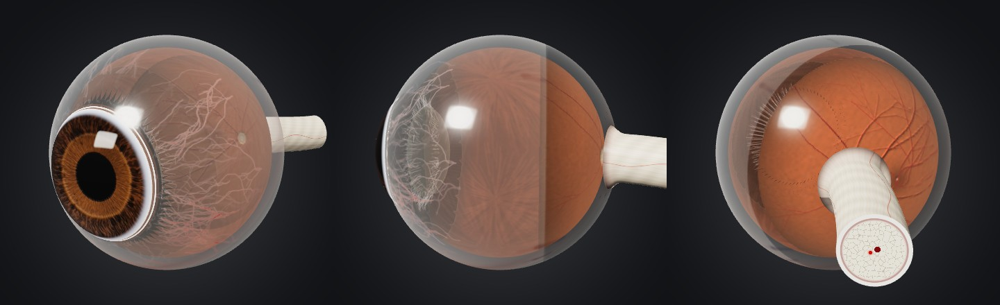

  *공막 투명도 80 — 앞, 옆, 뒤에서. 사진이 있는 망막은 진하게, 공막은 유리처럼*
* **3D 확대**: 막대의 **확대 바**를 끌면 화면 가운데를 중심으로, 휠을
  돌리면 **커서가 가리키는 곳으로** 다가갑니다(절개한 안구 안의 망막도 그 점이 커서 아래에 그대로 남음). 오른쪽 드래그도 확대, 가운데 버튼 또는
  Shift+드래그로 이동, `+`/`−`, `0`은 처음 보기, 더블클릭은 Simple로 가기입니다. 내부 모드에서는 커서 쪽으로 시선을 돌리며 시야를 4°까지 좁힙니다. 배율은 막대에 `배율 ×2.2`처럼
  표시됩니다.
* **외부 모드**: 공막·각막·홍채와 시신경을 그립니다. 시신경은 검출된(또는 2D 화면에서 우클릭으로
  지정한) 유두 뒤에 붙습니다. "앞쪽 절개"를 고르면 오른쪽 **깊이 막대**로 앞부분을 잘라 안쪽 망막을 봅니다.
  오른쪽 끝(100)으로 밀면 닫힌 안구가 됩니다. 깊이 막대가 **15 % 이상**이면 수정체 · 홍채 · 각막을 그리지 않아
  안쪽이 가리는 것 없이 보입니다. "세로 단면"은 [아래](#슬릿-스캔--세로-단면--망막-투시).
* **내부 모드**: 안구 안에서 망막을 바라봅니다. 드래그로 시선 이동, 휠로 시야를 넓히거나 좁힙니다.
* **각도 격자**: 후극에서 10°마다 링을 그립니다(30°마다 진하게).
* **사진이 있으면 안구 안쪽은 사진만 빼고 흰색**입니다 — 사진이 찍지 않은 망막과 앞쪽의 섬모체(잘린 면까지)를
  주황색 무늬로 지어 그리지 않고 무늬 없는 흰색으로, 불투명하게 그립니다. 사진 위에는 아무것도 겹치지 않아 사진은 제 색
  그대로입니다. 사진이 없는 안구 모형만 맥락막 무늬 · 주변부 혈관 · 톱니둘레 · 섬모체까지 그립니다. 45° 사진은 망막의
  작은 부분만, UWA 165° 사진은 대부분을 덮는 것이 정상입니다.
* "화각·투영 저장"을 누르면 그 영상의 매핑 값을 DB에 저장합니다.

### 황반과 시신경 유두를 실제 위치에

안구 모형이 기준입니다. 모형에서 **황반(중심와)은 안구 뒤쪽 한가운데(후극)**, **시신경 유두는 거기서 코쪽으로 21.5°
(망막 위 약 4.5 mm), 조금 위쪽**에 있습니다. 사진은 늘 황반이 가운데 오도록 찍히지 않으므로(유두 중심 촬영, 황반과 유두
사이를 중심에 두는 광각 장비, 주변부 촬영) 사진 중심을 무조건 후극에 붙이면 망막이 엉뚱한 곳에 놓입니다. 그래서 사진에서
황반과 유두를 찾아 **사진을 제자리로 돌려 얹습니다**.

| 사진에서 찾은 것 | 놓는 방법 |
|---|---|
| 황반 (+ 유두) | 황반을 후극에. 시신경은 사진의 유두 뒤에 붙습니다 |
| 유두만 (황반이 사진 밖) | 유두를 코쪽 제자리(21.5°, OD는 사진 오른쪽 · OS는 왼쪽)에 |
| 둘 다 없음 | 사진 중심을 후극에 (황반 중심 사진으로 봄) |

* **찾는 방법**: 유두는 가져올 때 찾고(혈관이 모이는 밝은 곳), 황반은 유두에서 귀쪽으로 약 4.5 mm, 조금 아래에 있는
  **혈관 없는 어두운 곳**의 중심입니다(중심와 반사 같은 작은 밝은 점은 지우고 찾습니다). 예전에 가져온 사진은 처음 열 때 찾습니다.
* **직접 지정**: 잘못 찾았거나 못 찾았으면 2D 사진에서 **오른쪽 클릭 → 여기를 황반으로 지정 / 시신경 유두로 지정**.
  보기 → 원·시신경 표시를 켜면 찾은 유두(노란 원)와 황반(하늘색 원)이 사진 위에 보입니다.
* **돌리는 방법**: 촬영 중 눈은 비틀림 없이 돌기 때문에(리스팅 법칙) 사진도 비틀지 않고 가장 짧게 돌립니다. 사진의 위쪽은
  그대로 위쪽이고, 기울기는 **회전**으로 따로 맞춥니다.
* **크기**: 사진이 망막을 얼마나 덮는지는 **화각**이 정합니다(45° 사진은 후극의 작은 부분, 176° 사진은 뒤쪽 대부분).
  설정 패널 아래에 사진에서 잰 **황반–유두 거리**(예: `21.2° · 4.4 mm`)가 나오는데, 보통 값(약 4.5 mm)과 20 % 넘게
  다르면 화각이 실제와 다를 수 있다고 알려 줍니다. 화각을 모르는 사진은 **황반–유두 거리로 크기 맞춤**을 누르면 이 거리가
  4.5 mm가 되도록 화각을 정합니다(사람마다 조금 다르므로 대략 맞춤).
* 사진 맞춤의 **실제 위치에 맞춤**을 끄면 사진 중심을 후극에 둡니다.
* 유두도 황반도 보이지 않는 주변부 사진은 위치를 알 수 없습니다. 같은 눈의 사진들과 **몽타주**로 합치면 겹치는 혈관으로
  서로의 위치가 정해지고, 합친 사진은 황반·유두로 다시 제자리에 놓입니다.

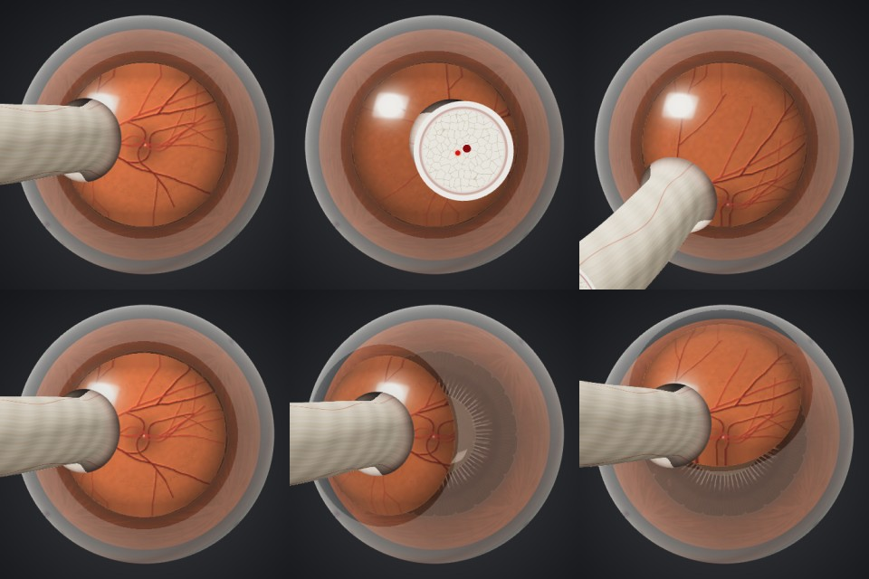

*45° 사진 세 장(황반 중심 · 코쪽 27° · 위쪽 24°)을 뒤에서 본 모습. 위: 사진 중심을 후극에 둔 경우 — 시신경이 엉뚱한 곳에
붙습니다. 아래: 실제 위치에 맞춤 — 망막이 찍힌 곳에 놓이고 시신경은 코쪽에*

### 부드러운 움직임과 3D 효과

스마트폰 화면처럼, 손을 떼도 움직임이 뚝 끊기지 않고 이어지다가 멎습니다.

| 어디서 | 움직임 |
|---|---|
| 3D 안구 | 돌리다 놓으면 **관성**으로 더 돌다가 멎음 · 휠 확대가 **미끄러지듯** 이어짐 · 정면 보기 / 시점 초기화 / 더블클릭이 **부드럽게 이동** |
| 2D 사진 | 휠 확대가 커서 아래 지점을 붙든 채 미끄러짐 · 끌다 놓으면 **관성으로 더 밀림**(가장자리에서 멈춤) · 화면 맞춤 / 100 % / 영역 확대가 부드럽게 · 다음 사진이 **겹쳐 넘어감** |
| 사진 목록 | 휠 스크롤이 미끄러지듯 |

움직임은 화면 주사율이 아니라 실제 흐른 시간으로 계산하므로 느린 PC에서도 속도가 같고, 화면을 누르면 진행 중이던
움직임은 그 자리에서 멈춥니다. **보기 → 부드러운 움직임**을 끄면 모든 전환이 바로 바뀝니다(원격 접속 등).

3D 안구의 효과(설정 패널의 **망막 입체 · 들어가며 보기 · 효과 · 표시** 묶음):

3D 안구는 처음에 **촬영한 원본 사진 그대로** 망막에 얹어 보여 줍니다. 혈관을 솟게 하거나 음영을 더하는 **망막 입체**
(표면 높낮이 · 입체 조명)는 **기본으로 꺼져** 있고, 필요할 때 설정 패널에서 켭니다(켜 둔 것은 다음에도 그대로).

* **망막 입체 → 표면 높낮이**(기본 꺼짐, 자세히): 사진이 얹힌 망막 표면을 실제로 올리고 내립니다 — 혈관은 솟고,
  시신경 유두 가운데의 함몰(cup)과 둘레의 테, 황반의 오목(fovea pit)은 파입니다(`fundusview/relief.py`: 혈관은 녹색
  채널의 가는 어두운 선, 함몰·오목은 찾은 유두·황반 자리). 촬영 범위 위에 촘촘한 망막 면을 따로 만들어 높낮이를
  주므로 안구를 돌리면 높낮이가 보입니다. **높이**로 얼마나 과장해서 보일지 정합니다.
* **입체 조명**(기본 꺼짐): 그 높낮이(표면 높낮이를 끄면 사진의 밝기)에 비스듬한 빛을 비춥니다. 혈관 가장자리에
  밝은 면과 그늘이 생겨 도드라져 보이고, 안구를 돌리면 빛이 따라 움직입니다.
* 안구 안쪽은 그림자 없이 고르게 밝습니다.
* **들어가며 보기 · 내부**: 안구 전체에서 각막 → 앞방 → 동공 → 수정체 → 유리체 → 망막까지 **어두워지지 않고**
  이어서 들어갑니다. 각막부터는 투명해져 동공으로 안쪽 망막이 보이고, 지나는 곳 이름이 안구 아래에 뜹니다.
  **▶ 들어가기**로 재생(다시 누르면 멈춤 · 끝에서 누르면 나오기), **위치** 막대로 원하는 곳에서 멈춥니다. 위 막대의
  `외부 | 내부`도 같은 길로 들어가고 나옵니다. (간단히 보기에서는 짧게 어두워졌다 바뀜)
* **전안부 선택**: 들어가며 보기를 재생하지 않고 **마우스 휠로** 직접 들어갑니다. [아래](#휠로-들어가기)
* **자동 회전**(기본 켜짐): 손을 떼고 있으면 천천히 돕니다. 만지면 멈췄다가 잠시 뒤 다시 돕니다(3D 화면에서만).

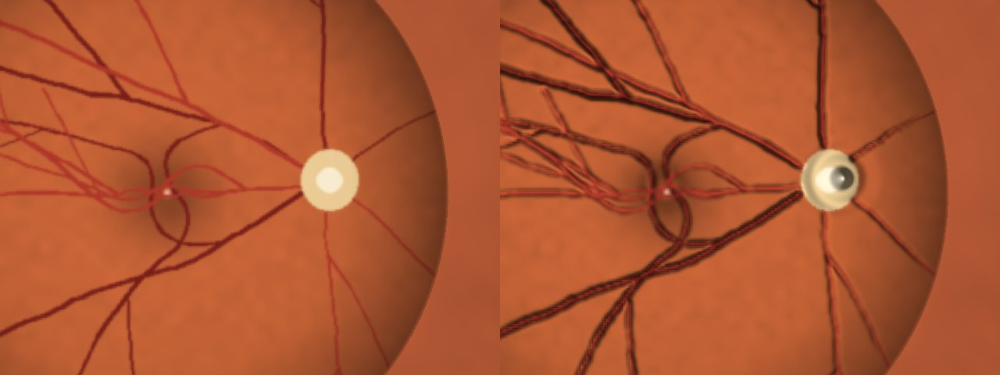

*망막 입체 — 표면 높낮이 끔(왼쪽) / 켬(오른쪽): 혈관이 솟고 시신경 유두 가운데가 파입니다*

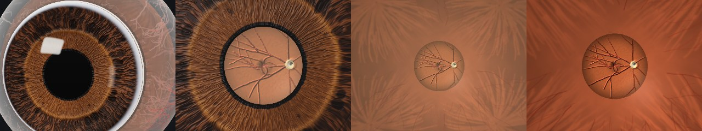

*들어가며 보기 — 각막 쪽으로 → 각막 앞(동공으로 망막이 보임) → 앞방 → 유리체*

**속도** — 실제 장비 크기(RetiCam 5736 × 4304, 약 2,400만 화소) 사진으로 잰 값입니다.

| 작업 | 시간 |
|---|---|
| 3D에 올릴 망막 영역 계산 | 0.06 s |
| 밝기·대비·감마 조정 한 번 | 0.01 s |
| 다음 사진으로 넘기기 | 0.07 s (이웃 사진을 미리 읽어 둠) |
| 3D 한 장 그리기, 그래픽카드 없는 PC · 자세히 | 43 ms (23장/초) |
| 3D 한 장 그리기, 그래픽카드 없는 PC · 간단히 | 19 ms (53장/초) |

한 장이 22 ms를 넘는 PC에서는 **움직이는 동안만** 작은 해상도와 성긴 모형으로 그렸다가 멈추면 바로 선명하게
다시 그립니다. 화면 저장은 항상 선명합니다.

### 휠로 들어가기

들어가며 보기와 같은 길(각막 → 앞방 → 동공 → 수정체 → 유리체 → 망막)을 **마우스 휠로** 원하는 만큼씩 들어가고 나옵니다.
3D 안구 위의 휠은 평소에는 확대 · 축소이고, **전안부 선택**을 켠 동안에만 들어가기 · 나오기가 됩니다.

1. **전안부 선택**: 설정 패널(막대의 **설정**)의 **들어가며 보기 → 전안부 선택**을 누릅니다. 전안부 둘레에 하늘색 고리가 생기고,
   안구 아래에 "전안부 선택 — 휠을 앞으로 돌리면 각막부터 망막까지 들어갑니다"가 뜹니다. 선택한 동안에는 자동 회전이 멈춥니다.
2. **휠**: 앞으로 돌리면 들어가고 뒤로 돌리면 나옵니다(한 칸에 길의 4 %, 25칸이면 망막). 첫 몇 칸에 안구가 닫히며
   각막이 정면으로 오고, 그다음 각막 → 앞방 → 동공 → 수정체 → 유리체를 지나 **망막(내부 시점)**에 닿습니다. 지나는 곳
   이름이 안구 아래에 뜨고, 위치 막대와 `외부 | 내부`도 함께 움직입니다. 오른쪽 드래그(위·아래)와 `+` `−`도 같습니다.
3. **망막에서**: 망막에 닿으면 그 휠은 거기서 멈춥니다. 다음 휠부터는 **커서 쪽으로 더 가까이**(내부 시점의 확대),
   뒤로 돌리면 먼저 전체 시야로 넓어진 다음 다시 나옵니다.
4. **왼쪽 드래그 = 둘러보기**: 들어가는 중에는 그 자리에서 고개를 돌리듯 위·아래·옆을 봅니다(앞방에서 홍채와
   전방각, 유리체에서 망막의 다른 곳). 놓으면 관성으로 조금 더 돕니다. 화살표 키도 같습니다.
5. **왼쪽 클릭 = 그곳으로**: 들어가는 중에 누른 곳이 화면 가운데로 부드럽게 옵니다(망막에서 보고 싶은 곳을 누르고 휠로
   다가가기).
6. **끝내기**: 휠을 끝까지 뒤로 돌리면 처음 보던 안구(앞쪽 절개 그대로)로 돌아옵니다 — 둘러본 방향도 처음으로.
   **Esc**, **전안부 선택**을 다시 누르기, 더블클릭 · 처음 시점 · 정면 · 안구 열기 · 슬릿 스캔
   · `외부`로 나가기로 선택이 풀리고 휠은 다시 확대 · 축소가 됩니다. 간단히 보기에서
   선택하면 자세히로 그립니다(설정은 그대로).

고리는 화면에만 보이고 **화면 저장**에는 들어가지 않습니다. [3D 안구 미리보기](#3d-안구-미리보기-웹-페이지) 웹
페이지에도 같은 기능이 있습니다.


*휠로 들어가기 — 전안부 선택(고리) → 휠: 안구가 닫히며 각막이 정면으로 → 앞방에서 왼쪽 드래그로 둘러보기 → 망막*

### 슬릿 스캔 · 세로 단면 · 망막 투시

| 단면에 화각 표시 | 슬릿 스캔 중 (창 전체) |
|---|---|
|  |  |
| **끝 화면 — 사진을 입힌 3D 안구** | |
|  | |

* **세로 단면**: 사진의 세로 자오선(사진의 위·아래 방향)을 따라 안구를 잘라 옆에서 봅니다. 잘린 면은 실제
  해부 구조대로 공막(흰색) → 맥락막 → 망막 층, 톱니둘레 앞의 섬모체, 홍채, 투명한 수정체(노란 핵),
  각막을 그리고, 남은 반쪽의 망막에는 사진이 입혀져 있습니다. 시신경 유두가 있는 쪽이 남으므로 우안은
  각막이 오른쪽, 좌안은 왼쪽을 향합니다(귀쪽에서 본 모습). 슬라이더 왼쪽 끝(0)은 정확히 반(광축을
  지나는 면), 오른쪽으로 갈수록 덜 잘리고 100은 닫힌 안구입니다. 앞쪽 절개와 세로 단면은 각자 깊이를
  기억합니다.
* **화각 표시**: 세로 단면에서는 안구 중심에서 촬영 범위 양 끝까지 두 선과 각도(예: **176°**, 안구 중심각)를,
  다른 보기에서는 망막 위 촬영 범위의 경계를 하늘색으로 그립니다. 몽타주는 그 단면에서 사진이 실제로 덮은 곳까지를
  대략(`약 220°`) 보이고, 경계 원은 그리지 않습니다.
* **망막 투시**: 공막·맥락막을 투명하게 해 사진을 입힌 망막을 안구 바깥에서도 봅니다(바깥에서 보므로 좌우가
  뒤집혀 보이는 것이 맞습니다). 망막이 없는 톱니둘레 앞은 흰 공막·각막·홍채 그대로입니다.
  앞쪽 절개·세로 단면 어느 쪽과도 함께 씁니다.
* **사진 나란히**: 3D 안구 오른쪽에 사진을 평면으로 함께 보여 줍니다(검은 바탕). 촬영 원 밖은 검게 가리므로
  장비가 사진 구석에 찍는 이름·ID는 보이지 않습니다.
* **▶ 슬릿 스캔** (약 12초, 사진 나란히로 바뀌고 실제 해부 모형인 **자세히**로 그림). 방향은 설정 패널의
  **슬릿 스캔** 묶음에서 고릅니다: **↓ 위에서 아래로 · ↑ 아래에서 위로**(세로 단면을 옆에서), **→ 왼쪽에서 오른쪽으로 ·
  ← 오른쪽에서 왼쪽으로**(앞을 연 안구를 정면에서, 슬릿이 망막 위를 지나감), **상하좌우**(네 방향을 차례로 —
  위아래 다음 단면이 닫히며 앞이 열림). 위아래의 경우:
  1. 안구가 옆으로 돌며 세로로 반이 잘립니다.
  2. 안구 중심에서 화각 선이 열리고 각도가 나타납니다.
  3. 슬릿(주황 선)이 사진을 위에서 아래로(또는 아래에서 위로) 훑습니다. 훑기 전 부분은 어둡고, 단면에서는 슬릿 빛이
     동공을 지나 사진의 그 줄이 닿는 망막 위치로 갑니다(같은 투영식 사용). 망막 위에는 그 줄이 곡선으로 빛납니다.
  4. 자르는 면이 바깥으로 물러나 황반·시신경 유두가 보이고, 망막 투시가 켜지며, 앞에서 비스듬히 본
     3D 안구(흰 공막·홍채·각막과 안쪽 망막의 사진)로 돌아갑니다.
  5. 그 뒤로 천천히 돕니다. 안구를 누르거나 돌리면(휠·키 포함) 언제든 멈추고 그 자리에서 직접 조작합니다.
* **크게 보기**: 3D 안구와 사진을 화면 전체로 보여 줍니다(환자 설명용). Space = 슬릿 스캔, Esc = 돌아가기(전안부 선택 중이면 첫 Esc는 선택만 풉니다).
* **화면 저장…**은 사진 나란히일 때 안구와 사진을 화면 그대로 한 장으로, 화각 선·각도도 함께 저장합니다.

### 해부학적 묘사

치수는 성인 평균(`fundusview/ui/eye_model.py`, 1 = 12 mm)이고, 질감은 처음 실행할 때 한 번 만들어
설정 폴더의 `cache\`에 저장합니다(다음부터는 바로 열림).

* **공막**: 젖은 표면의 광택, 결막 혈관(검열 부위에 많음)과 윤부 혈관 고리, 곧은근 부착부에서
  나오는 앞섬모체동맥, 깊은 공막위 혈관, 적도 뒤의 소용돌이정맥 4개, 시신경 둘레의 짧은뒤섬모체동맥.
* **각막**: 화소마다 광선을 추적합니다. 앞면 반사(프레넬)로 조명 상자가 비치는 반사광, 굴절(n 1.336)로
  보는 각도에 따라 확대·이동해 보이는 홍채, 동공 안 수정체 앞면의 희미한 반사(푸르키녜 Ⅲ상),
  **동공으로는 그 뒤의 망막(사진)이 보입니다** — 정면에서는 황반,
  공막이 덮이는 윤부 경계.
* **홍채**(갈색): 방사상 섬유주, 동공 주름(ruff), 지그재그 홍채주름(collarette), 푹스 움(crypt),
  수축 고랑, 주근깨. 높낮이를 음영으로 표현합니다.
* **안구벽 두께**: 절개면에 공막 → 맥락막상강 → 맥락막(혈관 단면) → RPE → 망막층(시세포·핵층·망상층·
  신경섬유층)이 보이고, 톱니둘레 앞에서는 섬모체 단면이 됩니다.
* **안쪽**: 톱니 모양 톱니둘레(ora serrata), 섬모체 평면부, 섬모체 돌기 72개, 섬모소대, 수정체
  (단면에서 노란 핵·피질층·피막), 홍채 뒷면, 전방각(섬모체띠·공막돌기·섬유주·슈발베선).
  안쪽은 그림자 없이 고르게 비춥니다. 절개 슬라이더 70 전후가 섬모체·수정체,
  81~83이 홍채 단면, 88 이상이 각막만 뗀 상태입니다.
* **시신경**: 경막 싸개가 공막과 이어지고, 잘린 끝에 신경 다발·경막·거미막밑공간과 중심망막동맥·정맥이
  보입니다.
* **외안근**(선택): 네 곧은근(틸로 나선 거리대로 부착, 흰 힘줄 → 붉은 근육)과 두 빗근의 절단 부위.

3D는 OpenGL 2.1이 필요합니다. 그래픽 드라이버가 오래된 PC에서는 **설정 → 일반 → 3D 렌더링 →
소프트웨어 렌더링**을 고르고 다시 시작합니다(PySide6에 포함된 Mesa `opengl32sw.dll` 사용). 이때 3D 그리기
명령(PyOpenGL)도 Windows의 `opengl32.dll`이 아니라 그 `opengl32sw.dll`로 보냅니다(`ui/glbind.py`).

## 3D 안구 미리보기 (웹 페이지)

`web3d/eye3d.html`은 프로그램의 3D 안구를 웹 페이지 한 장에 담은 것입니다. 3D 기능을 설치 없이 빨리 확인하고,
확인(컨펌)된 것만 프로그램에 넣기 위한 시제품입니다.

* **프로그램과 같은 그림**: 프로그램의 셰이더(`fundusview/ui/eye3d.py`), 안구 모형의 치수·윤곽·질감
  (`eye_model.py`), 사진을 안구에 얹는 계산(`projection.py`·`placement.py`), 황반·유두 찾기(`imaging.py`)를
  그대로 옮겼습니다. 셰이더·모형·질감·데모 사진은 `web3d/build.py`가 프로그램에서 직접 꺼내 넣습니다.
* **되는 것**: 프로그램의 3D 안구와 같습니다 — 외부/내부와 **들어가며 보기**(**휠로 들어가기** 포함), 앞쪽 절개·세로 단면과 깊이, 공막
  투명도, 망막 투시, **망막 입체**(표면 높낮이 · 높이 · 입체 조명), 자동 회전, 화각 표시, 사진 나란히, **▶ 슬릿 스캔**
  (↓ ↑ → ← · 상하좌우), 크게 보기, 시신경·외안근·각도 격자, 실제 위치에 맞춤(황반 → 후극,
  유두 → 코쪽)과 황반–유두 거리, 화각·투영·회전, 황반–유두 거리로 크기 맞춤. 관성 회전, 커서 쪽 확대, 두 손가락
  확대(터치).
* **사진**: 데모 사진 6장(RetiCam 176°, 45° 황반 중심·코쪽·위쪽, 30° 유두 중심, APOLLO 135°)과 **내 사진 열기**
  (끌어다 놓기도 됨). 내 사진은 브라우저 안에서만 쓰이고 어디에도 올라가지 않습니다. **황반·유두 자동으로 찾기**가
  기본으로 켜져 있어, 사진을 열면 브라우저 안에서 프로그램과 같은 방법으로 시신경 유두와 황반을 찾아 안구의 제자리에
  맞춥니다(데모 사진도 매번 찾음, 눈을 정하지 않으면 황반이 있는 쪽으로 우안·좌안도 정함). 찾은 곳은 사진 아래에
  "자동으로 찾음 / 직접 지정"으로 표시되고, 틀렸을 때만 **황반 지정 / 유두 지정**으로 고치며 **다시 찾기**로 되돌립니다.
* **새 기능을 먼저 해 보는 곳**: 셰이더는 프로그램의 것(`fundusview/ui/eye3d.py`)을 그대로 쓰고, 페이지에서만 시험할
  줄은 `web3d/build.py`의 `WEB_PATCHES`에 넣었다가 확인되면 프로그램으로 옮깁니다.
* **없는 것**: 2D 화면·측정·환자 목록(3D만 담았습니다).

다시 만들기: `python web3d/build.py` → `web3d/eye3d.html`. 페이지의 동작은 `web3d/app.js`, 모양은 `web3d/app.css`,
틀은 `web3d/page.html`입니다.

## 구조

```
fundusview/
  app.py            진입점 (OpenGL 모드, 테마, --demo / --home)
  config.py         설정 JSON (%APPDATA%\FundusViewer\settings.json)
  db.py             SQLite: patients / images / seen_files / import_log / orders(워크리스트에서 연 검사)
  profiles.py       카메라 프로필 (RetiCam, APOLLO, VK-2, VK-2 ID 폴더, 일반)
  extract/          메타데이터 추출 (dicom / reticam / apollo / embedded+sidecar / filename / normalize)
  importer.py       안정화 대기 → 중복 검사 → 추출 → 분석 → 라이브러리 저장 → DB
  watcher.py        watchdog 감시(또는 폴링) + 재검사 + 가져오기 작업 스레드
  imaging.py        영상 읽기(DICOM 포함), 촬영 원·시신경 검출, 표시 조정(LUT)
  projection.py     안구 기하 (θ↔영상 반경, 내부각↔외부각) — 셰이더와 동일한 식
  placement.py      사진이 안구의 어디에 놓이는지: 황반 → 후극, 유두 → 코쪽 제자리 (비틀림 없는 회전), 황반–유두 거리
  demo.py           합성 안저 사진 + 장비별 형식 데모 폴더
  measure.py        측정 (화소 → 망막 각도·mm, 각도, 면적)
  discpair.py       디스크 2장: 유두 지름 기준 자르기, OD/OS 배치
  disc3d.py         유두 3D: 한 장의 밝기 / 두 장의 시차에서 높낮이, 돌려 본 표면 그리기 (OpenGL 없이)
  glaucoma.py       녹내장 분석: 두 사진 맞춤 · 스테레오(적청 · 시차 지도) · C/D · 림 두께 · Garway-Heath 구역 ·
                    24-2 격자 · 변화 지도
  timeline.py       시간별 비교: 같은 눈의 유두 사진 고르기 · 기준 사진에 맞춤 · 시간순 한 장 · 시간 슬라이더 섞기
  calibrate.py      카메라 각도 보정: 여러 사진의 황반–유두 거리(중앙값)에서 광각 카메라의 렌즈 곡선
  montage.py        몽타주: 사진별 구면 회전, 혈관 특징점 자동 맞춤(RANSAC · 화각 보정), 기준점, 밝기 맞춤,
                    두 대역 섞기, 등거리 지도
  autosetup.py      자동 가져오기: 가져오기 폴더 + 장비 폴더(RetiCam·APOLLO) 찾기
  share.py          여러 컴퓨터에서 함께 쓰기: 서버(HTTP) · 서버에 연결한 뷰어의 데이터베이스 · 사진 캐시
  share_page.py     서버가 웹 브라우저에 주는 화면 (환자 목록 · 사진 · 메모)
  dicomnet.py       DICOM 통신: PACS 전송(C-STORE) · 워크리스트(MWL C-FIND) · 연결 시험(C-ECHO), JPEG/PNG → DICOM 영상
  review.py         검토: 검사(검사일) 묶기, 눈마다 보여 줄 사진 고르기, 이전 검사 순서
  samples.py        질환 샘플: 질환별 샘플 사진 보관 (라이브러리 폴더의 질환 샘플\, 설명 · 순서 · 출처는 index.json),
                    프로그램 기본 샘플 넣기 · 되살리기 (sample_photos/: 사진 · samples.json · CREDITS.md)
  diseases.py       질환 설명: 질환마다 설명 · 증상 · 치료 · 단계별 글과 그림 만드는 법 (안저 · 단면 · 보이는 모습)
  disease_art.py    질환 설명 그림의 붓: 모식 안저(혈관 · 유두 · 출혈 · 삼출물 · 드루젠 …), 망막 단면, 보이는 모습 · 암슬러 격자
                    (diseases.MECHANISMS: 질환마다 기전 단계 — 그림은 ui/mechanism_view)
  ui/               main_window, patient_list(환자 목록 창 — 처음에 뜨는 따로 된 창), toolbars(VK-2 명령·영상 처리 툴바), icons, eye3d(OpenGL 셰이더),
                    eye_model(안구 해부 치수·메시·절차적 질감), slit_scan(사진 나란히·슬릿 스캔 연출),
                    motion(관성 · 미끄러지는 확대 · 전환 애니메이션),
                    theme(어두운 화면: 색 · 글꼴 · 창 틀) + style.qss, widgets(스위치 · 나란한 단추 · 카드 · 접히는 도구 줄),
                    image_view(도구·사진 위 글자·황반/유두 표시),
                    multi_view(Simple · Multi 칸 · ◀ ▶ · 황반 · 디스크), pair3d(여러 장 3D · 깊이 막대),
                    sample_compare(질환 샘플과 비교 창), disease_view(환자 설명 그림: 한 장으로 그리기 · 단계 · 저장),
                    mechanism_view(기전 그림: 혈관 · 안구 · 시신경 · 망막 단면 · 시세포 그림과 단계 카드),
                    disc_pair(디스크 2장 미리 보기·저장·인쇄),
                    glaucoma_dialog(녹내장 분석 창: 디스크 C/D · 3D 입체 · 광각 · 스테레오 · 경과),
                    timeline_tab(녹내장 분석 → 시간별 비교 탭),
                    montage_dialog(몽타주 편집기: 반투명 겹치기·기준점·완성·3D), histogram, dialogs,
                    import_dialog(사진 가져오기 → 환자 정보 확인 창), dicom_dialogs(워크리스트 창 · DICOM 전송 창)
tests/              pytest (추출·투영·영상·가져오기·감시·GUI·디자인·3D 안구 모델·OpenGL 렌더링·웹 미리보기,
                    test_import_review: 가져오기 확인 창 · 환자 지정, test_import_stress: 극한 테스트 —
                    손상 파일 · 무작위 이름 · 대량 · 여러 스레드 · 환자 수천 명, test_dicomnet · test_dicom_gui:
                    시험용 PACS · 워크리스트 서버를 띄워 전송 · 조회)
web3d/              3D 안구 미리보기 웹 페이지 (build.py → eye3d.html)
fundus_viewer.spec  PyInstaller (Windows exe · Mac .app), build_windows.bat · build_mac.sh
macos_bundle.py     Mac 앱의 최소 macOS: 앱에 든 라이브러리(Mach-O)에서 읽어 Info.plist에 쓰고 빌드 뒤 확인
tools/eval_landmarks.py  유두 · 황반 찾기의 정확도 재기 (전문가가 표시한 공개 사진 IDRiD — 방법과 수치: docs/landmarks.md)
```

라이브러리 폴더(기본: `문서\FundusViewerLibrary`)에는 `fundus.db`, `images\<환자ID>\<검사일>\`
사본, `thumbs\`, `display\`(DICOM을 PNG로 바꾼 사본)가 들어갑니다. 처리 방식은 폴더마다
**복사**(기본, 원본 유지) / 이동 / 원본 위치 참조 중에서 고릅니다. 장비 공유 폴더는 반드시 복사나
참조로 두세요.

## 테스트

```bash
QT_QPA_PLATFORM=offscreen python -m pytest -q tests
```

`offscreen`에는 OpenGL이 없어서 3D 렌더링 테스트(`tests/test_eye3d_gl.py`)는 건너뜁니다. 리눅스에서는
Xvfb와 Mesa로 셰이더 컴파일까지 확인할 수 있습니다(CI도 이렇게 돌립니다).

```bash
FUNDUSVIEW_REQUIRE_GL=1 QT_QPA_PLATFORM=xcb xvfb-run -a python -m pytest -q tests/test_eye3d_gl.py
```

## 알려진 한계와 다음 단계

* **RetiCam 투영 보정의 기본값은 잠정값**입니다. 근거는 몽타주 샘플 한 장의 측정과 해부학적 유두 위치뿐입니다.
  **설정 → 카메라 각도 보정**으로 쌓인 사진에서 중심부의 각도는 다시 맞출 수 있지만, 가장자리가 정말 176°인지는
  그대로 남습니다. 보정을 확정하려면 둘 중 하나가 필요합니다.
  * SYSEYE에서 투영·왜곡 자료나 DICOM 적합성 문서를 받기
  * 격자 시험판을 찍은 사진으로 맞추기
  그때까지 3D 화면에서 투영을 "등거리"로 바꿔 비교할 수 있고, 영상별 "화각·투영 저장"도 됩니다.
  주변부 고정 촬영(fixation) 사진의 회전 정보는 아직 쓰지 않습니다(사진에서 찾은 황반·유두로 위치를 정합니다).
* **VK-2 원본 DB 연동**: `vk3x.mde`(Access) 스키마가 문서화되어 있지 않아, 원본 저장소
  사진의 환자 연결은 아직 하지 않습니다. 샘플 `.mde`로 테이블 구조를 확인한 뒤 읽기 전용
  커넥터를 추가할 수 있습니다. VK-2 전용 무손실 형식 `.dlt`는 읽지 못합니다.
* **APOLLO 단일 모드 파일**(IR / RF / FFA / AF / ICGA+FFA)의 JSON에는 환자 경로가 없습니다. 이런
  파일은 `PatientCapture\<ID>_<이름>` 폴더 구조에서 환자를 찾습니다. ICGA 단독의 `ImgType` 값은 아직
  확인하지 못했습니다. PNG 내보내기의 바이너리 헤더는 SKY 샘플 하나로만 확인했습니다.
* 3D 매핑은 1차 광학 모델입니다(카메라 왜곡과 안축장 차이는 반영하지 않음). 측정·진단용이 아닌
  시각화 용도입니다.
* 이 뷰어는 의료기기 인증을 받은 소프트웨어가 아닙니다. DB에는 환자 이름이 저장되므로 PC 접근
  권한을 관리하세요.
