# 안저 사진 뷰어 (Fundus Viewer)

Windows 10 / 11 · macOS 14 (Sonoma) 이상용 안저카메라 전용 뷰어입니다. **감시 폴더에 사진 파일이 떨어지면** 파일에서
환자 ID·이름 등 환자 정보를 추출해 뷰어 데이터베이스로 가져오고, 2D로 보거나 **광각 사진을
실제 안구처럼 입체(3D) 모델**로 돌려 볼 수 있습니다.

우선 회사 초광각 모델 **SYSEYE RetiCam 3100 Plus (1회 176° · 몽타주 220°)** 에 맞춰
만들었고, **Microclear APOLLO (WA 135° / UWA 165°)**, **Kowa VK-2 / VK-2s** (nonmyd·VX
시리즈) 출력과 일반 안저카메라 파일도 읽습니다.

| Detail (큰 사진 · 황반 · 시신경 유두) | 3D 안구 — 간단히 |
|---|---|
|  |  |
| **3D 안구 — 자세히 (절개 보기)** | **3D 안구 — 자세히 (닫힌 안구)** |
| 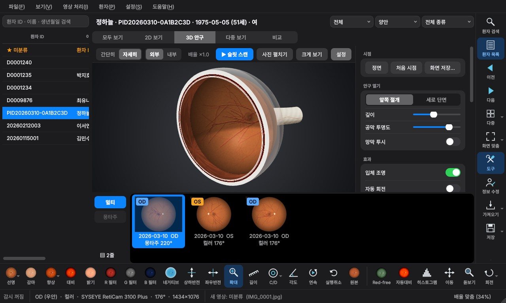 |  |
| **3D 안구 — 내부(망막 시점)** | **2D — 후극부 확대와 미니맵** |
| 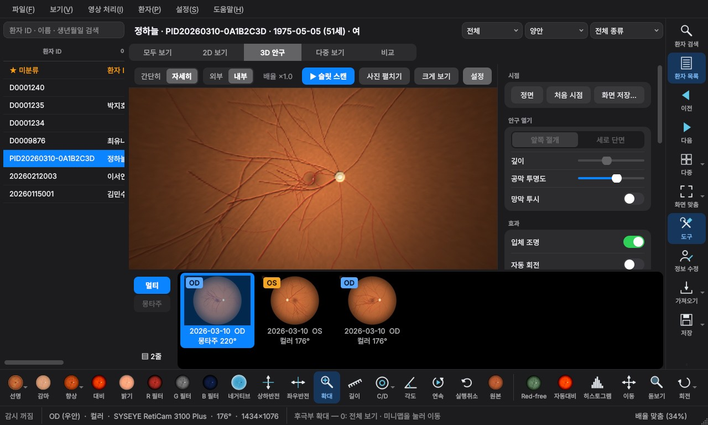 |  |

**슬릿 스캔** — 안구를 옆에서 반으로 자른 단면에 화각(안구 중심각)을 보이고, 슬릿이 사진을 위에서 아래로
(또는 아래에서 위로) 훑는 동안 빛이 동공을 지나 같은 망막 위치에 닿는 모습을 보여 준 뒤, 사진을 입힌 3D 안구로
돌아갑니다. 좌우 방향은 앞을 연 안구의 망막 위로, **상하좌우**는 네 방향을 차례로 보여 줍니다
([아래](#슬릿-스캔--세로-단면--망막-투시)).

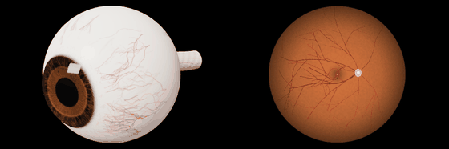

**자세히** 보기는 실제 해부 구조대로 그립니다.

| 각막·홍채 (굴절·반사광) | 앞쪽 절개 70 — 섬모체 돌기·소대·수정체 |
|---|---|
| 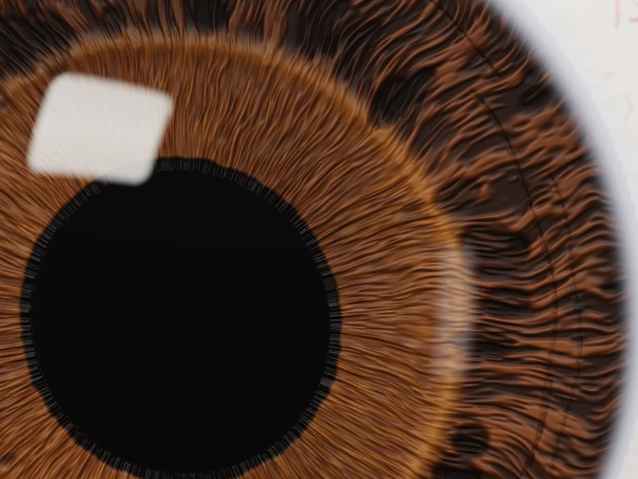 | 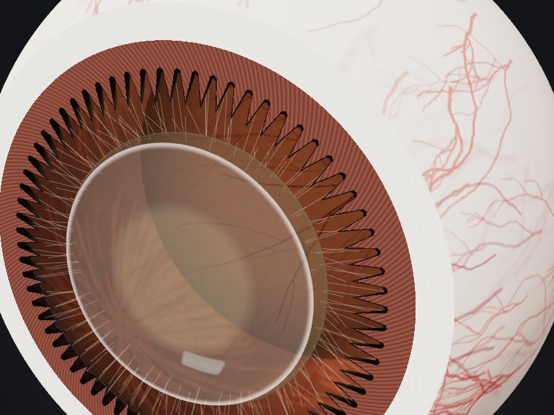 |
| **안구벽 단면 — 공막·맥락막·RPE·망막층** | **외안근 부착부와 시신경** |
|  | 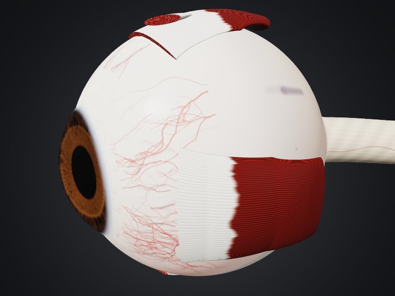 |

> 화면의 사진과 환자는 모두 `fundusview/demo.py`가 만든 **합성(가상) 데이터**입니다.

## 빠른 시작

```bat
pip install -r requirements.txt
python run_viewer.py --demo
```

`--demo`는 빈 라이브러리에 가상 환자 사진(RetiCam·APOLLO·VK-2·DICOM 형식)을 넣어 바로 써 볼
수 있게 합니다. `--home D:\FundusViewer`를 주면 설정과 라이브러리를 그 폴더 하나에 둡니다(휴대용).

**내려받기 (Windows 10 / 11):**
https://github.com/kukje1980/Image-capture/releases/download/fundus-viewer-latest/FundusViewer-windows.zip
— 로그인 없이 받아지며 항상 최신 빌드입니다. 압축을 풀고 `FundusViewer\FundusViewer.exe`를 실행합니다
("Windows의 PC 보호" 창이 뜨면 **추가 정보 → 실행**).

**내려받기 (Mac — Apple Silicon M1 · M2 · M3 · M4 …):**
https://github.com/kukje1980/Image-capture/releases/download/fundus-viewer-latest/FundusViewer-mac-AppleSilicon.dmg
— Intel Mac용은 만들지 않습니다(내 Mac의 칩과 macOS 버전은 화면 왼쪽 위  메뉴 → **이 Mac에 관하여**에 나옵니다). **macOS 14.4 (Sonoma) 이상**이
필요합니다 — 함께 들어가는 Qt 6.12가 그 버전용으로 만들어져 있어, 더 낮은 macOS에서는 "이 버전의 macOS에서는
사용할 수 없습니다"라고 나옵니다(정확한 버전은 내려받기 페이지의 표에 빌드마다 나옵니다). dmg를 열어
FundusViewer를 응용 프로그램 폴더로 끌어다 놓습니다. 애플 개발자 인증서 없이 임시(ad-hoc) 서명만 한 앱이라
처음 열 때 경고가 나옵니다: macOS 15 이상은 한 번 열어 경고를 닫은 뒤 **시스템 설정 → 개인정보 보호 및 보안 →
아래쪽 "그래도 열기"**, 14는 앱을 **Control+클릭 → 열기**. Mac에서는 Ctrl 대신 ⌘(⌘+클릭 = 두 번째 사진,
⌘1 · ⌘2 · ⌘3 = 보기), 트랙패드 두 손가락 스크롤·벌리기/오므리기로 확대·축소하고, 메뉴는 화면 맨 위 메뉴 막대에
있습니다. 설정은 `~/Library/Application Support/FundusViewer`, 라이브러리는 `문서/FundusViewerLibrary`에 둡니다.
장비 폴더는 홈 폴더와 연결된 볼륨(`/Volumes`의 USB 디스크·NAS)에서 찾고, 네트워크 공유(SMB·AFP·NFS)의 폴더는
폴링으로 감시합니다.

**직접 빌드:** Windows는 `build_windows.bat` 실행 → `dist\FundusViewer\FundusViewer.exe` (폴더째 복사해
사용). Mac은 `./build_mac.sh` → `dist/FundusViewer.app`과 `dist/FundusViewer-mac-<AppleSilicon|Intel>.dmg`
(빌드하는 Mac의 칩용 — 배포하는 것은 Apple Silicon용뿐). 앱의 최소 macOS(Info.plist `LSMinimumSystemVersion`)는 `macos_bundle.py`가 앱에 들어간
라이브러리에서 읽어 정합니다(PySide6·shiboken6의 바인딩 모듈은 PyPI 빌드 기계의 macOS가 적혀 있을 뿐이라 빼고 셉니다).
GitHub Actions(`fundus-viewer` 워크플로)가 커밋마다 Linux에서 시험(3D 안구 OpenGL 렌더링 포함)하고 Windows exe와
Mac 앱(Apple Silicon)을 빌드·시험하며, 기본 브랜치(`fundus-viewer`)의 빌드만 위 주소(릴리스
`fundus-viewer-latest`)에 올립니다(다른 브랜치·PR은 빌드·시험만). Mac 빌드는 전체 시험 뒤 번들 앱을 데모 사진으로
실제 실행해 보고, 3D 안구를 macOS OpenGL로 렌더링하는 시험도 거칩니다(macOS 15 러너 — GitHub에 macOS 14 러너는 이제
없습니다).

**3D 안구 미리보기 (웹 페이지):** `web3d/eye3d.html` 하나를 브라우저(Chrome·Edge·Safari·Firefox)로 열면 프로그램의
3D 안구를 설치 없이 돌려 볼 수 있습니다. 새 3D 기능은 여기서 먼저 확인한 뒤 프로그램에 넣습니다. 자세한 내용은
[아래](#3d-안구-미리보기-웹-페이지).

## 사용 흐름

사진 가져오기는 **설정 없이 자동**입니다. 프로그램을 켜면:

* **가져오기 폴더** `문서\안저사진 가져오기`를 만들고 감시합니다. 여기에 넣은 사진은 라이브러리로
  **옮겨지므로** 폴더가 비면 모두 들어간 것입니다.
  다른 폴더(예: 바탕화면이나 USB·NAS의 폴더)를 쓰려면 **설정 → 일반 → 가져오기 폴더**에서 고릅니다.
  **확인**을 누르면 다시 시작하지 않아도 바로 새 폴더를 감시하고, 예전 폴더는 감시 목록에서 빠집니다
  (나중에 다시 그 폴더로 바꿔도 됩니다). 라이브러리 폴더 안은 고를 수 없습니다.
* 모든 드라이브(네트워크 드라이브 포함)에서 촬영 프로그램 폴더를 찾아 알맞은 카메라 프로필로
  감시 목록에 넣습니다. 장비 폴더는 **복사**만 하고(원본 유지), 네트워크 드라이브는 폴링합니다.

  | 장비 | 찾는 폴더 |
  |---|---|
  | SYSEYE RetiCam 3100 Plus | `X:\reticam`, `X:\RetiCam`, `X:\레티캠`, `X:\SYSEYE` |
  | Microclear APOLLO | `X:\MicroClearClient\ImageData`, `X:\MC\Cro\PatientCapture`, `%USERPROFILE%\MicroClearClient\ImageData` |

* 감시가 바로 시작됩니다. 새 파일은 쓰기가 끝날 때까지 기다린 뒤 가져오고, 프로그램이 꺼져 있던
  동안 들어온 파일도 시작할 때 찾아냅니다.

다른 위치(예: 장비 PC의 공유 폴더 `\\<장비 IP>\D\reticam`)는 **설정 → 감시 폴더 → 폴더 추가**로
넣습니다. 설정에서 지운 폴더는 다시 자동으로 추가되지 않으며, **설정 → 일반**에서 자동 찾기를 끄거나
**지금 장비 폴더 다시 찾기**를 누를 수 있습니다.

### 사진 가져오기 — 환자 정보 확인

**사진 가져오기**(환자 목록 창의 버튼 · `가져오기 ▾` 메뉴의 파일 / 폴더 · 창에 끌어다 놓기)로 직접 고른 사진은
가져오기 전에 **확인 창**이 먼저 뜹니다. 사진에서 읽은 환자 정보를 **환자별로 한 줄씩** 보여 줍니다.

| 열 | 내용 |
|---|---|
| 환자 ID · 이름 · 생년월일 · 성별 | 사진(DICOM · 장비 데이터 · 부속 파일 · 파일 / 폴더 이름)에서 읽은 값. **칸을 눌러 고칠 수 있습니다.** |
| 사진 · 검사일 · 파일 | 그 환자의 사진 수, 검사일, 들어 있던 폴더와 파일 이름 |
| 상태 | **새 환자로 등록됩니다** · **등록된 환자** · **이름이 다릅니다**(사진의 이름 ≠ 등록된 이름) · **환자 정보 없음** |

* **환자 정보가 없는 사진**(`IMG_0001.jpg` 같은 이름)은 폴더별로 한 줄로 모입니다. 환자 ID 칸에 번호를 적으면
  그 환자의 사진으로 들어가고(등록된 번호면 이름 · 생년월일 · 성별이 채워짐), 비워 두면 전처럼 **미분류**로 들어갑니다.
* 줄 끝의 **← 이름 (ID)** 를 누르면 한 번에 지정됩니다. 환자 목록에서 **선택해 둔 환자**, 또는 사진에서 이름만
  읽혔을 때 **그 이름으로 등록된 환자가 한 명뿐이면 그 환자**가 나옵니다.
* 이미 가져온 사진은 건너뜁니다. 다만 **미분류에 있는 사진을 다시 골라 환자를 지정하면** 사진을 새로 넣지 않고
  그 사진에 환자만 지정합니다. 읽을 수 없는 파일(손상 · 사진이 아닌 파일)은 아래에 따로 알려 줍니다.
* 직접 고른 사진은 **위쪽 폴더 이름도** 읽습니다: `…\12345_홍길동\2026-03-01\IMG_0001.jpg`, `홍길동(12345)` 폴더를
  통째로 고른 경우 등. 폴더 이름에서 읽은 환자는 상태에 **폴더 이름에서 읽음**이라고 나오니 확인하세요.
* **가져오기**를 누르면 그대로 가져옵니다. 감시 폴더로 들어오는 사진은 전처럼 창 없이 자동으로 들어옵니다.

0. 프로그램을 켜면 **환자 목록 창**이 먼저 뜹니다([아래](#환자-목록-창-vk-2-open-list)). 환자를 찾아 **두 번 누르면**
   (또는 Enter · **사진 보기**) 환자 목록 창이 닫히며 그 환자의 사진이 한 화면에 **16장** 나옵니다(**16장 보기**,
   [아래](#16장-보기--multi-vk-2-방식)). 사진을 클릭해 고르고 **[Multi]** 를 누르면 고른 사진만, 다시 누르면 16장으로
   돌아옵니다. **설정 → 일반 → 환자를 열면**에서 **Simple**을 고르면 최신 OD | OS 두 장이 나란히 열립니다. 환자 목록 창은
   명령 툴바의 **[환자 목록]** · 보기 → 환자 목록 · Ctrl+0 으로 다시 엽니다.
1. 새 사진이 들어오면 환자 목록 창이 떠 있더라도 그 환자와 사진이 바로 열립니다(파일 → 새 영상 자동 표시).
2. 작업 화면: **왼쪽 명령 툴바**에 보기를 고르는 **[Simple] · [Multi] · [Detail] · [3D]** 와 **[Montage] · [Glaucoma]** 가
   있고, 큰 사진 화면 아래에 사진 목록(위 줄 OD · 아래 줄 OS, 최신 사진부터 — 사진 위에 날짜, 줄 왼쪽에 **OD / OS**)이
   있습니다. 환자 이름 · ID는 **아래 상태 줄**에 나옵니다. **16장 보기**(처음 화면)에서 고른 사진을 **Multi**로 모아 보고,
   **Simple**은 누를 때마다 최신 OD | OS 두 장 — 사진 목록을 **클릭**하는 대로 더해져(번호) 고른 장수에 맞게 화면이
   나뉩니다(1장 · 2장 · 4칸 · 6칸 …). 어느 사진이든 **더블클릭**하면 **Detail**에서 크게 열리고, 사진 좌우 끝의 **◀ ▶** 나
   **← → 키**로 이전 / 다음 사진을 봅니다([아래](#보기-고르기--16장-보기--multi--simple--detail)). 두 번째 사진을 **Ctrl+클릭**(②)하고
   **[Glaucoma] ▾ 디스크 2장**을 누르면 두 사진의 시신경 유두만 확대한 한 장을 만듭니다([아래](#디스크-2장-보험-청구용)).
   같은 눈을 여러 방향으로 찍은 사진을 골라 **[Montage]** 를 누르면 한 장으로 합쳐 3D에서도 봅니다
   ([아래](#몽타주-여러-장을-한-장으로--3d)).
3. 환자 ID를 찾지 못한 사진은 **★ 미분류**로 들어갑니다. 사진을 고르고 오른쪽 **정보 수정** 버튼으로
   환자를 지정합니다. 잘못된 환자로 잘못 들어가는 것보다 미분류가 안전하므로 추측하지 않습니다.

창에 파일·폴더를 끌어다 놓아도 가져오며, 같은 내용의 파일(SHA-256)은 한 번만 들어갑니다.

## 여러 컴퓨터에서 함께 쓰기 (공유)

한 컴퓨터(**서버**)가 데이터베이스와 사진을 갖고, 다른 컴퓨터는 병원 안 네트워크로 그 자료를 함께 봅니다.
데이터베이스 파일을 여는 것은 서버 컴퓨터 한 대뿐이라, 여러 대가 동시에 써도 데이터베이스가 깨지지 않습니다
(라이브러리 폴더를 공유 폴더에 두고 여러 컴퓨터가 직접 여는 방식은 SQLite가 깨질 수 있어 쓰지 않습니다).

**1. 서버 컴퓨터** (보통 장비 PC나 사진이 모이는 PC): 설정 → **공유** → `서버 — 이 컴퓨터의 자료를 다른 컴퓨터와 함께 사용`
→ 확인. 상태 줄에 **● 공유 중 http://192.168.0.10:8765** 처럼 주소가 나오고, 마우스를 올리면 **접속 암호**가 보입니다
(암호를 비워 두면 여섯 자리 숫자로 자동으로 만듭니다). 처음 켤 때 Windows 방화벽이 물으면 **액세스 허용**을 누릅니다.
사진 자동 가져오기(감시 폴더)는 전처럼 이 컴퓨터가 합니다. 서버의 뷰어가 켜져 있는 동안 다른 컴퓨터가 접속할 수 있습니다.

**2. 다른 컴퓨터 — 뷰어로** (모든 기능): 같은 뷰어를 설치하고 설정 → **공유** → `서버에 연결`, **서버 주소**
(`192.168.0.10:8765`)와 **접속 암호**를 넣고 [연결 시험] → 확인 → 프로그램을 다시 시작. 상태 줄에 **● 서버 연결**이 나옵니다.

* 환자 목록 창 · Simple · Multi · Detail · 16장 보기 · 3D · 녹내장 분석 · 디스크 2장 · 몽타주가 서버의 자료로 그대로 동작합니다.
* **편집한 내용은 서버에 저장**됩니다: 환자 정보, 메모, 눈(OD/OS), 황반 · 유두 표시, 환자 합치기, 편집 영상 · 몽타주 ·
  디스크 2장 · 녹내장 분석 저장. 파일 가져오기(끌어다 놓기)로 넣은 사진도 [환자 정보 확인](#사진-가져오기--환자-정보-확인)을
  거쳐 확인한 환자로 서버에 보내 서버 라이브러리에 저장합니다.
* 다른 컴퓨터에서 바꾼 내용과 새로 찍힌 사진은 몇 초 안에 목록에 나타납니다.
* 사진은 처음 볼 때 한 번 받아 이 컴퓨터에 보관하므로(최대 4 GB, 오래 안 본 것부터 지움) 두 번째부터는 바로 열립니다.
* 서버가 꺼져 있으면 시작할 때 [다시 시도] / [이 컴퓨터의 자료로 열기] / [끝내기]를 묻습니다. 쓰는 중에 연결이 끊기면
  상태 줄에 알리고, 그동안 바꾼 내용은 저장되지 않습니다.

**3. 다른 컴퓨터 — 웹 브라우저로** (설치 없이, 태블릿 · 휴대폰도): 주소창에 `http://192.168.0.10:8765` 를 넣고 접속 암호로
들어갑니다. 환자 검색, 검사일별 사진, 큰 화면(휠 · 두 손가락 확대, 끌어서 이동), **환자 정보 수정**과 **사진 메모**가 됩니다.
3D · 몽타주 · 녹내장 분석 같은 도구는 뷰어 프로그램에 있습니다.

| | 뷰어로 연결 | 웹 브라우저 |
|---|---|---|
| 설치 | 뷰어 설치 | 없음 |
| 보기 · 검색 | ○ | ○ |
| 환자 정보 · 메모 수정 | ○ | ○ |
| 3D · 몽타주 · 녹내장 · 디스크 2장 · 영상 처리 | ○ | — |

**백업**은 서버 컴퓨터의 라이브러리 폴더(기본 `문서\FundusViewerLibrary`) 하나만 정기적으로 복사하면 됩니다.
창 없이 서버만 돌리려면 `FundusViewer.exe --serve` (또는 `python run_viewer.py --serve`)로 실행합니다.

> 접속은 암호 하나로 지키는 **병원 내부망용**(암호화하지 않은 HTTP)입니다. 인터넷에 직접 열지 마세요 — 병원 밖에서
> 쓰려면 VPN을 거치세요. 두 컴퓨터가 같은 항목을 동시에 고치면 나중에 저장한 값이 남습니다.

## 환자 목록 창 (VK-2 OPEN LIST)

| 환자 목록 창 — 환자를 누르면 그 환자의 검사 목록 | 주 화면 — Simple: 최신 OD \| OS (환자를 열면 처음에는 16장 보기) |
|---|---|
|  |  |

프로그램을 켜면 먼저 뜨는 **따로 된 창**입니다. VK-2의 OPEN LIST(환자 ID 목록)처럼 모든 환자를 **환자 ID 순**으로
보여 주고, 환자 ID · 이름 · 날짜로 찾습니다. 전에는 처음 화면(환자 목록)과 작업 화면 왼쪽의 환자 창이 따로 있었는데,
이 창 하나로 합쳤습니다.

* **검색 조건**(위): **환자 ID** · **이름** · **생년월일**(`1958-03-12` · `19580312` · `1958` 어떻게 적어도 됨) — 적는 대로
  바로 찾고, Enter를 누르면 맞는 환자가 한 명일 때 그 환자가 골라집니다. **검사일**: 전체 / 오늘 / 최근 7일 /
  **기간**(시작일 ~ 끝일) — 그 기간에 촬영한 환자. **[지우기]** 로 조건을 모두 지웁니다.
* **환자 표**(창 너비 전체): 환자 ID · 이름 · 성별 · 생년월일 · 나이 · 최근 검사 · 검사 수 · 영상. 처음에는 환자 ID 순이고,
  **열 제목을 누르면 그 열로 정렬**, 한 번 더 누르면 반대로 정렬합니다(최근 검사 · 검사 수 · 영상은 처음 누르면 큰 것부터).
  환자 ID를 찾지 못한 사진이 있으면 맨 위에 **★ 미분류**가 나옵니다. 오른쪽 클릭: 사진 보기 · 3D · 정보 수정 · 환자 삭제.
* 그 아래 **검사 목록**: 검사일마다 한 줄(최신부터) — 눈(OD · OS), 사진 수, 촬영 종류별 장수(`컬러 3장 · Red-free 1장`).
  검사를 고르면 **[사진 보기]** · **[3D]** 가 그 검사의 사진을 엽니다. 사진이 아직 없는 환자는 그 자리에 사진 가져오는
  방법을 알려 줍니다.
* 오른쪽에 따로 된 환자 정보 칸은 없습니다(성별 · 생년월일 · 나이 · 최근 검사 · 검사 수 · 영상은 환자 표에 있음). 사진 썸네일도
  이 창에 없고, 사진은 주 화면에서 봅니다. **[정보 수정]** · **[환자 삭제]** 는 아래 단추 줄과 오른쪽 클릭 메뉴에 있습니다.
* 환자를 **한 번 누르면** 주 화면도 그 환자로 바뀝니다. **두 번 누르거나 Enter · [사진 보기]**:
  환자 목록 창이 닫히고 주 화면에서 봅니다 — **설정 → 일반 → 환자를 열면**에 따라 **16장 보기**(처음 설정, VK-2 방식 —
  사진 16장을 한 화면에, 골라서 [Multi]) 또는 고른 검사의 **최신 OD | OS 두 장**(Simple). Simple에서 고른 검사에 한쪽 눈만
  있으면 다른 눈은 그 전 검사의 최신 사진으로 채우고,
  눈을 알 수 없는 사진만 있는 환자(미분류 등)는 **Detail**(크게 보기)로 열립니다. **[3D]**: 고른 검사의 사진을 3D로. **[사진 가져오기]**: 파일 고르기 →
  [환자 정보 확인](#사진-가져오기--환자-정보-확인). 이 창에 파일 · 폴더를 끌어다 놓아도 가져옵니다.
* **닫기** · Esc 로 닫고, 명령 툴바의 **[환자 목록]**(VK-2 OPEN LIST) · 보기 → 환자 목록 ·
  **Ctrl+0** 으로 다시 엽니다. **환자 검색**(Ctrl+F)은 이 창을 열고 환자 ID 칸에 커서를 둡니다.
* 키보드 ↑ ↓ 로 환자를 옮겨 다니면 멈춘 환자의 검사 목록과 주 화면 사진이 나옵니다(지나가는 환자마다 사진을 읽지 않음).
* 환자가 아직 없으면 사진이 어떻게 들어오는지(감시 폴더 · 사진 가져오기 · 끌어다 놓기) 안내가 나옵니다.

## 화면 구성 (Kowa VK-2 방식)

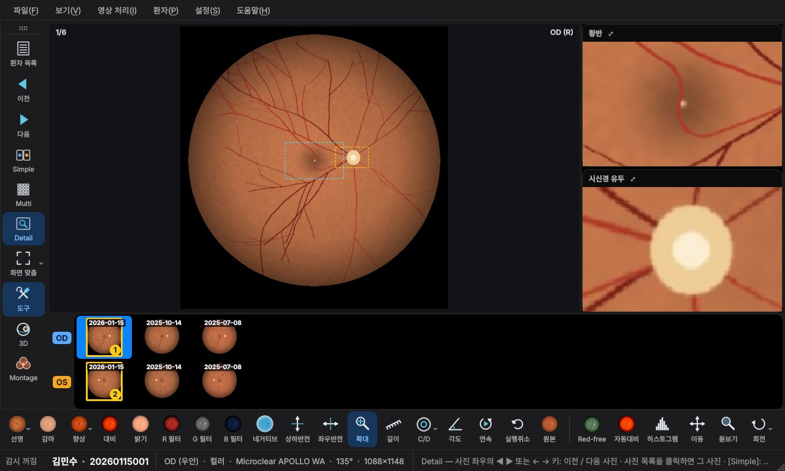

VK-2 캡처 화면처럼 만들었습니다.

**어두운 화면** — 사진을 보는 프로그램이라 화면 전체가 어둡습니다(아이폰의 다크 모드와 같은 방식). 바탕은 거의
검정이고 앞으로 나올수록 한 단계씩 밝아지며(창 → 카드 → 버튼), 지금 고른 것과 주 버튼만 **파란색** 하나로 표시합니다.
글자는 세 단계 밝기, 모서리는 둥글고 구분선은 가늘게. 켜고 끄는 항목은 **스위치**(미끄러지며 초록으로),
둘 중 하나를 고르는 항목은 **나란한 단추**(고른 쪽으로 밝은 판이 미끄러짐)이고, 탭을 바꾸면 화면이 겹쳐 넘어갑니다.
Windows에서는 창 제목 표시줄도 어둡게 맞춥니다.

* 검은 영상 화면과 **왼쪽 명령 툴바**, **아래쪽 영상 처리 툴바**로 되어 있습니다. 사진 화면이 가장 크게 나오도록
  화면 위의 탭 줄과 환자 줄은 없앴습니다.
* 환자 이름 · ID · 생년월일은 **아래 상태 줄**에 나옵니다. 환자 목록 창은 명령 툴바의 **환자 목록**(Ctrl+0)으로 엽니다.
* **명령 툴바**(왼쪽)에 보기를 고르는 **[Simple] · [Multi] · [Detail] · [3D]**(지금 보기가 켜져 있음)와 **[Montage](몽타주) ·
  [Glaucoma](녹내장 분석, ▾ 디스크 2장)** 가 있습니다([아래](#detail-크게-보기)의 표). 환자를 열면 나오는 **16장 보기**에서는
  어느 단추도 켜져 있지 않습니다 — 사진을 골라 **[Multi]** 를 누르면 고른 사진만, 다시 누르면 16장으로 돌아옵니다.
  Simple · Multi일 때 메뉴 옆에 **화면 분할**(1·2·4·6·9·16장) · **황반 · 디스크** · 고른 장수 · **선택 해제**가 나옵니다.
  단축키는 Simple Ctrl+1 · Multi Ctrl+2 · 3D Ctrl+3 · Detail Ctrl+5, 환자 목록 창 Ctrl+0, 질환 샘플과 비교 Ctrl+D 입니다.
* **명령 툴바 옮기기**: 툴바 맨 위의 **점 손잡이**를 끌어 **오른쪽**이나 **화면 위쪽**(가로로 한 줄)에 놓습니다. 툴바를
  오른쪽 클릭해 **왼쪽에 · 오른쪽에 · 화면 위쪽에**를 골라도 되고, 놓은 자리는 다음에 켤 때도 그대로입니다(보기 → 툴바 기본
  위치로: 왼쪽).
* 사진 화면 **아래**: 촬영 사진 목록만 화면 폭 전체에 나옵니다(위 줄 OD · 아래 줄 OS, 최신부터). 사진이 칸을 꽉 채우고
  설명 줄이 없어 낮으며, 날짜는 사진 위에, 눈(OD · OS)은 줄 왼쪽에 한 번만 나옵니다.
* 0.3.0부터 **검토 · 2D 보기 · 비교** 화면은 쓰지 않습니다. 큰 2D 사진은 Detail에, 두 장 비교는
  [디스크 2장] · [녹내장](스테레오 보기 · 경과 비교)에 있습니다.
* 사진 위에는 구석에 작은 글자 두 개만 나옵니다. 왼쪽 위에 사진 번호(`1/2`), 오른쪽 위에 눈(`OD (R)`). 환자 이름·ID·날짜는
  사진 위에 쓰지 않습니다(메뉴 줄의 환자 이름과 사진 목록에 있음). 보기 → 화면 글자 표시로 끕니다.
* 상태 표시줄에는 자동 가져오기 상태, 영상 정보(눈 · 촬영 종류 · 장비 · 화각 · 크기), 측정 결과가 나옵니다.
  영상 정보에 마우스를 올리면 값마다 **어디서 읽었는지**(RetiCam 데이터 / 파일 이름 / DICOM …)가 보입니다.
* 영상 처리 툴바도 끌어서 옮길 수 있고, 보기 → 툴바 기본 위치로 되돌립니다. ▾ 표시가 있는 버튼은 화살표를
  누르면 추가 기능이 나옵니다. 버튼 위에 마우스를 올리면 VK-2의 해당 버튼 이름도 보입니다.

### Detail (크게 보기)


어느 사진이든 **더블클릭**하거나 명령 툴바의 **[Detail]** 을 누르면 나오는 화면입니다(Ctrl+5, 전에는 "모두 보기"). 왼쪽에
**큰 사진**(모든 영상 처리 · 측정 도구를 여기서 씀), 오른쪽에 확대 화면 둘이 있습니다.

* **이전 / 다음 사진**: 큰 사진의 **왼쪽 · 오른쪽 끝에 마우스를 대면 ◀ ▶** 가 나오고, 누르면 사진 목록의 이전 / 다음
  사진으로 넘어갑니다(첫 사진에는 ◀, 마지막 사진에는 ▶ 가 없음). 키보드 **← →** 도 같습니다. 사진 목록에서 다른 사진을
  **클릭**해도 그 사진이 여기서 열립니다.

* **황반**: 사진에서 찾은 황반(중심와)을 중심으로 확대합니다. 큰 사진 위의 **하늘색 틀**이 이 화면에 보이는 곳입니다.
* **시신경 유두**: 시신경 유두를 더 가깝게 확대합니다. 큰 사진 위의 **노란 틀**이 이 화면에 보이는 곳입니다.
* 확대 크기는 그 사진의 황반–유두 거리에 맞춰 정하므로 45° 사진이나 초광각 사진이나 같은 범위가 보입니다.
  황반이나 유두를 찾지 못한 사진은 제목에 `(찾지 못함 — 사진 가운데)`가 붙고 사진 가운데를 보여 줍니다.
  위치가 틀리면 큰 사진에서 **오른쪽 클릭 → 황반 / 시신경 유두로 지정**으로 고칩니다.
* 확대 화면에서도 휠로 배율을, 드래그로 위치를 바꿀 수 있습니다. Red-free·대비 같은 처리는
  큰 사진과 똑같이 적용됩니다. 틀은 화면에만 보이고 복사·저장·인쇄되는 영상에는 들어가지 않습니다.
* 확대 화면의 제목(**⤢**)이나 화면을 누르면 큰 사진이 그곳으로 확대됩니다. `0` 키(또는 화면 맞춤)를 누르면 다시 전체가 보입니다.
  큰 사진을 **다시 더블클릭하거나 [Detail]을 다시 누르면 Detail이 닫히고 보던 화면**(Simple · Multi의 그 사진들 · 16장 보기 ·
  3D)으로 돌아갑니다.
* 큰 사진과 확대 화면 사이의 경계를 끌어 크기를 바꿀 수 있습니다.

**왼쪽 명령 툴바** (위에서 아래로 — 맨 위의 점 손잡이로 오른쪽 · 화면 위쪽에 옮길 수 있음)

| 버튼 | VK-2 | 기능 |
|---|---|---|
| 환자 목록 | OPEN LIST | [환자 목록 창](#환자-목록-창-vk-2-open-list) 열기/닫기 (Ctrl+0) — 환자 검색(Ctrl+F)도 이 창에서 |
| 이전 / 다음 | PREV / NEXT | 이전·다음 사진 (PageUp / PageDown · ← / →) — Simple · Multi에서는 고른 사진 사이 |
| Simple | | 최신 OD \| OS 두 장, 사진 목록을 클릭하면 더하기 · 빼기 (Ctrl+1, [아래](#보기-고르기--16장-보기--multi--simple--detail)) |
| Multi | MULTI | 16장 보기에서 고른 사진만 — 다시 누르면 16장 보기로 (Ctrl+2, [아래](#16장-보기--multi-vk-2-방식)) |
| Detail | | 사진 한 장을 크게 + 황반 · 시신경 유두 확대 (Ctrl+5) — 다시 누르면 보던 화면으로 |
| 화면 맞춤 ▾ | SCALE | 화면 맞춤 · 100~800% · **확대 위치**: 후극부, 위·아래·코·귀쪽 주변부 |
| 도구 | TOOLS | 영상 처리 툴바 보이기/숨기기 |
| 3D | (DDV 자리) | 3D 안구 모형 (Ctrl+3, 다시 누르면 보던 화면으로 — Simple에 두 장이면 두 장 3D, 여러 장 골라 두었으면 한 장 / 모두를 물어봄) |
| Montage | | 고른 사진(같은 눈 2장 이상)으로 몽타주 ([아래](#몽타주-여러-장을-한-장으로--3d)) |
| Glaucoma ▾ | | 녹내장 분석: 디스크 C/D · 유두 3D 입체 · 광각 RNFL · 스테레오 보기 · 경과 비교(깜빡임) ([아래](#녹내장-분석)) — ▾ **디스크 2장** (보험 청구용) |
| 인쇄 | PRINT | 화면 영상 + 환자 정보 머리말 (Ctrl+P) |
| 설정 · 종료 | EXIT | |

환자 검색 · 정보 수정 · 가져오기 · 저장은 0.8.0부터 툴바에 없고 메뉴에 있습니다 — **환자 → 환자 검색**(Ctrl+F) ·
**환자 → 정보 수정** · **파일 → 파일 가져오기 · 폴더 가져오기 · 감시 폴더 지금 검사** · **파일 → 파일로 저장 · 환자 기록에
새 사진으로 저장 · 클립보드로 복사**(Ctrl+C).

**아래쪽 영상 처리 툴바** (VK-2 Image Processing Toolbar 순서)

버튼 그림은 VK-2처럼 **작은 안저 사진에 그 효과를 적용한 모습**입니다. 사진에 적용 중인 처리는
버튼이 켜진 색으로 표시되고, 툴바에 마우스를 올리면 적용 순서가 보입니다.

| 버튼 | VK-2 | 기능 |
|---|---|---|
| 선명 ▾ | SHARPEN | 선명하게 (누를 때마다 누적, ▾ 약·강) |
| 감마 · 대비 · 밝기 | GAMMA · CONTST · BRIGHT | 버튼 옆에 슬라이더가 열림, 초기화 버튼 |
| 향상 ▾ | ENHANCE | 국소 대비 향상(미세 혈관·병변), ▾ 히스토그램 평활화 · 노이즈 감소 |
| R · G · B 필터 ▾ | RED · GREEN · BLUE FILTER | 한 색 성분만. 켜진 필터를 다시 누르면 컬러 · G 필터 ▾ **녹색 + RNFL 강화**: 녹색 성분에 국소 대비를 높여 신경섬유층(RNFL)이 잘 보이게 — 녹내장 분석 → 광각 분석의 레드프리 · RNFL 대비 강화 0.9와 같은 그림 |
| 네거티브 | NEGATIVE | 반전 영상 |
| 상하반전 · 좌우반전 | FLIP VRT · FLIP HRZ | |
| 확대 | ZOOM | **처음부터 켜져 있음.** 휠로 확대·축소 (커서 위치 중심) · 드래그로 사진 이동 |
| 길이 | LENGTH | px와 **망막 각도·mm** |
| C/D ▾ | C/D RATIO | 길이 방식(cup·disc 지름) / ▾ 면적 방식(최대 12점 둘레) |
| 각도 | ANGLE | 세 점(가운데 점이 꼭짓점) |
| 연속 | LOOP | 이 환자 사진을 차례로 보기 (사진 클릭 시 멈춤) |
| 실행취소 · 원본 | UNDO · ORIGINAL | 마지막 처리 되돌리기 (Ctrl+Z) · 모든 처리·측정 해제 |
| Red-free · 자동대비 · 히스토그램 | | 녹색 채널 · 밝기 범위 자동 맞춤 · 검정/흰색 레벨 |
| 이동 · 돋보기 · 회전 ▾ | | 드래그 이동 · 누르는 동안 돋보기(누른 채 휠로 배율) · 90° 회전 |
| 글자 ▾ · 회색조 · 지우기 ▾ | | 글자 / 화살표+글자 · 누르는 동안 그 가로줄 밝기 그래프 · 마지막 / 모든 측정 지우기 |

**마우스 조작**
* **확대·축소는 휠로만**: 휠을 굴리면 커서 위치를 중심으로 확대·축소됩니다. 보고 싶은 곳(시신경 유두, 황반)에
  커서를 두고 휠을 올리면 됩니다. 드래그로는 배율이 바뀌지 않습니다. Mac 트랙패드는 두 손가락 벌리기·오므리기.
  큰 사진 · 확대 화면 · Simple 의 칸 모두 같습니다.
* **왼쪽 드래그로 사진 이동**: 커서가 손 모양이고, 왼쪽 버튼으로 끌어 확대한 사진을 옮깁니다.
  전체 사진으로 돌아가려면 `0` 키(또는 화면 맞춤)를 누릅니다.
* **더블클릭**: Simple의 칸이나 Multi의 사진을 더블클릭하면 Detail에서 크게 열리고, Detail의 큰 사진을 **다시
  더블클릭하면 보던 화면으로** 돌아갑니다(0.8.1부터 — 전에는 돋보기). 돋보기는 아래 툴바의 **[돋보기]** 를 고르고
  누르는 동안 나오며(누른 채 휠로 배율), 배율은 오른쪽 클릭 메뉴 → **돋보기 배율**에서도 바꿉니다.
* 다른 도구(길이·각도 등)를 쓰는 중에도 **휠**로 확대·축소하고 **가운데 버튼 드래그**로 이동합니다.
* **오른쪽 클릭**: 메뉴 (시신경 유두 · 황반 위치 지정, 화면 맞춤, 돋보기 배율, 미니맵)
* **가운데 버튼 드래그**: 이동 · **더블클릭**: Detail로 크게 열기 / Detail에서는 보던 화면으로
* **사진 좌우 끝의 ◀ ▶**: 이전 / 다음 사진 (Detail) · Simple · Multi의 칸에서는 그 칸에 같은 눈의 이전 / 다음 사진
* **키보드**: `+` / `−` 확대·축소(커서 위치) · `0` 화면에 맞춤 · `1` 100% · `←` / `→` 이전 / 다음 사진

**확대해서 보기 (광각 사진)**

* 원본 해상도 그대로 최대 40배까지 확대합니다.
* **미니맵**: 확대하면 오른쪽 위에 전체 사진이 나오고 지금 보는 곳이 노란 틀로 표시됩니다.
  미니맵을 누르거나 끌면 그곳으로 이동합니다(오른쪽 클릭 메뉴에서 끌 수 있음).
* **확대 위치**: 화면 맞춤 ▾ 또는 상태 표시줄 오른쪽의 **[배율]** 버튼에서 후극부(황반·시신경)와
  위·아래·코·귀쪽 주변부로 바로 확대합니다. 코쪽은 시신경 유두 쪽(OD 오른쪽, OS 왼쪽)이고,
  촬영 원이 화면 틀보다 큰 광각 사진에서도 사진 안으로 맞춥니다.
* 돋보기 도구는 누르는 동안 커서 아래만 2~10배로 보여 줍니다.

**처리와 측정 동작 방식**
* 처리는 화면에서만 적용되며 저장된 원본 사진은 바뀌지 않습니다.
* 다른 사진으로 넘어가면 선명·향상 같은 처리 단계는 초기화됩니다. 감마·대비·밝기·필터는 유지됩니다.
* 길이는 그 영상의 화각·투영(3D와 같은 안구 모형)으로 **망막 위 실제 거리**로 바꿔 보여 줍니다. 초광각 사진은 주변부일수록 화소당 거리가 달라서 화소 길이만으로는 비교할 수 없기 때문입니다.

### 보기 고르기 — 16장 보기 · Multi · Simple · Detail

환자를 열면 **16장 보기**(VK-2 MULTI 화면)가 나옵니다. 나머지 보기는 명령 툴바의 단추로 고르고, 켜져 있는 단추가 지금 보기입니다.

| 단추 | 보이는 것 | 사진 목록을 클릭하면 |
|---|---|---|
| (환자를 열면) **16장 보기** | 이 환자의 사진 **16장**을 한 화면에 ([아래](#16장-보기--multi-vk-2-방식)) | (16장이 곧 사진 목록 — 클릭: 고르기) |
| **Multi** (Ctrl+2) | 16장 보기에서 **고른 사진만** 한 화면에 — **다시 누르면 16장 보기로** | **더하기**(번호) · 다시 클릭하면 **빼기** |
| **Simple** (Ctrl+1) | 누를 때마다 **최신 OD \| OS 두 장**을 크게 나란히 (OD 왼쪽 · OS 오른쪽) — 그다음은 고른 사진들 | **더하기**(번호) · 다시 클릭하면 **빼기** |
| **Detail** (Ctrl+5) | 사진 한 장을 크게 + 황반 · 시신경 유두 확대 ([위](#detail-크게-보기)) | 그 사진을 봄 |
| **3D** (Ctrl+3) | 보고 있는 사진을 [3D 안구](#3d-안구-모델)로 — 한 번 더 누르면 보던 화면으로 | 그 사진을 3D로 |

어느 화면에서든 사진(칸 · 사진 목록 · 16장 보기의 사진)을 **더블클릭**하면 Detail에서 크게 열리고, Detail의 큰 사진을
**다시 더블클릭하면** 보던 화면으로 그대로 돌아갑니다(Simple · Multi는 고른 사진 그대로). 고른 사진은 16장 보기 · Multi ·
Simple이 함께 씁니다(16장 보기에서 번호가 붙은 사진 = Multi에 나오는 사진). [Simple] 단추는 최신 OD | OS 두 장부터 다시
시작하고, Simple에서 [Multi]를 누르면 16장 보기로 갑니다. **설정 → 일반 → 환자를 열면**을 **Simple**로 바꾸면 환자를 열 때
Simple이 나옵니다.

**Simple · Multi** (둘 다 고른 사진을 칸마다 한 장씩 보여 주는 화면)
* Simple을 누르면 고른 검사의 **최신 OD와 OS 사진** 두 장이 나옵니다 — OD 왼쪽, OS 오른쪽(마주 본 환자 방향), OD 칸이
  선택됨, 사진 목록에 1 · 2 번호. 컬러 사진을 먼저 고르고, 눈 · 촬영 종류 고르기는 그대로 따릅니다. 한쪽 눈 사진만 있으면
  그 한 장이 크게 나옵니다. 환자 목록에서 다른 검사를 고르면(손으로 바꾸지 않았으면) 그 검사의 OD | OS로 바뀝니다.
* 사진 목록에서 사진을 **클릭**하면 노란 테두리와 번호(3, 4 …)가 붙고 그 사진이 **더해집니다**. 화면은 고른
  장수에 맞게 저절로 나뉩니다 — 1장 · 2장(나란히) · 3~4장 4칸 · 5~6장 6칸 · 7~9장 9칸 · 16칸(최대 16장).
* 고른 사진을 **다시 클릭하면 빠지고** 화면도 줄어듭니다.
  모두 빼거나 메뉴 옆의 **선택 해제**를 누르면 **사진 목록의 모든 사진**이 나오고, **화면 분할**(또는 보기 → Simple 화면
  분할)에서 장수를 고르면 VK-2처럼 보고 있는 사진부터 차례로 그만큼 나옵니다.
* **칸 좌우의 ◀ ▶**: 칸의 왼쪽 · 오른쪽 끝에 마우스를 대면 나오고, 누르면 **그 칸에 같은 눈의 이전(더 최근) / 다음(더 전)
  사진**이 들어옵니다(번호 · 자리는 그대로, 다른 칸에 나와 있는 사진은 건너뜀). 칸을 누른 뒤 **← →** 도 같습니다.
  사진 목록에서의 ← → 와 [이전] · [다음]은 나와 있는 사진 사이를 옮겨 다닙니다.
* **황반 · 디스크**(메뉴 옆, 켜 둔 것은 기억): 사진마다 **아래에 황반과 시신경 유두를 확대**해서 보여 줍니다 — Detail의
  확대 화면과 같은 범위(유두–황반 거리로), 원본 해상도에서 잘라 그 사진의 보정(Red-free · 대비 …)을 그대로. 찾지 못했으면
  사진 가운데를 보여 주고 제목에 그렇게 씁니다. 확대 화면도 휠 · 드래그로 움직이고, 더블클릭하면 Detail입니다. 화면 분할
  4장 이하일 때 나옵니다.
* **칸을 누르면 그 사진만** 아래 영상 처리 툴바(감마 · 대비 · 밝기 · Red-free · R/G/B 필터 · 선명 · 향상 ·
  자동 대비 · 네거티브)로 보정됩니다 — 마지막에 누른 칸의 사진으로, 그 칸은 **파란 테두리**로 둘리고 제목 오른쪽에
  **파란 [보정] 아이콘**이 붙습니다(사진이 2장 이상일 때). 다른 칸은 그대로이고,
  사진마다 실행 취소(Ctrl+Z) · 원본이 따로 있습니다.
  보정한 사진을 Detail로 열어도 같은 보정이 보입니다.
* 칸마다 휠로 따로 확대·축소하고 드래그로 옮길 수 있습니다. Simple에 두 장일 때 **[3D]** 를 누르면 두 사진이 함께 3D로 나오고,
  Multi에서 두 장 이상 · Simple에 세 장 이상이면 한 장 / 모두를 묻습니다([여러 장 3D](#두-장-3d--여러-장-3d)).
  **[Montage]** 는 고른 사진(같은 눈 2장 이상)으로 만듭니다.
* 새 사진이 들어오면(새 영상 자동 표시) Simple은 최신 OD | OS가 다시 나옵니다 — 사진을 손으로 바꾸지 않았을 때. 바꿨으면
  새 사진은 Detail에서 크게 나옵니다.

| Simple — 황반 · 디스크 켬 |
|---|
| 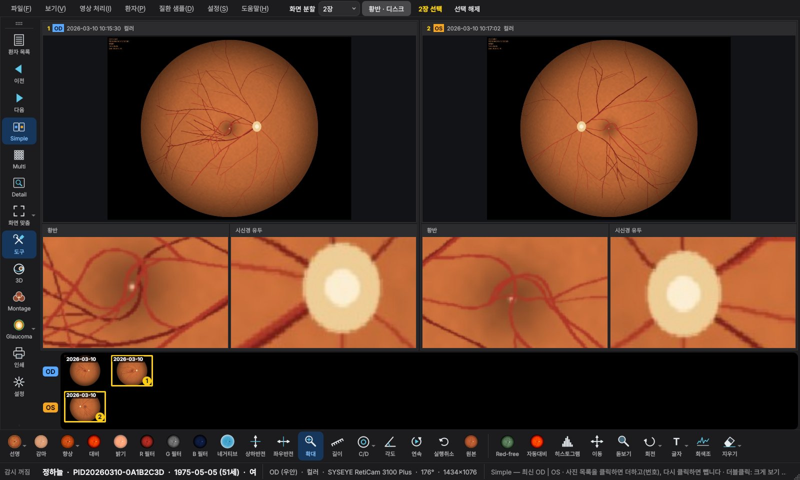 |

### 사진 목록
* 사진 목록은 화면 **아래쪽**에 화면 폭 전체로 나옵니다. **사진이 칸을 꽉 채우고** 사진 아래에 설명 줄이 없어서, 전보다
  사진은 크고 목록은 낮습니다(그만큼 위의 사진 화면이 커짐).
* **눈별로** 나옵니다 — **위 줄은 OD, 아래 줄은 OS**(OU 사진이 있으면 셋째 줄), 줄마다 **최신 사진부터**. 눈은 사진마다
  쓰지 않고 **줄 왼쪽에 한 번만** 색 글자로 나옵니다 — **OD**(파랑) · **OS**(주황) · **OU**(보라).
* **날짜**는 사진 위(왼쪽 위)에 겹쳐 나옵니다. **보기 → 사진 목록 표시**(또는 설정 → 일반)에서 고릅니다(기억됨):
  **날짜**(처음에 켜짐) · **종류**(컬러 · 몽타주 · Red-free … 처음에 꺼짐, 켜면 사진 왼쪽 아래에) ·
  **눈별로 두 줄**(끄면 모든 사진을 한 줄로 — OD 다음 OS, 이때는 사진마다 눈 표시가 붙음).
* 눈을 모르는 사진(**미상**)은 목록에 나오지 않습니다. 위쪽 눈 고르기에서 **미상**을 고르면 그 사진만 보이고,
  [정보 수정]으로 눈을 정하면 OD · OS 줄로 들어갑니다. 환자의 사진이 모두 미상이면(빈 목록 대신) 그대로 보입니다.
  화각 · 장비는 아래 상태 줄에, 검사 일시 · 파일 이름은 사진에 마우스를 올리면 나옵니다.
* 줄이 화면보다 길면 휠이나 스크롤 막대로 **옆으로** 넘깁니다(두 줄이 함께 움직입니다). 한쪽 눈 사진만 있거나
  눈 고르기로 OD만 보면 한 줄입니다. Detail · Multi에서 이전 / 다음은 OD 줄을 지나 OS 줄로 갑니다.
* 고른 사진(Simple · Multi에 나와 있는 사진)은 노란 테두리와 번호, 두 번째 사진은 ② 입니다. 지금 보고 있는 사진에 따로
  파란 표시는 하지 않습니다(0.9.1부터 — 고른 표시와 헷갈려서).

| Simple (4장) | Red-free (VK-2 사진) |
|---|---|
| 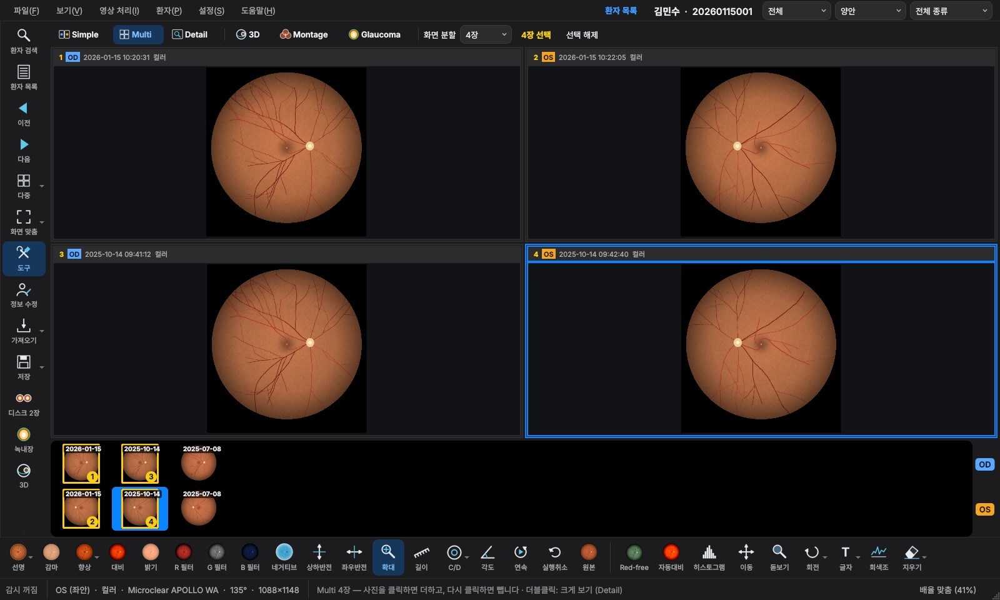 | 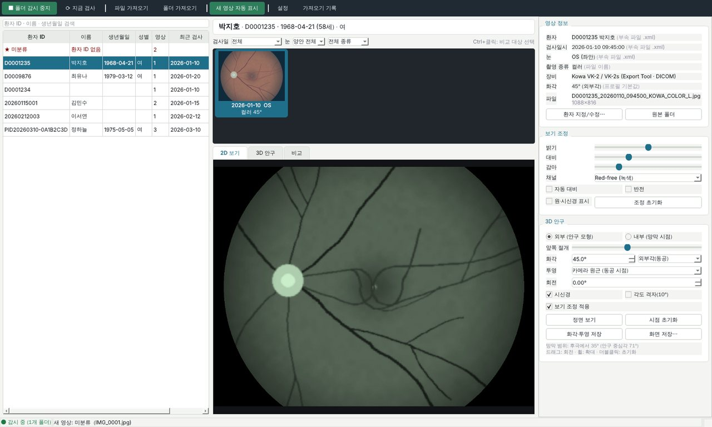 |

### 16장 보기 · Multi (VK-2 방식)


환자를 열면 그 환자의 사진이 **한 화면에 16장**(4 × 4, 최신 사진부터) 나옵니다 — VK-2의 MULTI 화면입니다. 환자를 열 때
나오는 화면은 **설정 → 일반 → 환자를 열면**에서 고릅니다(0.9.0부터 처음 설정은 16장 보기, 전에 Simple로 쓰던 설정도 한 번
16장 보기로 바뀝니다).

| 고르는 것 | 환자를 열면 |
|---|---|
| **16장 보기** (처음 설정, VK-2 방식) | 그 환자의 사진이 **한 화면에 16장**, 아무것도 고르지 않은 채로 |
| **Simple — 최신 OD \| OS 두 장** | 고른 검사의 최신 OD(왼쪽) · OS(오른쪽)가 나란히 ([위](#보기-고르기--16장-보기--multi--simple--detail)) |

16장 보기에서는:

* 사진마다 왼쪽 위에 눈(**OD** 파랑 · **OS** 주황)이 나옵니다. 테두리는 고른 사진(노란색)에만 있습니다.
* 사진을 **클릭**하면 노란 테두리와 번호(1, 2, 3 …)가 붙어 골라지고, 다시 클릭하면 빠집니다. 아래 줄 오른쪽에 고른 장수가
  나옵니다(`3장 선택 — [Multi]: 고른 사진만 보기`).
* 명령 툴바의 **[Multi]** (Ctrl+2)를 누르면 **고른 사진만** 모여 한 화면에 나옵니다(장수에 맞게 1 · 2 · 4 · 6 · 9 · 16칸,
  칸마다 따로 보정, [Multi]가 켜짐). **[Multi]를 다시 누르면 16장 보기로** 돌아오고, 고른 사진은 번호 그대로 남아 있어
  더 고르거나 빼고 다시 [Multi]를 누를 수 있습니다. **선택 해제**는 모두 빼기. 고른 사진이 없으면 [Multi]는 먼저 고르라고 알려 줍니다.
* [Simple]이 넣은 최신 OD | OS 두 장은 고른 사진으로 치지 않아, Simple에서 [Multi]를 누르면 아무것도 고르지 않은 16장 보기가 됩니다.
* **더블클릭**하면 그 사진을 Detail에서 크게 봅니다. **Ctrl+클릭**은 두 번째 사진(②), 오른쪽 클릭은 사진 메뉴입니다.
* 사진이 16장보다 많으면 아래 줄의 **◀ 이전 16장 · 다음 16장 ▶** 이나 마우스 휠로 넘깁니다. PageUp / PageDown(이전 · 다음
  사진)으로 움직이면 그 사진이 있는 16장이 나옵니다.
* 사진의 날짜 · 시각(· 촬영 종류)은 칸의 오른쪽 위에 나옵니다.
* 이 화면에서는 16장이 곧 사진 목록이라 아래 줄의 작은 사진 목록은 감추고, 그 자리에 쪽 넘기기와 고른 장수가 나옵니다.

## 질환 샘플과 비교

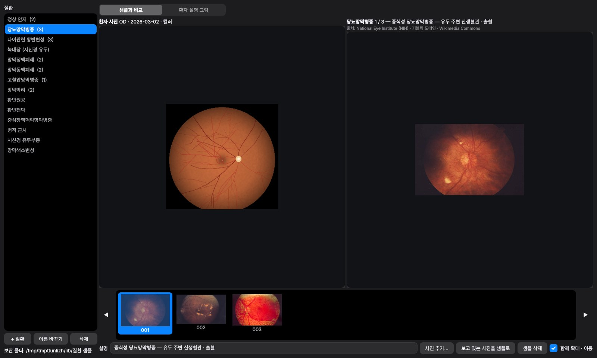

메뉴 **질환 샘플 → 질환 샘플과 비교…** (Ctrl+D): 보고 있는 환자 사진(주 화면에 보이는 대로 — 보정 포함)과 **망막 질환의
샘플 사진**을 나란히 놓고 봅니다.

* 왼쪽에 **질환 목록**(샘플 장수) — 처음에는 정상 안저 · 당뇨망막병증 · 나이관련 황반변성 · 녹내장(시신경 유두) ·
  망막정맥폐쇄 · 망막동맥폐쇄 · 고혈압망막병증 · 망막박리 · 황반원공 · 황반전막 · 중심장액맥락망막병증 · 병적 근시 ·
  시신경 유두부종 · 망막색소변성. **[+ 질환]** · **[이름 바꾸기]**(더블클릭도) · **[삭제]**(그 질환의 샘플도 함께)로 바꿉니다.
* 가운데 왼쪽이 **환자 사진**, 오른쪽이 고른 질환의 **샘플**, 그 아래에 그 질환의 샘플들(◀ ▶)과 **설명**(샘플마다 메모).
* **함께 확대 · 이동**(처음에 켜짐): 한쪽을 휠로 확대하거나 끌어 옮기면 다른 쪽도 사진의 같은 부분을 보여 줍니다.
* **샘플 등록**: **[사진 추가…]**(사진 파일 여러 장 · 창에 끌어다 놓아도 됨) 또는 **[보고 있는 사진을 샘플로]** — 주 화면의
  사진을 보이는 대로 저장합니다. 메뉴 **질환 샘플 → 보고 있는 사진을 질환 샘플로 등록…** 도 같습니다(질환을 고르거나 새 이름을 적음).
* 샘플은 질환 이름과 번호로 저장되고(`당뇨망막병증_003.jpg`) 원래 파일 이름은 남기지 않습니다. 환자 사진을 샘플로 할 때는
  **사진 원 밖을 검게** 저장합니다 — 카메라가 그곳에 환자 이름 · ID · 날짜를 찍어 두는 경우가 있어서입니다.
* 샘플은 라이브러리 폴더의 **`질환 샘플\`** 에 질환마다 폴더로 들어갑니다(`index.json`에 질환 순서와 설명). 메뉴 **질환 샘플 →
  보관 폴더 열기**. 그 폴더를 다른 컴퓨터에 복사하면 같은 샘플을 씁니다. 여러 컴퓨터에서 함께 쓸 때 샘플은 컴퓨터마다 따로입니다.

## 디스크 2장 (보험 청구용)


두 사진의 **시신경 유두 부분만 확대해 한 장**으로 만듭니다. 녹내장 등의 보험 청구에 붙이는 유두 사진용입니다.

1. 썸네일에서 사진 한 장을 더블클릭해 열고, 두 번째 사진을 **Ctrl+클릭**합니다. 두 번째 사진에는 **②** 표시와 주황색
   바탕이 붙습니다. ②를 다시 Ctrl+클릭하면 해제됩니다. ② 사진을 더블클릭하면
   두 사진의 역할만 바뀌고 둘 다 골라진 채로 있습니다.
2. 명령 툴바의 **[Glaucoma] ▾ 디스크 2장**(또는 썸네일 오른쪽 클릭, 파일 메뉴)을 누릅니다.
3. 미리 보기 창에서 확인하고 **환자 기록에 저장**(사진 목록에 `디스크 2장` 종류로 추가, 원본은 그대로) ·
   **파일로 저장**(JPEG/PNG) · **인쇄**(A4 가로) · **복사** 중 하나를 고릅니다.

* **배치**: 우안 OD가 왼쪽, 좌안 OS가 오른쪽입니다(마주 본 환자 방향). 같은 눈 두 장은 먼저 찍은 사진이 왼쪽이며,
  **좌우 바꾸기**로 바꿀 수 있습니다.
* **머리말**에 환자 이름·ID·생년월일(검사일 기준 나이)·성별이 들어가고, 사진마다 눈, 아래에 검사 일시·장비·화각이
  들어갑니다.
* **유두 위치**: 가져올 때 검출했거나 큰 사진에서 오른쪽 클릭으로 지정한 위치를 씁니다. 찾지 못한 사진은 예상
  위치(중심와에서 코쪽 4.5 mm)로 자르고 경고를 보여 줍니다. 미리 보기에서 **유두 중심을 클릭하면** 그곳을 중심으로
  다시 자르며, 그 위치는 그 사진의 유두 위치로 저장됩니다(3D 시신경에도 반영).
* **범위**: 한 칸의 너비를 **유두 지름의 배수**로 정합니다 — 가깝게 ×2.5 · 보통 ×3.5(기본) · 넓게 ×5. 화소가 아니라
  각 사진의 화각·투영으로 유두 크기(1.8 mm)를 계산하므로 45° 사진과 초광각 사진도 같은 망막 범위로 잘립니다.
* 색은 **원본 그대로**입니다. **화면 조정 적용**을 켜면 큰 사진의 감마·대비·밝기·필터를 함께 적용합니다.
* 미분류 사진, 서로 다른 환자의 사진, 전안부 사진은 쓸 수 없습니다.

## 녹내장 분석

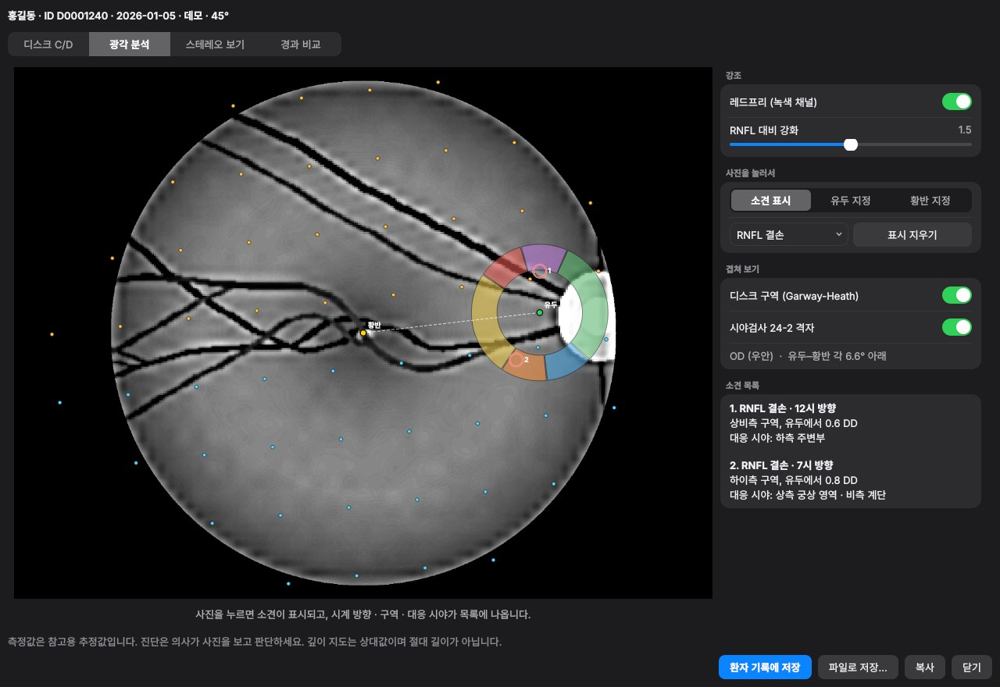

명령 툴바의 **[Glaucoma]** (또는 파일 메뉴 · 썸네일 오른쪽 클릭)을 누르면 보고 있는 사진으로
녹내장 분석 창이 열립니다. 두 번째 사진을 **Ctrl+클릭**(②)해 두면 두 장을 쓰는 탭도 함께 열립니다.

| 탭 | 쓰는 사진 | 하는 일 |
|---|---|---|
| **디스크 C/D** | 보고 있는 사진 | 사진을 시신경 유두 주변(유두 지름의 2.5 · 3.5 · 5배)으로 잘라 보여 줍니다. 초록 선을 디스크 경계에, 노란 선을 컵 경계에 맞추면(가운데 점: 통째로 옮기기, **S · N · I · T 점은 하나씩 따로** — 반대쪽 점은 그대로라 한쪽만 넓거나 좁은 모양도 맞춤, 0.9.2부터) **수직 · 수평 · 면적 C/D**, **림 두께(I · S · N · T, 디스크 수직 지름 대비)** 와 **ISNT 순서**가 나옵니다 |
| **광각 분석** | 보고 있는 사진 | **레드프리 + RNFL 대비 강화**로 신경섬유층을 강조하고, 유두 둘레에 **Garway-Heath 구역**과 **시야검사 24-2 격자**를 겹칩니다. 사진을 눌러 소견(RNFL 결손 · 디스크 출혈)을 표시하면 **시계 방향 · 구역 · 대응 시야 · 유두에서의 거리(DD)** 가 목록에 나옵니다. 유두와 황반은 가져올 때 찾은 위치가 미리 지정됩니다 |
| **3D 입체** | 보고 있는 사진 (한 장) 또는 두 장 | 시신경 유두를 **돌려 볼 수 있는 입체 표면**으로 보여 줍니다. **한 장**이면 사진의 밝기로 모양을 추정하고(창백한 곳 = 컵 = 깊은 곳, 림과 혈관은 조금 솟음), **두 장**(같은 눈을 조금 다른 위치에서)이면 두 사진의 **시차로 계산한 깊이**를 씁니다. 사진을 끌어 돌리기 · 자동으로 흔들기 · 깊이 과장 · 입체 조명 · 등고선 · 적청 안경, 두 장일 때는 같은 표면 위에서 **두 사진 깜빡임** |
| **스테레오 보기** | 두 장 (같은 눈을 조금 다른 위치에서) | 위글(번갈아 보기) · 나란히(평행 / 교차) · 적청 안경 · **깊이 지도**(파랑 = 깊은 곳, 빨강 = 솟은 곳, 누른 높이의 단면 그래프) |
| **경과 비교** | 두 장 (이전 · 이후) | 날짜가 이른 사진이 기준입니다. 깜빡임 · 겹치기 · **변화 지도**(밝기가 달라진 곳을 분홍색으로) |
| **환자 설명** | (사진을 쓰지 않음) | 환자에게 녹내장을 설명하는 **모형**입니다. **정상 · 초기 · 중기 · 말기**를 고르면 시신경 유두 모식도(함몰이 커짐)와 **환자가 보는 시야 (예시)**, 그 단계의 설명 글이 나옵니다. 이 환자의 실제 진행 단계가 아니므로 환자 기록에는 저장되지 않습니다(파일 저장 · 복사는 됨) |

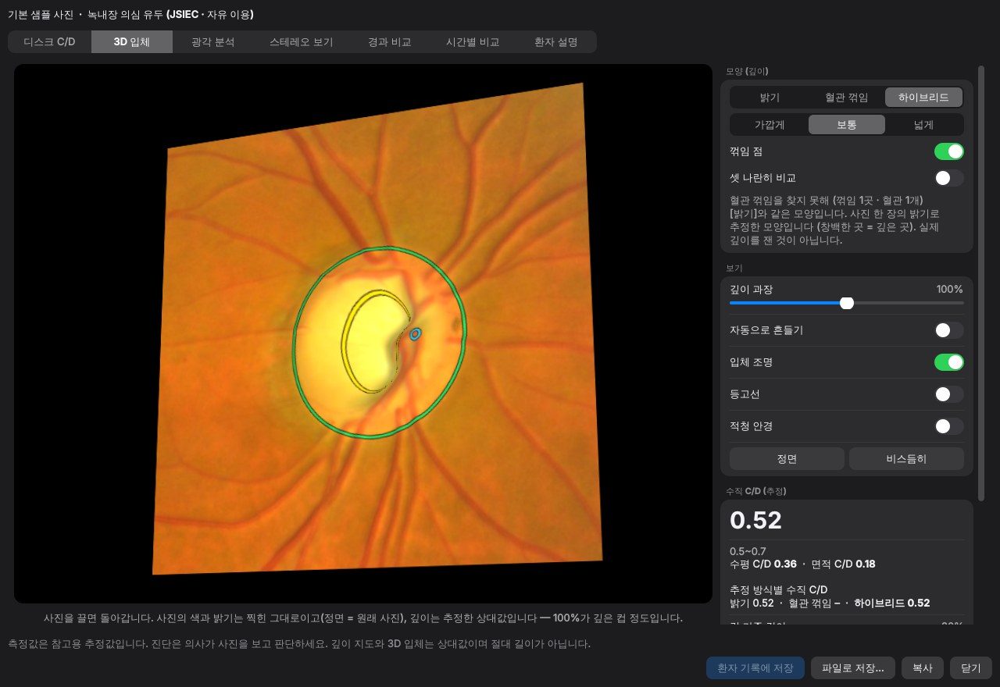

* 두 장을 쓰는 탭은 두 사진을 각각 **유두 중심으로 같은 망막 범위**(유두 지름의 5배 · 10배, 또는 사진 전체)로 잘라
  맞춥니다. 화각이 다른 카메라의 사진끼리도 같은 크기로 겹칩니다. **자동 맞춤**은 두 사진의 혈관 점들을 맞춰
  **회전 · 크기 · 좌우 · 상하**를 찾습니다(0.9.2부터 — 전에는 좌우 · 상하만이라 조금 다른 위치에서 찍은 두 장이 통째로
  흔들렸음). 좌우 · 상하는 슬라이더로 고칠 수 있습니다.
* **기준점** (스테레오 보기의 위글 · 적청): 사진을 누르면 그곳에서 두 사진을 정확히 겹쳐(0.1 화소 단위) 그 점은 움직이지
  않고 나머지가 깊이만큼 움직입니다 — 유두 테두리의 혈관처럼 무늬가 뚜렷한 곳을 누르세요. 기준점은 화면에 하늘색 십자로
  표시되고(저장하는 그림에는 들어가지 않음), 다른 곳을 누르면 옮겨지고 **맞춤 해제**로 지웁니다.
* 두 사진의 검사일이 같으면 스테레오 보기가, 다르면 경과 비교가 먼저 열립니다.
* **두 장 깜빡임(플리커)** 은 세 곳에 있습니다: **경과 비교 → 깜빡임**(이전 · 이후 사진, 속도 1~6 Hz), **스테레오 보기 → 위글**
  (같은 날 찍은 두 장), **3D 입체 → 두 사진 깜빡임**(기울인 입체 표면 위에서).
* **3D 입체**의 한 장 추정은 사진의 밝기에서 만든 **그림**이지 깊이를 잰 것이 아닙니다. 두 장 스테레오는 시차가 작으면
  (두 사진을 거의 같은 자리에서 찍었으면) 믿을 만하지 않다고 알려 줍니다. 시선이 다른 두 장처럼 **스테레오 쌍이 아닌 두 장**은
  유두 둘레가 고르게 나오지 않는 것으로 가려내어 한 장 추정으로 열립니다. 컵이 솟아 보이면 **깊이 뒤집기**를 켭니다.
  OD와 OS처럼 서로 다른 눈의 두 장은 스테레오가 되지 않으므로 한 장씩 봅니다.
* 지금 보이는 분석 화면은 **환자 기록에 저장**(사진 목록에 `녹내장 분석` 종류의 새 사진으로, 원본은 그대로) ·
  **파일로 저장** · **복사**할 수 있습니다.
* 측정값은 **참고용 추정값**입니다. 깊이 지도는 상대값이며 길이가 아닙니다. 진단은 의사가 사진을 보고 판단합니다.

## 몽타주 (여러 장을 한 장으로 · 3D)


같은 눈을 시선을 바꿔 가며 찍은 사진(45° 5방향, 초광각 2장 등)을 **겹치는 혈관에 맞춰 한 장으로 합치고**,
그 결과를 **3D 안구**에 입혀 봅니다.

1. **[Simple]** 의 사진 목록이나 **[Multi]** (16장)에서 같은 눈의 사진을 2장 이상 **클릭**해 번호를 붙인 뒤, 명령 툴바의 **[Montage]** 를 누릅니다
   (또는 썸네일 오른쪽 클릭 · 파일 메뉴). 열리면 바로 **자동 합치기**가 실행됩니다.
2. **맞추기 (반투명 겹치기)** 탭에서 결과를 확인하고 필요하면 손으로 고칩니다.
3. **완성** 탭에서 합친 사진을, **3D 안구** 탭에서 안구 위의 모습을 보고 **환자 기록에 저장**(사진 목록에 `몽타주` 종류로
   추가, 원본은 그대로) 또는 **파일로 저장**(PNG/JPEG) 합니다.

**자동 합치기** — 사진마다 혈관이 잘 보이는 초록 채널에서 특징점(SIFT)을 찾아 사진 쌍마다 맞추고, 사진을 평면에서
옮기는 대신 **안구(구면) 위에서 회전**시켜 놓습니다. 그래서 초광각 사진처럼 가장자리가 휘는 사진도 정확히 겹칩니다.
겹치는 사진이 가장 많은 순서로 하나씩 놓은 뒤 모든 사진을 함께 다시 맞추며, 45° 같은 일반 카메라 사진은 화각이
기기 설정과 조금(±15%) 다르면 그것도 고칩니다(목록에 `보정 ×0.90` 처럼 표시). 겹치는 곳을 찾지 못한 사진은 그 자리에
두고 알려 줍니다.
**광각 사진은 화각 그대로, 렌즈 곡선만 사진에서 찾기** — 광각 사진(광각 보정 · 등거리 투영)의 **화각은 카메라의 값
(176°)을 그대로** 씁니다. 몽타주의 각도가 여기서 나오기 때문입니다. 렌즈 곡선(중심이 얼마나 확대되는지)만 겹치는
혈관이 가장 많이 일치하는 것을 그 사진들에서 찾아, 주어진 값보다 일치점이 1.3배 넘게 많을 때만 바꿉니다(아래 줄에
`렌즈 곡선 보정 (화각 176° 그대로, 일치점 139 → 287)` 처럼 표시). 화각은 사진별 화각 칸에서 직접 고칠 수 있습니다.

**반사 · 플레어 가리기** — 눈꺼풀·속눈썹에 번진 밝은 빛(시야 가장자리에 닿은 넓고 하얗게 뜬 곳)과, 시선이 다른 사진들에서
**그림의 같은 자리**에 있는 밝은 점(렌즈 플레어 — 망막이라면 자리가 옮겨졌을 것)은 합칠 때 빼고 다른 사진의 그 자리로
채웁니다. 시신경 유두는 밝아도 망막과 함께 움직이므로 남깁니다. 저장하는 원본 크기 몽타주에도 같이 적용됩니다.

**시간** — 사진이 커도 맞추는 시간은 같습니다(긴 변 1600픽셀 복사본으로 맞춤). 저장할 때 원본으로 다시 그리는 시간만
늘어나는데, **빠르게 저장**을 켜면 몽타주를 최대 2400픽셀(기본 4000)로 그려 절반 아래로 줄어듭니다(다음에도 기억).

흐리거나 잡음이 많고 혈관이 옅은 사진은 **혈관만 남긴 절반 크기 그림**에서 한 번 더 특징점을 찾고, 그래도 안 맞으면
조건을 느슨하게 해 다시 맞춰 봅니다(이때는 서로 일치하는 점을 두 배로 요구해 엉뚱한 사진끼리 붙지 않게 합니다).

**수동으로 맞추기** — 고른 사진(노란 테두리)이 **반투명**하게 위에 놓입니다.

| 조작 | 동작 |
|---|---|
| 사진을 드래그 | 그 사진을 안구 위에서 옮기기 (잡은 곳이 마우스를 따라감) |
| Ctrl+드래그 · 오른쪽 드래그 | 사진 중심을 축으로 돌리기 (⟲ / ⟳ 1° 버튼도 있음) |
| 방향키 · Shift+방향키 | 0.1° · 1° 옮기기 |
| `[` `]` (Shift) | 0.2° (1°) 돌리기 |
| Tab | 다음 사진 고르기 |
| 빈 곳 드래그 · 휠 · 더블클릭 | 화면 이동 · 확대 · 전체 보기 |
| Ctrl+Z / 되돌리기 | 마지막 이동·회전·맞추기 취소 |

* **투명도** 슬라이더로 고른 사진의 비침을 조절하고, **색으로 구분**을 켜면 고른 사진은 초록, 나머지는 자홍으로 보여
  혈관이 정확히 겹친 곳은 회색, 어긋난 곳은 초록·자홍 테두리로 드러납니다.
* 사진마다 **화각 · 화각 기준(외부각/안구 중심각) · 투영**을 고칠 수 있고, 체크를 끄면 그 사진을 몽타주에서 뺍니다.
* **가운데 사진**은 몽타주의 중심(3D에서 각막 맞은편 후극)이 됩니다. 정하지 않으면 자동 합치기 뒤 가운데 있는 사진이
  골라집니다.

**기준점으로 맞추기** — 자동으로 못 맞춘 사진은 **[기준점으로 맞추기…]** 에서 고른 사진(왼쪽)과 이웃 사진(오른쪽)의
**같은 곳(혈관 갈림길·교차점)** 을 차례로 클릭합니다. 2쌍이면 위치와 회전, **4쌍 이상이면 화각까지** 맞춥니다.
왼쪽에 점을 찍으면 오른쪽에 지금 배치로 예상한 위치가 점선 원으로 나오고, 맞춘 뒤 가장 큰 어긋남(°)을 알려 줍니다.

**자연스럽게 합치기** — 겹친 부분의 밝기를 비교해 사진마다 밝기·색을 맞추고(**밝기 맞추기**), 두 대역으로 섞습니다.
넓은 밝기는 각 사진의 가장자리(촬영 원과 4:3 화면의 잘린 위·아래, 가린 글자까지)로 갈수록 부드럽게 줄어드는 가중치로
섞어 경계선이 보이지 않고, 혈관 같은 세밀한 부분은 그곳을 가장 가운데로 본 사진 한 장에서 가져와(다음 사진으로는 좁은
띠에서만 넘어감) 맞춤이 조금 어긋나도 혈관이 두 겹으로 겹치지 않습니다 — 어긋난 만큼은 이음매에서 혈관이 살짝 끊겨 보입니다.
0.9.2 전에는 여러 장이 모두 자기 가장자리에서 먼 곳(광각 사진 여러 장의 가운데, 후극)에서 세밀한 부분까지 평균을 내어
혈관이 두 개로 보였습니다. 저장할 때는 원본 해상도 사진으로 다시 그립니다(최대 4000 × 4000).

**각도 · 3D** — 몽타주는 후극(가운데 사진의 중심)에서의 각도가 그대로 거리가 되는 **등거리 지도**로 그려, 3D 안구에
따로 보정 없이 사진이 찍힌 자리에 입힙니다. 이 지도는 모든 사진을 둘러싼 원이라 그 지름(예: 45° 5방향 → 약 127°)은
실제로 찍힌 것보다 큽니다. 그래서 화면에 보이는 각도는 **실제로 사진이 덮은 범위를 대략 잰 값**입니다 — 지도 가운데를
지나는 가로 · 세로 폭을 5° 단위로(예: 176° 사진 2장을 좌우로 → `가로 약 220° · 세로 약 175°`). 3D의 세로 단면에서도
화각 선과 각도가 그 단면에서 사진이 실제로 끝나는 곳에 맞춰집니다(`약 175°`). **몽타주 화각 자동**을 끄면 지도 전체의
각도를 직접 정할 수 있고, 저장한 뒤에도 3D 화면의 화각·투영에서 바꿀 수 있습니다. 저장한 몽타주는 이 기하 정보를 함께 가지므로 2D 측정(° · mm)도 됩니다. 몽타주 썸네일을 오른쪽
클릭하면 **몽타주 다시 편집…** 으로 저장한 배치를 불러와 고칠 수 있습니다.

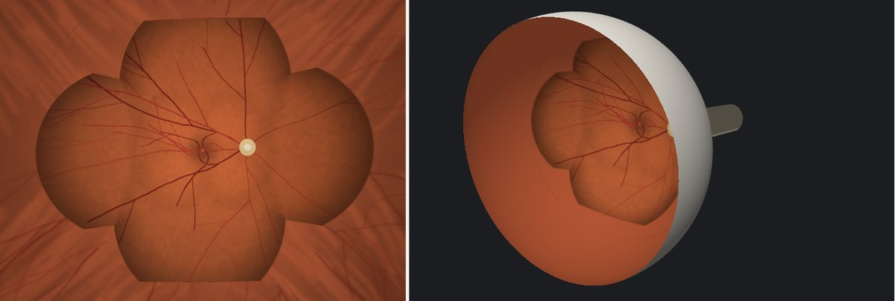

*왼쪽: 45° 사진 5장을 합친 몽타주를 안구 안에서 본 모습 · 오른쪽: 저장한 몽타주를 3D 화면에서 (안구 중심각 127°, 등거리)*

`FundusViewer --demo` 로 실행하면 데모 환자 `D0001240`(VK-2, 45° 5방향)으로 바로 써 볼 수 있습니다.

## 장비별 폴더와 읽는 정보

| 장비 | 감시할 폴더 | 읽는 정보 |
|---|---|---|
| **SYSEYE RetiCam 3100 Plus** | 장비 PC의 저장 폴더, 예: `D:\reticam`(장비 PC에 설치) 또는 네트워크 공유 `\\<장비 IP>\D\reticam`(**폴링** 체크) | JPEG 안 APP15 JSON(`patientID`, `patientName`/`patientLastName`+`patientFirstName`, `patientBornDate`, `patientSex`, `eyeLaterality`, `modeID`, 몽타주 여부), 파일 이름 `<이름>-od-color-YYYYMMDD-HHMMSS-mmm` |
| **Microclear APOLLO** | 장비 공유 폴더 `…\PatientCapture` (SMB, **폴링** 체크) 또는 PC 뷰어 `MicroClearClient\ImageData` | 폴더 `<ID>_<이름>`, JPEG 주석 `Description:{JSON}`(검사 시각·Eye·FieldAngle·DevModel·ImgType), 케이스 내보내기 `<ID>.json`(생년월일·성별) |
| **Kowa VK-2 / VK-2s** | Kowa Export Tool 출력 폴더, VK-2 DICOM 로컬 저장 폴더 | 파일명 `ID_YYYYMMDD_HHMMSS_R_FUNDUS (COLOR)_1` (VK EXPORT / MDR / JOIA 형식), JOIA `.xml`, DICOM 태그 |
| VK-2 "폴더로 복사" | 그 폴더 (프로필: *파일명 = 환자 ID*) | 파일 이름 = 환자 ID |
| 기타 카메라 | 저장 폴더 | DICOM, EXIF/XMP/JPEG 주석, 같은 이름의 `.txt/.ini/.xml/.json/.csv`, 일반 파일명 규칙 |

**RetiCam 참고**
* 장비의 기본 환자(`#AnonymousID#` / Anonymous / 1980-01-01)로 찍은 사진은 등록되지 않은
  환자이므로 **미분류**로 들어옵니다.
* 촬영 시각은 파일 이름의 시각을 씁니다. JSON의 `dateTime`은 시간대만큼 몇 시간 어긋난 경우가
  있습니다.
* 확장자가 `.jpg`인데 내용이 TIFF인 내보내기 파일도 읽습니다(TIFF 태그에서 JSON을 찾음).
* VK-2와 연동해 "파일 이름 앞 6자리 = 환자 ID"로 내보내도록 설정한 병원은 **설정 → 파일명
  규칙**에 `^(?P<pid>\d{6})`을 추가하세요.
* 사진 왼쪽 위에 이름·ID가 글자로 찍혀 있습니다(장비가 넣는 것). 3D에서는 촬영 원 밖이라
  보이지 않습니다.
* 다른 이름으로 내보내거나 다시 저장해 RetiCam 데이터와 파일 이름이 없어진 사진도 **사진 크기**(5734 × 4300 ·
  5736 × 4304, RetiCam만의 크기)로 RetiCam(176°)으로 알아봅니다. 전에는 일반 카메라(45°)로 들어와 같은 범위인데 3D ·
  몽타주 · 측정에서 훨씬 작게 보였습니다. 0.9.2 이전에 그렇게 들어온 사진은 새 버전을 처음 열 때 한 번 RetiCam으로 고칩니다
  (로그에 `카메라 다시 확인` 장수). 환자 · 날짜 · 눈은 그런 사진에 없어 미분류 · 파일 날짜 그대로입니다.

VK-2 원본 저장소(`vk_3x\-000512\vk000005.jpg`)의 파일은 이름에 환자 정보가 없어
(환자 연결은 `vk3x.mde` DB에만 있음) **미분류**로 들어옵니다. VK-2 사진은 Export Tool 또는
DICOM 내보내기 폴더를 감시하세요.

### 환자 정보 추출 순서

앞선 출처가 채운 값은 뒤에서 바꾸지 않습니다. 각 값의 출처는 상태 표시줄의 영상 정보에 마우스를 올리면 보입니다.

1. **DICOM 태그**: PatientID, PatientName(한글 이름 그룹 우선; `Specific Character Set`이 없는
   VK-2 파일은 CP949 / ISO 2022 이스케이프를 직접 해석), BirthDate, Sex, Acquisition/Content
   Date·Time, Image Laterality(0020,0062)→Laterality(0020,0060), Horizontal FOV(0022,000C)
2. **장비 데이터**: RetiCam APP15 JSON, APOLLO 폴더·JSON (`Eye` 1=OD 0=OS, `FieldAngle`
   60/90/112 → 90/135/165°)
3. **부속 파일**(sidecar): JOIA XML의 `ID / LastName / FirstName / DOB / Sex / ImageLaterality` 등
4. **이미지 내장 텍스트**: EXIF(Make/Model, DateTimeOriginal, UserComment, Windows XP 태그),
   JPEG 주석, PNG 텍스트, XMP에서 `PatientID=…; Name: …` 형태의 키·값. 사진 속 글은 환자와 상관없는
   경우가 많아(포토샵 · 휴대폰이 넣는 XMP 식별자, `Name: Sunset`, 주소의 `id=5` …) **환자 기록으로 읽힐 때만**
   씁니다: `PatientID` · `환자번호`처럼 분명한 키이거나, 환자 항목이 둘 이상(ID + 이름 등) 있을 때.
5. **파일·폴더 이름**: 프로필 규칙 → 사용자 규칙(설정 → 파일명 규칙, 정규식, 즉석 시험 가능)
   → 일반 규칙(`ID_이름_YYYYMMDD_OD`, `12345678_홍길동`, `12345_홍길동_2024-03-05_OD` …)
   → **이름과 번호 한 쌍**(`홍길동_12345`, `홍길동(12345)`, `OD 12345 홍길동` — 순서 무관)
   → 상위 폴더(`12345_홍길동\20240305\`, `홍길동_12345`).
   환자로 읽지 않는 것: 번호만 있는 이름(`12345.jpg`), 날짜 · 시각(`20240305_101500.jpg`의 `101500`,
   이름 옆의 생년월일 `홍길동_19800101`), 카메라 · 휴대폰 · 메신저 접두어(`IMG_` `DSC` `KakaoTalk_` `Screenshot_` …),
   이름 자리의 낱말(`사진` `우안` `새 폴더` `backup` …), 번호가 둘이라 어느 쪽인지 알 수 없는 이름.
6. 그래도 없으면: 화각은 프로필 기본값, 검사일은 파일 시각, 눈은 시신경 유두 위치로 추정
   (OD는 유두가 오른쪽)

이미 등록된 환자의 이름·생년월일은 가져오기로 덮어쓰지 않습니다(빈 칸만 채움).

## 두 장 3D · 여러 장 3D

**Simple**에 사진이 두 장(OD | OS, 또는 고른 두 장)일 때 **[3D]** 를 누르면 두 사진이 각각 3D 안구가 되어 나란히
나옵니다. 사진을 여러 장 골라 두었으면 — **16장 보기 · Multi**에서 2장 이상, 또는 Simple에 3장 이상 — **[3D]** 를 누를 때
**보고 있는 사진만**(3D 탭) 볼지, **고른 사진 모두** 볼지 묻습니다. 모두를 고르면 사진마다 3D 안구가 2 × 2 · 2 × 3 · 3 × 3으로
나옵니다(한 번에 9장까지 — 더 고르면 앞의 9장). 3D 탭에서 정한 모양(자세히 / 간단히 · 유리 공막 · 안구 열기 …)을 그대로 따릅니다.

* 조작은 3D 화면과 같습니다: 드래그 = 회전, 휠 · + / − · 오른쪽 드래그 = 확대 · 축소, 가운데 / Shift+드래그 = 이동,
  더블클릭 · 0 = 처음 보기.
* **함께 움직이기**(처음에 켜짐): 한 안구를 돌리거나 확대하면 다른 안구도 같은 방향 · 같은 배율로 움직입니다. 끄면 따로 움직입니다.
* **깊이 막대**: 안구마다 오른쪽 가장자리에 3D 화면과 같은 깊이 막대가 있어(처음에는 3D 화면의 깊이), 위아래로 끌거나 막대
  위에서 휠을 굴려 자르는 깊이를 정합니다(맨 위 = 닫힌 안구). 함께 움직이기가 켜져 있으면 모든 안구가 같은 깊이로 잘립니다.
* [처음 보기] · [정면]은 모든 안구에 함께 적용됩니다. **[3D]** 를 다시 누르면 보던 화면(Simple · Multi · 16장 보기)으로 돌아갑니다.
* 세 장 이상은 안구가 작아지므로 사진을 줄여(가로 2048 화소까지) 얹습니다 — 메모리를 덜 쓰고 보기에는 같습니다.
* 사진이 한 장만 화면에 있으면(Detail 등) [3D]는 전처럼 3D 탭을 엽니다(설정 · 슬릿 스캔 · 들어가며 보기는 3D 탭에 있음).

## 3D 안구 모델

반지름 1(≈12 mm)인 구를 안구로 봅니다. 사진은 메시에 붙이지 않고 프래그먼트 셰이더가
망막 표면의 점마다 **안구 중심에서 잰 후극으로부터의 각도 θ**와 방위각 φ를 구해 사진에서 색을
찾습니다. 그래서 화각·투영·회전을 바꾸면 바로 반영되고 확대해도 정확합니다.

* **화각 기준**: 광각 장비는 안구 중심각(내부각)으로, 일반 안저카메라(45°/50°)는 동공에서 잰
  외부각으로 표시합니다. 변환은 동공(절점) 위치 `d = 0.58`(안구 반지름 단위)인 원근 모델로 하며,
  이 값은 "내부 200° ≈ 외부 135°" 관례와 맞습니다. Microclear 규칙(외부각 × 1.5 = 안구 중심각)과도
  일치합니다.
* **투영**: 카메라마다 다음을 기본으로 씁니다. 스테레오그래픽과 정사영도 고를 수 있습니다.
  * **RetiCam 3100 Plus**: **광각 보정(중심 확대)**. 식은 `θ = θmax·((1−c)·ρ + c·ρ³)`,
    `c = 0.2545`, `θmax = 88°`입니다. 같은 176°라도 등거리로 펴면 실제 사진에서 시신경 유두
    (중심에서 영상 반경의 0.32)가 중심와에서 28°에 놓여, 해부학적 위치(약 22°)와 맞지 않습니다.
    이 식은 유두가 22°에 오도록 중심부를 확대합니다. 몽타주는 220°로 둡니다. 2023년형 50°급
    RetiCam 파일은 일반 카메라 원근으로 처리합니다.
    **카메라 각도 보정**(설정 메뉴) — 이 `c`를 병원에 쌓인 사진으로 다시 구합니다. 사진 한 장에서 크기를 아는 것은
    황반–유두 사이(약 4.5 mm, 안구 중심각 21.5°)뿐이고 눈마다 조금씩 다르지만, 같은 카메라로 찍은 여러 환자의
    중앙값은 카메라의 값입니다. 황반과 유두가 모두 표시된 사진을 모아(다른 사진들과 크게 다른 것은 빼고) 그 중앙값이
    21.5°가 되는 `c`를 계산해, 사용한 사진 수 · 사진 사이의 차이 · 지금 값과 새 값을 보여 줍니다. **적용**하면
    이 컴퓨터의 설정에 저장되어 그 카메라의 모든 사진(각도 · mm 측정, 3D, 몽타주)에 쓰이고, **기본값으로**로 되돌립니다.
    사진 가장자리(176°)는 한 장짜리 사진으로는 잴 수 없어 카메라의 값 그대로 둡니다. 5장부터 계산하고 20장
    이상이면 믿을 만합니다. 황반이 잘못 찾아진 사진은 2D에서 황반을 다시 표시한 뒤 **다시 재기**를 누릅니다.
  * **APOLLO**(SLO 스캔): 스캔각이 영상 반경에 비례하므로 **등거리(각도 비례)**를 씁니다.
  * **일반 카메라**: **카메라 원근(동공 시점)**, 즉 `tan α = sin θ / (cos θ + d)`를 씁니다.
  검증: 공급사 UWA 샘플에서 유두가 중심에서 약 250 px(반경 1023 px) 떨어져 있고, 등거리 165°로
  바꾸면 약 20°입니다. 이는 해부학적 중심와–유두 거리(약 4.5 mm / 12 mm)와 일치합니다.
* **보기 방식**: **자세히**(기본) — 아래 [해부학적 묘사](#해부학적-묘사)의 실제 해부 구조 모형으로,
  [3D 안구 미리보기](#3d-안구-미리보기-웹-페이지) 웹 페이지와 같은 그림입니다(같은 셰이더·모형·질감을 씀). 느린 PC는
  3D 탭 위 막대의 **간단히 | 자세히**에서 **간단히**(흰 공막과 단순한 홍채·각막·시신경 위에 사진만 보이는 가벼운 모형, 소프트웨어
  렌더링에서도 빠름)로 바꿀 수 있고, 고른 방식은 저장됩니다.
* **3D 탭의 구성**: 웹 페이지와 같습니다. 위에는 **막대 한 줄** — `간단히 | 자세히` · `외부 | 내부` · 배율과 **확대 바** ·
  **▶ 슬릿 스캔 · 크게 보기 · 설정**. 나머지 설정은 모두 **설정**(막대의 설정 버튼, 또는 메뉴 **설정 → 3D 보기 설정…**)을
  눌러야 오른쪽에 열리는 **설정 패널**에 웹 페이지와 같은 순서로 있습니다(처음에는 닫혀 있고, 열어 둔 것은 다음에도 그대로).
* **깊이 막대** (3D 화면 오른쪽): 안구를 바깥에서 볼 때 3D 화면 오른쪽 가장자리에 세로 막대가 있습니다. 위에 **깊이**와
  지금 깊이(예: `58%`, 맨 위면 `닫힘`)가 파란 글자로, 막대 위아래 끝에 **닫힘 · 깊게**(세로 단면은 **닫힘 · 절반**)가 적혀 있고,
  잘라 낸 만큼 파랗게 채워집니다. 흰 손잡이를 **위아래로 끌거나**, 막대의 아무 곳이나 누르거나, 막대 위에서 **휠**을 굴리면
  (아래로 = 더 깊게) 자르는 깊이가 바뀝니다. 설정 패널 안구 열기의 **깊이** 슬라이더와 같은 값이고, 내부 모드에서는 숨습니다.
* **마우스 휠 — 고를 수 있음**: 안구 위에서 휠이 하는 일을 설정 패널 맨 위의 **마우스 휠**(또는 **설정 → 일반 →
  3D 마우스 휠**)에서 고릅니다. 고른 것은 다음에도 그대로입니다(0.7.1부터 처음 설정은 **확대** — 전에 깊이로 쓰던
  설정도 한 번 확대로 바뀝니다).

  | 마우스 휠 | 휠을 굴리면 |
  |---|---|
  | **확대** (처음 설정) | **커서가 가리키는 곳으로** 확대 · 축소. 자르는 깊이는 오른쪽 **깊이 막대**로 |
  | **깊이** | 안구를 바깥에서 볼 때 **자르는 깊이**(앞으로 굴리면 더 깊게, 뒤로 굴리면 닫힘 — 앞쪽 절개 · 세로 단면 모두, 깊이 막대와 같은 값). 내부 모드에는 깊이가 없으므로 확대 |
  | **들어가기** | 전안부를 따로 고르지 않아도 앞으로 굴리면 각막 → 앞방 → 동공 → 수정체 → 유리체 → 망막으로 **들어가고**, 뒤로 굴리면 나옵니다([휠로 들어가기](#휠로-들어가기)) |

  어느 것이든 **확대**는 막대의 **확대 바**(×0.3 ~ ×16) · Ctrl+휠 · 오른쪽 드래그 · + / − 로도 됩니다. 그 아래 스위치
  **각막을 누르면 휠로 들어가기**(처음에 켜짐)를 켜 두면, 깊이 · 확대에서도 각막을 눌러 **전안부를 선택**한 동안에는 휠이
  **들어가기 · 나오기**가 됩니다. 끄면 각막을 눌러도 휠은 고른 그대로입니다.

  | 묶음 | 내용 |
  |---|---|
  | 사진 | 사진 이름 · **장비**(그 장비의 화각·투영으로 얹음) · **눈**(자동 / OD / OS) · **황반·유두 자동으로 찾기** · 사진(유두 노란 원, 황반 하늘색 원) · 찾은 곳("자동으로 찾음 / 직접 지정") · 고치기: **황반 지정 · 유두 지정 · 다시 찾기** |
  | 망막 입체 | **표면 높낮이** · 높이 · 입체 조명 |
  | 시점 | 정면 · 처음 시점 · 화면 저장 |
  | 들어가며 보기 | ▶ 들어가기 · 위치 · **전안부 선택**(휠로 들어가기) |
  | 안구 열기 | `앞쪽 절개 | 세로 단면`, 깊이, **공막 투명도**, 망막 투시 |
  | 슬릿 스캔 | 방향 `↓ | ↑ | → | ← | 상하좌우` · ▶ 슬릿 스캔 |
  | 효과 | 자동 회전 · 화각 표시 · 사진 나란히 |
  | 표시 | **단순하게 보기** · 시신경 · 외안근 · 각도 격자 · 영상 처리 적용(2D 보정을 3D 사진에도, 기본 꺼짐) |
  | 사진 맞춤 | **실제 위치에 맞춤** · 화각 · 화각 기준 · 투영 · 회전 · 황반–유두 거리로 크기 맞춤 · 화각·투영 저장 |
  | 조작 | 마우스·키 사용법 |

  **사진** 묶음: 사진을 가져올 때 자동으로 찾아 둔 시신경 유두와 황반이 사진 위에 표시됩니다. 틀렸으면 **황반 지정 /
  유두 지정**을 누르고 그 사진에서 제자리를 누릅니다(2D 사진의 오른쪽 클릭과 같음 — 직접 지정한 곳은 "직접 지정"으로
  표시되고, 유두를 옮겨도 직접 지정한 황반은 그대로). **다시 찾기**는 직접 지정한 곳을 지우고 다시 찾습니다.
  **자동으로 찾기**를 끄면 직접 지정한 곳만 씁니다. 눈을 **자동**으로 두면 황반이 유두의 어느 쪽에 있는지로 정합니다.
* **공막 투명도**(기본 80): 공막이 **유리처럼 비쳐** 보이고, **사진이 있는 망막은 진하게 그대로** 남습니다. 안구를
  돌리면 뒤에서도 옆에서도 망막의 사진이 안구 속 어디에 얼마나 넓게 놓여 있는지 보입니다(45° 사진은 후극의 작은
  부분, 초광각 사진은 안구 뒤쪽 대부분). 사진 밖으로는 홍채·수정체·섬모체가 은은하게 비칩니다. 낮추면 뿌연 유리,
  100으로 올리면 맑은 유리, 0으로 내리면 예전의 흰 공막입니다.

  

  *공막 투명도 80 — 앞, 옆, 뒤에서. 사진이 있는 망막은 진하게, 공막은 유리처럼*
* **3D 확대**: 막대의 **확대 바**를 끌면 화면 가운데를 중심으로, 휠(마우스 휠을 **깊이** · **들어가기**로 바꾸었으면 Ctrl+휠)을
  돌리면 **커서가 가리키는 곳으로** 다가갑니다(절개한 안구 안의 망막도 그 점이 커서 아래에 그대로 남음). 오른쪽 드래그도 확대, 가운데 버튼 또는
  Shift+드래그로 이동, `+`/`−`, 더블클릭·`0`은 처음 보기입니다. 내부 모드에서는 커서 쪽으로 시선을 돌리며 시야를 4°까지 좁힙니다. 배율은 막대에 `배율 ×2.2`처럼
  표시됩니다. 마우스 휠이 **들어가기**이거나 **전안부를 선택**해 두면 휠은 각막부터 망막까지 **들어가고 나옵니다**
  ([휠로 들어가기](#휠로-들어가기)).
* **외부 모드**: 공막·각막·홍채와 시신경을 그립니다. 시신경은 검출된(또는 2D 화면에서 우클릭으로
  지정한) 유두 뒤에 붙습니다. "앞쪽 절개"를 고르면 오른쪽 **깊이 막대**로 앞부분을 잘라 안쪽 망막을 봅니다.
  오른쪽 끝(100)으로 밀면 닫힌 안구가 됩니다. 깊이 막대가 **15 % 이상**이면 수정체 · 홍채 · 각막을 그리지 않아
  안쪽이 가리는 것 없이 보입니다(0.9.1부터). 그렇게 연 안구는 눌러도 전안부가 선택되지 않아 휠은 늘 확대 · 축소입니다(0.9.2부터). "세로 단면"은 [아래](#슬릿-스캔--세로-단면--망막-투시).
* **내부 모드**: 안구 안에서 망막을 바라봅니다. 드래그로 시선 이동, 휠로 시야를 넓히거나 좁힙니다.
* **각도 격자**: 후극에서 10°마다 링을 그립니다(30°마다 진하게).
* **사진이 있으면 안구 안쪽은 사진만 빼고 흰색**입니다(0.9.1부터) — 사진이 찍지 않은 망막과 앞쪽의 섬모체(잘린 면까지)를
  주황색 무늬로 지어 그리지 않고 무늬 없는 흰색으로, 불투명하게 그립니다. 사진 위에는 아무것도 겹치지 않아 사진은 제 색
  그대로입니다. 사진이 없는 안구 모형만 맥락막 무늬 · 주변부 혈관 · 톱니둘레 · 섬모체까지 그립니다. 45° 사진은 망막의
  작은 부분만, UWA 165° 사진은 대부분을 덮는 것이 정상입니다.
* "화각·투영 저장"을 누르면 그 영상의 매핑 값을 DB에 저장합니다.

### 황반과 시신경 유두를 실제 위치에

안구 모형이 기준입니다. 모형에서 **황반(중심와)은 안구 뒤쪽 한가운데(후극)**, **시신경 유두는 거기서 코쪽으로 21.5°
(망막 위 약 4.5 mm), 조금 위쪽**에 있습니다. 사진은 늘 황반이 가운데 오도록 찍히지 않으므로(유두 중심 촬영, 황반과 유두
사이를 중심에 두는 광각 장비, 주변부 촬영) 사진 중심을 무조건 후극에 붙이면 망막이 엉뚱한 곳에 놓입니다. 그래서 사진에서
황반과 유두를 찾아 **사진을 제자리로 돌려 얹습니다**.

| 사진에서 찾은 것 | 놓는 방법 |
|---|---|
| 황반 (+ 유두) | 황반을 후극에. 시신경은 사진의 유두 뒤에 붙습니다 |
| 유두만 (황반이 사진 밖) | 유두를 코쪽 제자리(21.5°, OD는 사진 오른쪽 · OS는 왼쪽)에 |
| 둘 다 없음 | 사진 중심을 후극에 (황반 중심 사진으로 봄) |

* **찾는 방법**: 유두는 가져올 때 찾고(혈관이 모이는 밝은 곳), 황반은 유두에서 귀쪽으로 약 4.5 mm, 조금 아래에 있는
  **혈관 없는 어두운 곳**의 중심입니다(중심와 반사 같은 작은 밝은 점은 지우고 찾습니다). 예전에 가져온 사진은 처음 열 때 찾습니다.
* **직접 지정**: 잘못 찾았거나 못 찾았으면 2D 사진에서 **오른쪽 클릭 → 여기를 황반으로 지정 / 시신경 유두로 지정**.
  보기 → 원·시신경 표시를 켜면 찾은 유두(노란 원)와 황반(하늘색 원)이 사진 위에 보입니다.
* **돌리는 방법**: 촬영 중 눈은 비틀림 없이 돌기 때문에(리스팅 법칙) 사진도 비틀지 않고 가장 짧게 돌립니다. 사진의 위쪽은
  그대로 위쪽이고, 기울기는 **회전**으로 따로 맞춥니다.
* **크기**: 사진이 망막을 얼마나 덮는지는 **화각**이 정합니다(45° 사진은 후극의 작은 부분, 176° 사진은 뒤쪽 대부분).
  설정 패널 아래에 사진에서 잰 **황반–유두 거리**(예: `21.2° · 4.4 mm`)가 나오는데, 보통 값(약 4.5 mm)과 20 % 넘게
  다르면 화각이 실제와 다를 수 있다고 알려 줍니다. 화각을 모르는 사진은 **황반–유두 거리로 크기 맞춤**을 누르면 이 거리가
  4.5 mm가 되도록 화각을 정합니다(사람마다 조금 다르므로 대략 맞춤).
* 사진 맞춤의 **실제 위치에 맞춤**을 끄면 예전처럼 사진 중심을 후극에 둡니다.
* 유두도 황반도 보이지 않는 주변부 사진은 위치를 알 수 없습니다. 같은 눈의 사진들과 **몽타주**로 합치면 겹치는 혈관으로
  서로의 위치가 정해지고, 합친 사진은 황반·유두로 다시 제자리에 놓입니다.


*45° 사진 세 장(황반 중심 · 코쪽 27° · 위쪽 24°)을 뒤에서 본 모습. 위: 사진 중심을 후극에 둔 경우 — 시신경이 엉뚱한 곳에
붙습니다. 아래: 실제 위치에 맞춤 — 망막이 찍힌 곳에 놓이고 시신경은 코쪽에*

### 부드러운 움직임과 3D 효과

스마트폰 화면처럼, 손을 떼도 움직임이 뚝 끊기지 않고 이어지다가 멎습니다.

| 어디서 | 움직임 |
|---|---|
| 3D 안구 | 돌리다 놓으면 **관성**으로 더 돌다가 멎음 · 휠 확대가 **미끄러지듯** 이어짐 · 정면 보기 / 시점 초기화 / 더블클릭이 **부드럽게 이동** |
| 2D 사진 | 휠 확대가 커서 아래 지점을 붙든 채 미끄러짐 · 끌다 놓으면 **관성으로 더 밀림**(가장자리에서 멈춤) · 화면 맞춤 / 100 % / 영역 확대가 부드럽게 · 다음 사진이 **겹쳐 넘어감** |
| 사진 목록 | 휠 스크롤이 미끄러지듯 |

움직임은 화면 주사율이 아니라 실제 흐른 시간으로 계산하므로 느린 PC에서도 속도가 같고, 화면을 누르면 진행 중이던
움직임은 그 자리에서 멈춥니다. **보기 → 부드러운 움직임**을 끄면 모든 전환이 예전처럼 바로 바뀝니다(원격 접속 등).

3D 안구의 효과(설정 패널의 **망막 입체 · 들어가며 보기 · 효과 · 표시** 묶음):

3D 안구는 처음에 **촬영한 원본 사진 그대로** 망막에 얹어 보여 줍니다. 혈관을 솟게 하거나 음영을 더하는 **망막 입체**
(표면 높낮이 · 입체 조명)는 **기본으로 꺼져** 있고, 필요할 때 설정 패널에서 켭니다(켜 둔 것은 다음에도 그대로).
이전 버전에서 켜진 채 쓰던 설정은 이 버전을 처음 열 때 한 번 꺼집니다.

* **망막 입체 → 표면 높낮이**(기본 꺼짐, 자세히): 사진이 얹힌 망막 표면을 실제로 올리고 내립니다 — 혈관은 솟고,
  시신경 유두 가운데의 함몰(cup)과 둘레의 테, 황반의 오목(fovea pit)은 파입니다(`fundusview/relief.py`: 혈관은 녹색
  채널의 가는 어두운 선, 함몰·오목은 찾은 유두·황반 자리). 촬영 범위 위에 촘촘한 망막 면을 따로 만들어 높낮이를
  주므로 안구를 돌리면 높낮이가 보입니다. **높이**로 얼마나 과장해서 보일지 정합니다.
* **입체 조명**(기본 꺼짐): 그 높낮이(표면 높낮이를 끄면 사진의 밝기)에 비스듬한 빛을 비춥니다. 혈관 가장자리에
  밝은 면과 그늘이 생겨 도드라져 보이고, 안구를 돌리면 빛이 따라 움직입니다.
* 안구 안쪽은 고르게 밝습니다(절개 가장자리가 망막에 드리우던 그림자를 없앴습니다).
* **들어가며 보기 · 내부**: 안구 전체에서 각막 → 앞방 → 동공 → 수정체 → 유리체 → 망막까지 **어두워지지 않고**
  이어서 들어갑니다. 각막부터는 투명해져 동공으로 안쪽 망막이 보이고, 지나는 곳 이름이 안구 아래에 뜹니다.
  **▶ 들어가기**로 재생(다시 누르면 멈춤 · 끝에서 누르면 나오기), **위치** 막대로 원하는 곳에서 멈춥니다. 위 막대의
  `외부 | 내부`도 같은 길로 들어가고 나옵니다. (간단히 보기에서는 짧게 어두워졌다 바뀜)
* **휠로 들어가기**: 들어가며 보기를 재생하지 않고 **마우스 휠로** 직접 들어갑니다. [아래](#휠로-들어가기)
* **단순하게 보기**(표시 묶음): 공막·홍채·수정체·섬모체·주변부·시신경을 단순한 모양과 색으로 그려 사진이 얹힌 망막과
  그 입체가 잘 보이게 합니다(망막은 그대로).
* **자동 회전**(기본 켜짐): 손을 떼고 있으면 천천히 돕니다. 만지면 멈췄다가 잠시 뒤 다시 돕니다(3D 화면에서만).

(사진 펼치기는 들어가며 보기로 바뀌어 없어졌습니다. 이 기능들은 먼저 [3D 안구 미리보기](#3d-안구-미리보기-웹-페이지)
웹 페이지에서 확인한 뒤 넣었습니다.)


*망막 입체 — 표면 높낮이 끔(왼쪽) / 켬(오른쪽): 혈관이 솟고 시신경 유두 가운데가 파입니다*


*들어가며 보기 — 각막 쪽으로 → 각막 앞(동공으로 망막이 보임) → 앞방 → 유리체*

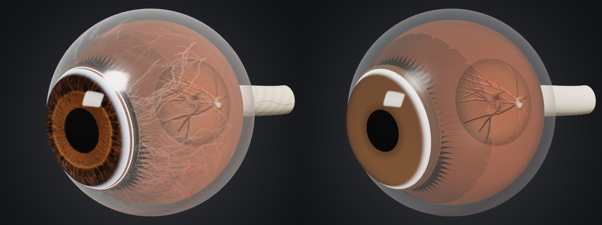

*단순하게 보기 끔 / 켬 — 공막의 혈관, 홍채 결이 사라지고 망막이 남습니다*

**속도** — 실제 장비 크기(RetiCam 5736 × 4304, 약 2,400만 화소) 사진으로 잰 값입니다.

| 작업 | 전 | 후 |
|---|---|---|
| 3D에 올릴 망막 영역 계산 | 1.5 s | 0.06 s |
| 밝기·대비·감마 조정 한 번 | 0.2 s | 0.01 s |
| 다음 사진으로 넘기기 | 0.4 s | 0.07 s (이웃 사진을 미리 읽어 둠) |
| 3D 한 장 그리기, 그래픽카드 없는 PC · 자세히 | 97 ms (10장/초) | 43 ms (23장/초) |
| 3D 한 장 그리기, 그래픽카드 없는 PC · 간단히 | 38 ms (26장/초) | 19 ms (53장/초) |

3D는 눈에 보이는 차이 없이 모형의 삼각형 수를 줄였고(그래픽카드가 없으면 삼각형 처리에 시간이 가장 많이 듭니다),
그래도 한 장이 22 ms를 넘는 PC에서는 **움직이는 동안만** 작은 해상도와 성긴 모형으로 그렸다가 멈추면 바로 선명하게
다시 그립니다. 화면 저장은 항상 선명합니다.

### 휠로 들어가기

들어가며 보기와 같은 길(각막 → 앞방 → 동공 → 수정체 → 유리체 → 망막)을 **마우스 휠로** 원하는 만큼씩 들어가고 나옵니다.

설정 패널의 **마우스 휠**을 **들어가기**로 해 두면 1번 없이 바로 휠로 들어갑니다(Ctrl+휠은 확대). 깊이 · 확대일 때는 아래처럼
전안부를 먼저 고릅니다(**각막을 누르면 휠로 들어가기** 스위치가 켜져 있을 때 — 처음 설정).

1. **전안부 선택**: 3D 안구의 **각막을 왼쪽 클릭**합니다(앞쪽을 조금 절개해 둔 안구는 앞쪽 열린 곳을 누름). 깊이 15 %
   이상으로 연 안구에는 각막 · 수정체가 없어 눌러도 선택되지 않으니(휠은 확대), 깊이 막대를 15 % 아래로 올리거나(닫힘 쪽)
   설정 패널(막대의 **설정**)의 **들어가며 보기 → 전안부 선택**을 누릅니다. 선택한 전안부 둘레에 하늘색 고리가 생기고, 안구 아래에
   "전안부 선택 — 휠을 앞으로 돌리면 각막부터 망막까지 들어갑니다"가 뜹니다. 선택한 동안에는 자동 회전이 멈춥니다.
2. **휠**: 앞으로 돌리면 들어가고 뒤로 돌리면 나옵니다(한 칸에 길의 4 %, 25칸이면 망막). 첫 몇 칸에 안구가 닫히며
   각막이 정면으로 오고, 그다음 각막 → 앞방 → 동공 → 수정체 → 유리체를 지나 **망막(내부 시점)**에 닿습니다. 지나는 곳
   이름이 안구 아래에 뜨고, 위치 막대와 `외부 | 내부`도 함께 움직입니다. 오른쪽 드래그(위·아래)와 `+` `−`도 같습니다.
3. **망막에서**: 망막에 닿으면 그 휠은 거기서 멈춥니다. 다음 휠부터는 **커서 쪽으로 더 가까이**(내부 시점의 확대),
   뒤로 돌리면 먼저 전체 시야로 넓어진 다음 다시 나옵니다.
4. **왼쪽 드래그 = 둘러보기**: 들어가는 중에는 그 자리에서 고개를 돌리듯 위·아래·옆을 봅니다(앞방에서 홍채와
   전방각, 유리체에서 망막의 다른 곳). 놓으면 관성으로 조금 더 돕니다. 화살표 키도 같습니다.
5. **왼쪽 클릭 = 그곳으로**: 들어가는 중에 누른 곳이 화면 가운데로 부드럽게 옵니다(망막에서 보고 싶은 곳을 누르고 휠로
   다가가기).
6. **끝내기**: 휠을 끝까지 뒤로 돌리면 처음 보던 안구(앞쪽 절개 그대로)로 돌아옵니다 — 둘러본 방향도 처음으로.
   **Esc**, 다른 곳 클릭(처음 위치에서), **전안부 선택**을 다시 누르기, 더블클릭 · 처음 시점 · 정면 · 안구 열기 · 슬릿 스캔
   · `외부`로 나가기로 선택이 풀리고 휠은 다시 **마우스 휠**에서 고른 대로(깊이 · 확대) 됩니다. 간단히 보기에서
   선택하면 자세히로 그립니다(설정은 그대로).

고리는 화면에만 보이고 **화면 저장**에는 들어가지 않습니다. [3D 안구 미리보기](#3d-안구-미리보기-웹-페이지) 웹
페이지에도 같은 기능이 있습니다.

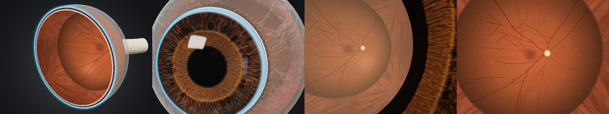

*휠로 들어가기 — 전안부 선택(고리) → 휠: 안구가 닫히며 각막이 정면으로 → 앞방에서 왼쪽 드래그로 둘러보기 → 망막*

### 슬릿 스캔 · 세로 단면 · 망막 투시

| 단면에 화각 표시 | 슬릿 스캔 중 (창 전체) |
|---|---|
| 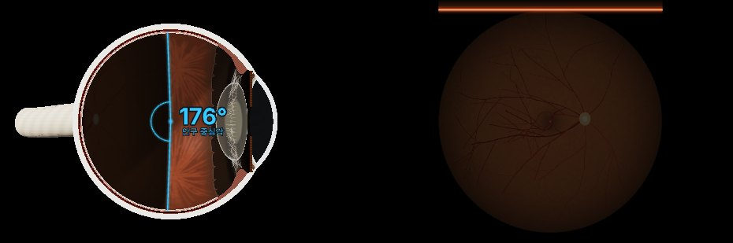 | 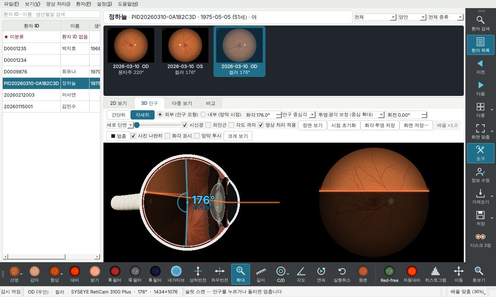 |
| **끝 화면 — 사진을 입힌 3D 안구** | |
| 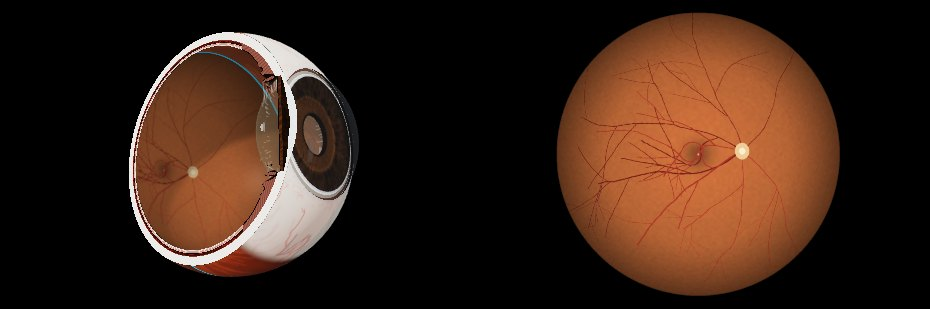 | |

* **세로 단면**: 사진의 세로 자오선(사진의 위·아래 방향)을 따라 안구를 잘라 옆에서 봅니다. 잘린 면은 실제
  해부 구조대로 공막(흰색) → 맥락막 → 망막 층, 톱니둘레 앞의 섬모체, 홍채, 투명한 수정체(노란 핵),
  각막을 그리고, 남은 반쪽의 망막에는 사진이 입혀져 있습니다. 시신경 유두가 있는 쪽이 남으므로 우안은
  각막이 오른쪽, 좌안은 왼쪽을 향합니다(귀쪽에서 본 모습). 슬라이더 왼쪽 끝(0)은 정확히 반(광축을
  지나는 면), 오른쪽으로 갈수록 덜 잘리고 100은 닫힌 안구입니다. 앞쪽 절개와 세로 단면은 각자 깊이를
  기억합니다.
* **화각 표시**: 세로 단면에서는 안구 중심에서 촬영 범위 양 끝까지 두 선과 각도(예: **176°**, 안구 중심각)를,
  다른 보기에서는 망막 위 촬영 범위의 경계를 하늘색으로 그립니다. 몽타주는 그 단면에서 사진이 실제로 덮은 곳까지를
  대략(`약 220°`) 보이고, 경계 원은 그리지 않습니다.
* **망막 투시**: 공막·맥락막을 투명하게 해 사진을 입힌 망막을 안구 바깥에서도 봅니다(바깥에서 보므로 좌우가
  뒤집혀 보이는 것이 맞습니다). 망막이 없는 톱니둘레 앞은 흰 공막·각막·홍채 그대로입니다.
  앞쪽 절개·세로 단면 어느 쪽과도 함께 씁니다.
* **사진 나란히**: 3D 안구 오른쪽에 사진을 평면으로 함께 보여 줍니다(검은 바탕). 촬영 원 밖은 검게 가리므로
  장비가 사진 구석에 찍는 이름·ID는 보이지 않습니다.
* **▶ 슬릿 스캔** (약 12초, 사진 나란히로 바뀌고 실제 해부 모형인 **자세히**로 그림). 방향은 설정 패널의
  **슬릿 스캔** 묶음에서 고릅니다: **↓ 위에서 아래로 · ↑ 아래에서 위로**(세로 단면을 옆에서), **→ 왼쪽에서 오른쪽으로 ·
  ← 오른쪽에서 왼쪽으로**(앞을 연 안구를 정면에서, 슬릿이 망막 위를 지나감), **상하좌우**(네 방향을 차례로 —
  위아래 다음 단면이 닫히며 앞이 열림). 위아래의 경우:
  1. 안구가 옆으로 돌며 세로로 반이 잘립니다.
  2. 안구 중심에서 화각 선이 열리고 각도가 나타납니다.
  3. 슬릿(주황 선)이 사진을 위에서 아래로(또는 아래에서 위로) 훑습니다. 훑기 전 부분은 어둡고, 단면에서는 슬릿 빛이
     동공을 지나 사진의 그 줄이 닿는 망막 위치로 갑니다(같은 투영식 사용). 망막 위에는 그 줄이 곡선으로 빛납니다.
  4. 자르는 면이 바깥으로 물러나 황반·시신경 유두가 보이고, 망막 투시가 켜지며, 앞에서 비스듬히 본
     3D 안구(흰 공막·홍채·각막과 안쪽 망막의 사진)로 돌아갑니다.
  5. 그 뒤로 천천히 돕니다. 안구를 누르거나 돌리면(휠·키 포함) 언제든 멈추고 그 자리에서 직접 조작합니다.
* **크게 보기**: 3D 안구와 사진을 화면 전체로 보여 줍니다(환자 설명용). Space = 슬릿 스캔, Esc = 돌아가기.
* **화면 저장…**은 사진 나란히일 때 안구와 사진을 화면 그대로 한 장으로, 화각 선·각도도 함께 저장합니다.

### 해부학적 묘사

치수는 성인 평균(`fundusview/ui/eye_model.py`, 1 = 12 mm)이고, 질감은 처음 실행할 때 한 번 만들어
설정 폴더의 `cache\`에 저장합니다(다음부터는 바로 열림).

* **공막**: 젖은 표면의 광택, 결막 혈관(검열 부위에 많음)과 윤부 혈관 고리, 곧은근 부착부에서
  나오는 앞섬모체동맥, 깊은 공막위 혈관, 적도 뒤의 소용돌이정맥 4개, 시신경 둘레의 짧은뒤섬모체동맥.
* **각막**: 화소마다 광선을 추적합니다. 앞면 반사(프레넬)로 조명 상자가 비치는 반사광, 굴절(n 1.336)로
  보는 각도에 따라 확대·이동해 보이는 홍채, 동공 안 수정체 앞면의 희미한 반사(푸르키녜 Ⅲ상),
  공막이 덮이는 윤부 경계.
* **홍채**(갈색): 방사상 섬유주, 동공 주름(ruff), 지그재그 홍채주름(collarette), 푹스 움(crypt),
  수축 고랑, 주근깨. 높낮이를 음영으로 표현합니다.
* **안구벽 두께**: 절개면에 공막 → 맥락막상강 → 맥락막(혈관 단면) → RPE → 망막층(시세포·핵층·망상층·
  신경섬유층)이 보이고, 톱니둘레 앞에서는 섬모체 단면이 됩니다.
* **안쪽**: 톱니 모양 톱니둘레(ora serrata), 섬모체 평면부, 섬모체 돌기 72개, 섬모소대, 수정체
  (단면에서 노란 핵·피질층·피막), 홍채 뒷면, 전방각(섬모체띠·공막돌기·섬유주·슈발베선).
  안쪽은 그림자 없이 고르게 비춥니다. 절개 슬라이더 70 전후가 섬모체·수정체,
  81~83이 홍채 단면, 88 이상이 각막만 뗀 상태입니다.
* **시신경**: 경막 싸개가 공막과 이어지고, 잘린 끝에 신경 다발·경막·거미막밑공간과 중심망막동맥·정맥이
  보입니다.
* **외안근**(선택): 네 곧은근(틸로 나선 거리대로 부착, 흰 힘줄 → 붉은 근육)과 두 빗근의 절단 부위.

3D는 OpenGL 2.1이 필요합니다. 그래픽 드라이버가 오래된 PC에서는 **설정 → 일반 → 3D 렌더링 →
소프트웨어 렌더링**을 고르고 다시 시작합니다(PySide6에 포함된 Mesa `opengl32sw.dll` 사용).

## 3D 안구 미리보기 (웹 페이지)

`web3d/eye3d.html`은 프로그램의 3D 안구를 웹 페이지 한 장에 담은 것입니다. 3D 기능을 설치 없이 빨리 확인하고,
확인(컨펌)된 것만 프로그램에 넣기 위한 시제품입니다.

* **프로그램과 같은 그림**: 프로그램의 셰이더(`fundusview/ui/eye3d.py`), 안구 모형의 치수·윤곽·질감
  (`eye_model.py`), 사진을 안구에 얹는 계산(`projection.py`·`placement.py`), 황반·유두 찾기(`imaging.py`)를
  그대로 옮겼습니다. 셰이더·모형·질감·데모 사진은 `web3d/build.py`가 프로그램에서 직접 꺼내 넣습니다.
* **되는 것**: 프로그램의 3D 안구와 같습니다 — 외부/내부와 **들어가며 보기**(**휠로 들어가기** 포함), 앞쪽 절개·세로 단면과 깊이, 공막
  투명도, 망막 투시, **망막 입체**(표면 높낮이 · 높이 · 입체 조명), 자동 회전, 화각 표시, 사진 나란히, **▶ 슬릿 스캔**
  (↓ ↑ → ← · 상하좌우), **단순하게 보기**, 크게 보기, 시신경·외안근·각도 격자, 실제 위치에 맞춤(황반 → 후극,
  유두 → 코쪽)과 황반–유두 거리, 화각·투영·회전, 황반–유두 거리로 크기 맞춤. 관성 회전, 커서 쪽 확대, 두 손가락
  확대(터치).
* **사진**: 데모 사진 6장(RetiCam 176°, 45° 황반 중심·코쪽·위쪽, 30° 유두 중심, APOLLO 135°)과 **내 사진 열기**
  (끌어다 놓기도 됨). 내 사진은 브라우저 안에서만 쓰이고 어디에도 올라가지 않습니다. **황반·유두 자동으로 찾기**가
  기본으로 켜져 있어, 사진을 열면 브라우저 안에서 프로그램과 같은 방법으로 시신경 유두와 황반을 찾아 안구의 제자리에
  맞춥니다(데모 사진도 매번 찾음, 눈을 정하지 않으면 황반이 있는 쪽으로 우안·좌안도 정함). 찾은 곳은 사진 아래에
  "자동으로 찾음 / 직접 지정"으로 표시되고, 틀렸을 때만 **황반 지정 / 유두 지정**으로 고치며 **다시 찾기**로 되돌립니다.
* **새 기능을 먼저 해 보는 곳**: 셰이더는 프로그램의 것(`fundusview/ui/eye3d.py`)을 그대로 쓰고, 페이지에서만 시험할
  줄은 `web3d/build.py`의 `WEB_PATCHES`에 넣었다가 확인되면 프로그램으로 옮깁니다(지금은 비어 있음 — 들어가며 보기,
  망막 입체, 단순하게 보기, 슬릿 방향 모두 프로그램에 들어갔습니다).
* **없는 것**: 2D 화면·측정·환자 목록(3D만 담았습니다).

다시 만들기: `python web3d/build.py` → `web3d/eye3d.html`. 페이지의 동작은 `web3d/app.js`, 모양은 `web3d/app.css`,
틀은 `web3d/page.html`입니다.

## 구조

```
fundusview/
  app.py            진입점 (OpenGL 모드, 테마, --demo / --home)
  config.py         설정 JSON (%APPDATA%\FundusViewer\settings.json)
  db.py             SQLite: patients / images / seen_files / import_log
  profiles.py       카메라 프로필 (RetiCam, APOLLO, VK-2, VK-2 ID 폴더, 일반)
  extract/          메타데이터 추출 (dicom / reticam / apollo / embedded+sidecar / filename / normalize)
  importer.py       안정화 대기 → 중복 검사 → 추출 → 분석 → 라이브러리 저장 → DB
  watcher.py        watchdog 감시(또는 폴링) + 재검사 + 가져오기 작업 스레드
  imaging.py        영상 읽기(DICOM 포함), 촬영 원·시신경 검출, 표시 조정(LUT)
  projection.py     안구 기하 (θ↔영상 반경, 내부각↔외부각) — 셰이더와 동일한 식
  placement.py      사진이 안구의 어디에 놓이는지: 황반 → 후극, 유두 → 코쪽 제자리 (비틀림 없는 회전), 황반–유두 거리
  demo.py           합성 안저 사진 + 장비별 형식 데모 폴더
  measure.py        측정 (화소 → 망막 각도·mm, 각도, 면적)
  discpair.py       디스크 2장: 유두 지름 기준 자르기, OD/OS 배치
  disc3d.py         유두 3D: 한 장의 밝기 / 두 장의 시차에서 높낮이, 돌려 본 표면 그리기 (OpenGL 없이)
  glaucoma.py       녹내장 분석: 두 사진 맞춤 · 스테레오(적청 · 시차 지도) · C/D · 림 두께 · Garway-Heath 구역 ·
                    24-2 격자 · 변화 지도
  calibrate.py      카메라 각도 보정: 여러 사진의 황반–유두 거리(중앙값)에서 광각 카메라의 렌즈 곡선
  montage.py        몽타주: 사진별 구면 회전, 혈관 특징점 자동 맞춤(RANSAC · 화각 보정), 기준점, 밝기 맞춤,
                    두 대역 섞기, 등거리 지도
  autosetup.py      자동 가져오기: 가져오기 폴더 + 장비 폴더(RetiCam·APOLLO) 찾기
  share.py          여러 컴퓨터에서 함께 쓰기: 서버(HTTP) · 서버에 연결한 뷰어의 데이터베이스 · 사진 캐시
  share_page.py     서버가 웹 브라우저에 주는 화면 (환자 목록 · 사진 · 메모)
  review.py         검토: 검사(검사일) 묶기, 눈마다 보여 줄 사진 고르기, 이전 검사 순서
  samples.py        질환 샘플: 질환별 샘플 사진 보관 (라이브러리 폴더의 질환 샘플\, 설명 · 순서는 index.json)
  ui/               main_window, patient_list(환자 목록 창 — 처음에 뜨는 따로 된 창), review_view(검토 화면 — 0.3.0부터 숨김:
                    두 화면 · 연동 · 확대창 · 타임라인), toolbars(VK-2 명령·영상 처리 툴바), icons, eye3d(OpenGL 셰이더),
                    eye_model(안구 해부 치수·메시·절차적 질감), slit_scan(사진 나란히·슬릿 스캔 연출),
                    motion(관성 · 미끄러지는 확대 · 전환 애니메이션),
                    theme(어두운 화면: 색 · 글꼴 · 창 틀) + style.qss, widgets(스위치 · 나란한 단추 · 카드 · 접히는 도구 줄),
                    image_view(도구·사진 위 글자·황반/유두 표시),
                    multi_view(Simple · Multi 칸 · ◀ ▶ · 황반 · 디스크), pair3d(여러 장 3D · 깊이 막대),
                    sample_compare(질환 샘플과 비교 창), disc_pair(디스크 2장 미리 보기·저장·인쇄),
                    glaucoma_dialog(녹내장 분석 창: 디스크 C/D · 3D 입체 · 광각 · 스테레오 · 경과),
                    montage_dialog(몽타주 편집기: 반투명 겹치기·기준점·완성·3D), histogram, dialogs,
                    import_dialog(사진 가져오기 → 환자 정보 확인 창)
tests/              pytest (추출·투영·영상·가져오기·감시·GUI·디자인·3D 안구 모델·OpenGL 렌더링·웹 미리보기,
                    test_import_review: 가져오기 확인 창 · 환자 지정, test_import_stress: 극한 테스트 —
                    손상 파일 · 무작위 이름 · 대량 · 여러 스레드 · 환자 수천 명)
web3d/              3D 안구 미리보기 웹 페이지 (build.py → eye3d.html)
fundus_viewer.spec  PyInstaller (Windows exe · Mac .app), build_windows.bat · build_mac.sh
macos_bundle.py     Mac 앱의 최소 macOS: 앱에 든 라이브러리(Mach-O)에서 읽어 Info.plist에 쓰고 빌드 뒤 확인
```

라이브러리 폴더(기본: `문서\FundusViewerLibrary`)에는 `fundus.db`, `images\<환자ID>\<검사일>\`
사본, `thumbs\`, `display\`(DICOM을 PNG로 바꾼 사본)가 들어갑니다. 처리 방식은 폴더마다
**복사**(기본, 원본 유지) / 이동 / 원본 위치 참조 중에서 고릅니다. 장비 공유 폴더는 반드시 복사나
참조로 두세요.

## 테스트

```bash
QT_QPA_PLATFORM=offscreen python -m pytest -q tests
```

`offscreen`에는 OpenGL이 없어서 3D 렌더링 테스트(`tests/test_eye3d_gl.py`)는 건너뜁니다. 리눅스에서는
Xvfb와 Mesa로 셰이더 컴파일까지 확인할 수 있습니다(CI도 이렇게 돌립니다).

```bash
FUNDUSVIEW_REQUIRE_GL=1 QT_QPA_PLATFORM=xcb xvfb-run -a python -m pytest -q tests/test_eye3d_gl.py
```

## 알려진 한계와 다음 단계

* **RetiCam 투영 보정의 기본값은 잠정값**입니다. 근거는 몽타주 샘플 한 장의 측정과 해부학적 유두 위치뿐입니다.
  **설정 → 카메라 각도 보정**으로 쌓인 사진에서 중심부의 각도는 다시 맞출 수 있지만, 가장자리가 정말 176°인지는
  그대로 남습니다. 보정을 확정하려면 둘 중 하나가 필요합니다.
  * SYSEYE에서 투영·왜곡 자료나 DICOM 적합성 문서를 받기
  * 격자 시험판을 찍은 사진으로 맞추기
  그때까지 3D 화면에서 투영을 "등거리"로 바꿔 비교할 수 있고, 영상별 "화각·투영 저장"도 됩니다.
  주변부 고정 촬영(fixation) 사진의 회전 정보는 아직 쓰지 않습니다(사진에서 찾은 황반·유두로 위치를 정합니다).
* **VK-2 원본 DB 연동**: `vk3x.mde`(Access) 스키마가 문서화되어 있지 않아, 원본 저장소
  사진의 환자 연결은 아직 하지 않습니다. 샘플 `.mde`로 테이블 구조를 확인한 뒤 읽기 전용
  커넥터를 추가할 수 있습니다. VK-2 전용 무손실 형식 `.dlt`는 읽지 못합니다.
* **APOLLO 단일 모드 파일**(IR / RF / FFA / AF / ICGA+FFA)의 JSON에는 환자 경로가 없습니다. 이런
  파일은 `PatientCapture\<ID>_<이름>` 폴더 구조에서 환자를 찾습니다. ICGA 단독의 `ImgType` 값은 아직
  확인하지 못했습니다. PNG 내보내기의 바이너리 헤더는 SKY 샘플 하나로만 확인했습니다.
* 3D 매핑은 1차 광학 모델입니다(카메라 왜곡과 안축장 차이는 반영하지 않음). 측정·진단용이 아닌
  시각화 용도입니다.
* 이 뷰어는 의료기기 인증을 받은 소프트웨어가 아닙니다. DB에는 환자 이름이 저장되므로 PC 접근
  권한을 관리하세요.
