# 안저 사진 뷰어 (Fundus Viewer)

Windows 10 / 11 · macOS 11 이상용 안저카메라 전용 뷰어입니다. **감시 폴더에 사진 파일이 떨어지면** 파일에서
환자 ID·이름 등 환자 정보를 추출해 뷰어 데이터베이스로 가져오고, 2D로 보거나 **광각 사진을
실제 안구처럼 입체(3D) 모델**로 돌려 볼 수 있습니다.

우선 회사 초광각 모델 **SYSEYE RetiCam 3100 Plus (1회 176° · 몽타주 220°)** 에 맞춰
만들었고, **Microclear APOLLO (WA 135° / UWA 165°)**, **Kowa VK-2 / VK-2s** (nonmyd·VX
시리즈) 출력과 일반 안저카메라 파일도 읽습니다.

| 2D 보기 | 3D 안구 — 간단히 |
|---|---|
| 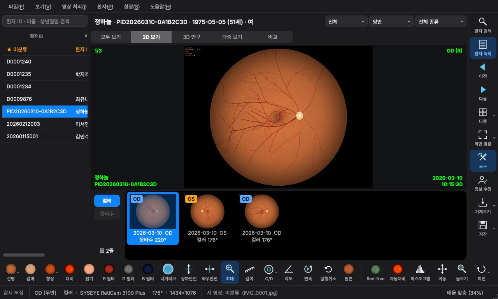 | 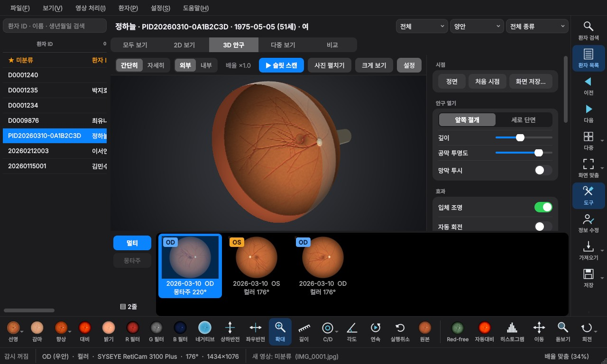 |
| **3D 안구 — 자세히 (절개 보기)** | **3D 안구 — 자세히 (닫힌 안구)** |
| 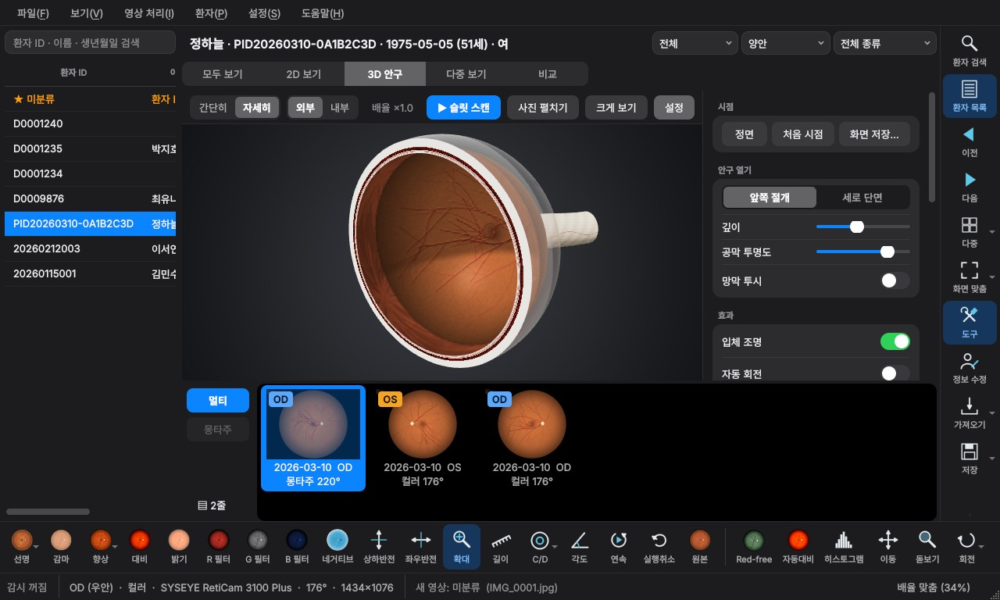 | 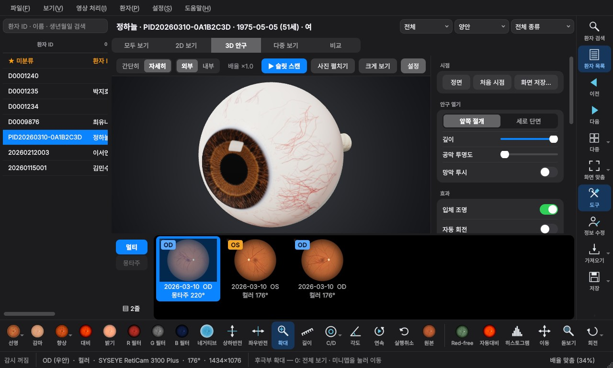 |
| **3D 안구 — 내부(망막 시점)** | **2D — 후극부 확대와 미니맵** |
| 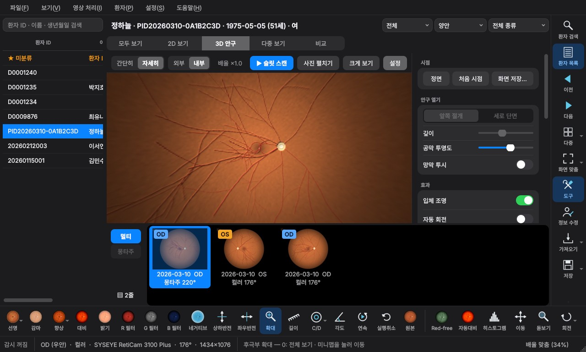 | 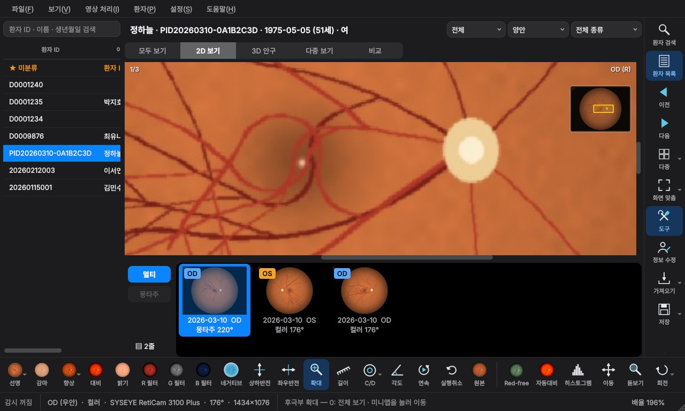 |

**슬릿 스캔** — 안구를 옆에서 반으로 자른 단면에 화각(안구 중심각)을 보이고, 슬릿이 사진을 위에서 아래로
(또는 아래에서 위로) 훑는 동안 빛이 동공을 지나 같은 망막 위치에 닿는 모습을 보여 준 뒤, 사진을 입힌 3D 안구로
돌아갑니다. 좌우 방향은 앞을 연 안구의 망막 위로, **상하좌우**는 네 방향을 차례로 보여 줍니다
([아래](#슬릿-스캔--세로-단면--망막-투시)).

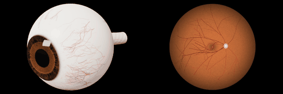

**자세히** 보기는 실제 해부 구조대로 그립니다.

| 각막·홍채 (굴절·반사광) | 앞쪽 절개 70 — 섬모체 돌기·소대·수정체 |
|---|---|
| 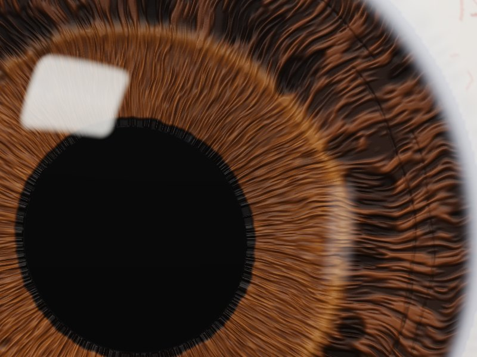 | 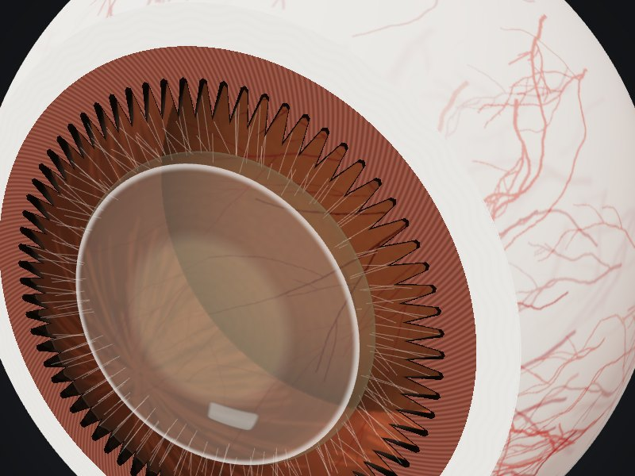 |
| **안구벽 단면 — 공막·맥락막·RPE·망막층** | **외안근 부착부와 시신경** |
| 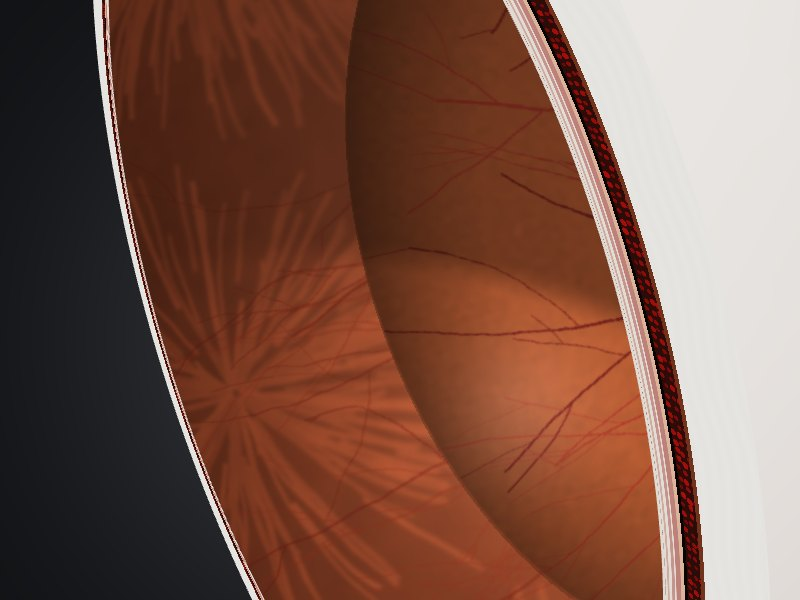 | 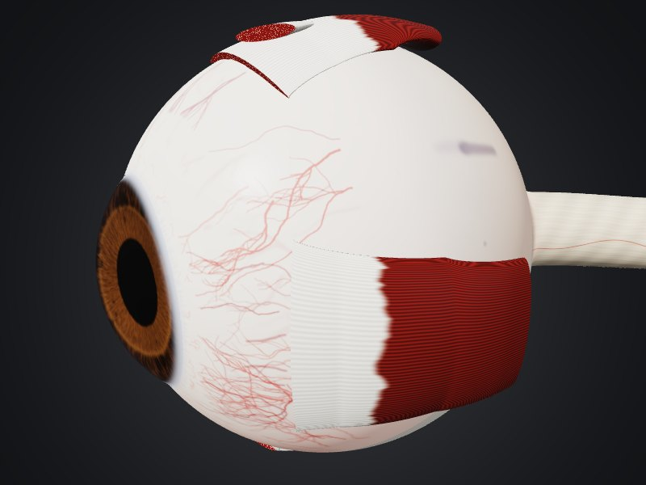 |

> 화면의 사진과 환자는 모두 `fundusview/demo.py`가 만든 **합성(가상) 데이터**입니다.

## 빠른 시작

```bat
pip install -r requirements.txt
python run_viewer.py --demo
```

`--demo`는 빈 라이브러리에 가상 환자 사진(RetiCam·APOLLO·VK-2·DICOM 형식)을 넣어 바로 써 볼
수 있게 합니다. `--home D:\FundusViewer`를 주면 설정과 라이브러리를 그 폴더 하나에 둡니다(휴대용).

**내려받기 (Windows 10 / 11):**
https://github.com/kukje1980/Image-capture/releases/download/fundus-viewer-latest/FundusViewer-windows.zip
— 로그인 없이 받아지며 항상 최신 빌드입니다. 압축을 풀고 `FundusViewer\FundusViewer.exe`를 실행합니다
("Windows의 PC 보호" 창이 뜨면 **추가 정보 → 실행**).

**직접 빌드:** Windows는 `build_windows.bat` 실행 → `dist\FundusViewer\FundusViewer.exe` (폴더째 복사해
사용). GitHub Actions(`fundus-viewer` 워크플로)가 커밋마다 Linux에서 시험(3D 안구 OpenGL 렌더링 포함)하고
Windows exe를 빌드하며, `main` 브랜치의 빌드만 위 주소(릴리스 `fundus-viewer-latest`)에 올립니다(다른
브랜치·PR은 빌드·시험만).

**Mac:** 프로그램은 macOS 11 이상에서도 동작하지만 Mac용 파일은 지금은 자동으로 만들지 않습니다. 필요하면
Mac에서 `./build_mac.sh` → `dist/FundusViewer.app`과 `dist/FundusViewer-mac-<AppleSilicon|Intel>.dmg`
(빌드하는 Mac의 칩용)를 직접 만듭니다. 애플 인증서 없이 임시(ad-hoc) 서명만 한 앱이라 처음 열 때 경고가
나옵니다: macOS 15 이상은 한 번 열어 경고를 닫은 뒤 **시스템 설정 → 개인정보 보호 및 보안 → 그래도 열기**,
14 이하는 앱을 **Control+클릭 → 열기**. Mac에서는 Ctrl 대신 ⌘(⌘+클릭 = 두 번째 사진), 트랙패드 두 손가락
스크롤·벌리기/오므리기로 확대·축소합니다. 설정은 `~/Library/Application Support/FundusViewer`, 라이브러리는
`문서/FundusViewerLibrary`에 둡니다.

**3D 안구 미리보기 (웹 페이지):** `web3d/eye3d.html` 하나를 브라우저(Chrome·Edge·Safari·Firefox)로 열면 프로그램의
3D 안구를 설치 없이 돌려 볼 수 있습니다. 새 3D 기능은 여기서 먼저 확인한 뒤 프로그램에 넣습니다. 자세한 내용은
[아래](#3d-안구-미리보기-웹-페이지).

## 사용 흐름

사진 가져오기는 **설정 없이 자동**입니다. 프로그램을 켜면:

* **가져오기 폴더** `문서\안저사진 가져오기`를 만들고 감시합니다. 여기에 넣은 사진은 라이브러리로
  **옮겨지므로** 폴더가 비면 모두 들어간 것입니다.
* 모든 드라이브(네트워크 드라이브 포함)에서 촬영 프로그램 폴더를 찾아 알맞은 카메라 프로필로
  감시 목록에 넣습니다. 장비 폴더는 **복사**만 하고(원본 유지), 네트워크 드라이브는 폴링합니다.

  | 장비 | 찾는 폴더 |
  |---|---|
  | SYSEYE RetiCam 3100 Plus | `X:\reticam`, `X:\RetiCam`, `X:\레티캠`, `X:\SYSEYE` |
  | Microclear APOLLO | `X:\MicroClearClient\ImageData`, `X:\MC\Cro\PatientCapture`, `%USERPROFILE%\MicroClearClient\ImageData` |

* 감시가 바로 시작됩니다. 새 파일은 쓰기가 끝날 때까지 기다린 뒤 가져오고, 프로그램이 꺼져 있던
  동안 들어온 파일도 시작할 때 찾아냅니다.

다른 위치(예: 장비 PC의 공유 폴더 `\\<장비 IP>\D\reticam`)는 **설정 → 감시 폴더 → 폴더 추가**로
넣습니다. 설정에서 지운 폴더는 다시 자동으로 추가되지 않으며, **설정 → 일반**에서 자동 찾기를 끄거나
**지금 장비 폴더 다시 찾기**를 누를 수 있습니다.

1. 새 사진이 들어오면 그 환자와 사진이 바로 열립니다(파일 → 새 영상 자동 표시).
2. 왼쪽 환자 목록 → 아래쪽 사진 목록(최신 사진부터, 사진마다 **OD/OS** 표시) → 위쪽 **모두 보기 / 2D 보기 /
   3D 안구 / 다중 보기 / 비교** 탭. 처음 화면인 **모두 보기**에는 큰 사진과 다중 · 확대 · 3D 화면이 함께 나옵니다
   ([아래](#모두-보기)). 사진을 **클릭**하면 멀티로 골라지고(번호), **더블클릭**하면 2D로 크게 열립니다. 사진 목록
   왼쪽의 **[멀티]** 를 누르면 고른 사진이 다중 보기에 모이고 칸마다 따로 보정할 수 있습니다
   ([아래](#사진-목록--멀티-vk-2-방식)). 두 번째 사진을 **Ctrl+클릭**하면
   두 장이 골라져 비교 탭에 나란히 나오고, **[디스크 2장]** 으로 두 사진의 시신경 유두만 확대한 한 장을
   만듭니다([아래](#디스크-2장-보험-청구용)). 같은 눈을 여러 방향으로 찍은 사진을 골라 **[몽타주]** 를 누르면
   한 장으로 합쳐 3D 안구에서도 봅니다([아래](#몽타주-여러-장을-한-장으로--3d)).
3. 환자 ID를 찾지 못한 사진은 **★ 미분류**로 들어갑니다. 사진을 고르고 오른쪽 **정보 수정** 버튼으로
   환자를 지정합니다. 잘못된 환자로 잘못 들어가는 것보다 미분류가 안전하므로 추측하지 않습니다.

창에 파일·폴더를 끌어다 놓아도 가져오며, 같은 내용의 파일(SHA-256)은 한 번만 들어갑니다.

## 화면 구성 (Kowa VK-2 방식)

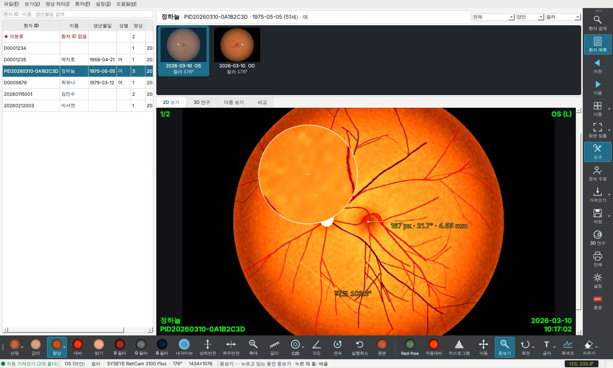

VK-2 캡처 화면처럼 만들었습니다.

**어두운 화면** — 사진을 보는 프로그램이라 화면 전체가 어둡습니다(아이폰의 다크 모드와 같은 방식). 바탕은 거의
검정이고 앞으로 나올수록 한 단계씩 밝아지며(창 → 카드 → 버튼), 지금 고른 것과 주 버튼만 **파란색** 하나로 표시합니다.
글자는 세 단계 밝기, 모서리는 둥글고 구분선은 가늘게. 켜고 끄는 항목은 **스위치**(미끄러지며 초록으로),
둘 중 하나를 고르는 항목은 **나란한 단추**(고른 쪽으로 밝은 판이 미끄러짐)이고, 탭을 바꾸면 화면이 겹쳐 넘어갑니다.
Windows에서는 창 제목 표시줄도 어둡게 맞춥니다.

* 검은 영상 화면과 **오른쪽 명령 툴바**, **아래쪽 영상 처리 툴바**로 되어 있습니다.
* 촬영 사진 목록(썸네일)은 **영상 화면 아래**에 가로로 있고, 영상 화면 위의 탭으로
  모두 보기(Ctrl+5) · 2D 보기(Ctrl+1) · 3D 안구(Ctrl+2) · 다중 보기(Ctrl+3) · 비교(Ctrl+4)를 고릅니다.
* 사진 위에는 구석에 작은 글자 두 개만 나옵니다. 왼쪽 위에 사진 번호(`1/2`), 오른쪽 위에 눈(`OD (R)`). 환자 이름·ID·날짜는
  사진 위에 쓰지 않습니다(탭 위의 환자 줄과 사진 목록에 있음). 보기 → 화면 글자 표시로 끕니다.
* 상태 표시줄에는 자동 가져오기 상태, 영상 정보(눈 · 촬영 종류 · 장비 · 화각 · 크기), 측정 결과가 나옵니다.
  영상 정보에 마우스를 올리면 값마다 **어디서 읽었는지**(RetiCam 데이터 / 파일 이름 / DICOM …)가 보입니다.
* 두 툴바는 끌어서 옮길 수 있고, 보기 → 툴바 기본 위치로 되돌립니다. ▾ 표시가 있는 버튼은 화살표를
  누르면 추가 기능이 나옵니다. 버튼 위에 마우스를 올리면 VK-2의 해당 버튼 이름도 보입니다.

### 모두 보기

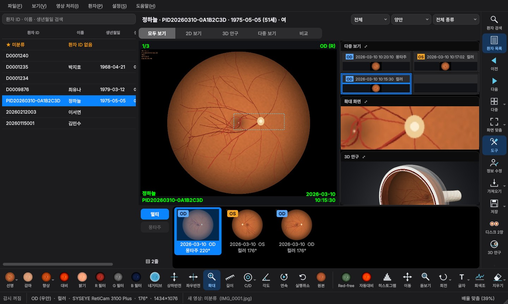

프로그램을 열면 나오는 첫 화면입니다. 왼쪽에 **큰 화면**(2D 보기와 같은 화면 · 같은 도구), 오른쪽에 작은 화면 셋이
있습니다.

* **다중 보기**: 선택한 사진부터 4장(2 × 2). 사진 목록에서 멀티로 고른 사진이 있으면 고른 사진(앞의 4장)이
  사진마다의 보정 그대로 나옵니다. 클릭하면 그 사진을 고르고, 더블클릭하면 2D 보기로 엽니다.
* **확대 화면**: 처음에는 **시신경 유두**를 4배로 보여 줍니다. 큰 사진에서 보고 싶은 곳을 **클릭**하면 그 곳이
  확대되고, 큰 사진 위의 **점선 틀**이 지금 확대 화면에 보이는 곳입니다. 확대 화면에서도 위/아래 드래그·휠로
  배율을, 가운데 버튼 드래그로 위치를 바꿉니다. Red-free·대비 같은 처리는 큰 화면과 똑같이 적용됩니다.
  점선 틀은 화면에만 보이고 복사·저장·인쇄되는 영상에는 들어가지 않습니다.
* **3D 안구**: 3D 안구 탭과 같은 모형입니다(돌리기·확대 그대로). OpenGL을 쓸 수 없는 PC에서는 이 칸에
  **3D 안구 보기 →** 버튼만 나오고, 3D는 3D 안구 탭에서 봅니다.
* 각 칸 제목(**⤢**)을 누르면 그 화면을 크게(해당 탭으로) 엽니다. 칸 사이의 경계를 끌어 크기를 바꿀 수 있습니다.

**오른쪽 명령 툴바** (VK-2 Command Toolbar 순서)

| 버튼 | VK-2 | 기능 |
|---|---|---|
| 환자 검색 | ID# SEARCH | 환자 ID·이름 검색 (Ctrl+F) |
| 환자 목록 | OPEN LIST | 왼쪽 환자 목록 보이기/숨기기 |
| 이전 / 다음 | PREV / NEXT | 이전·다음 사진 (PageUp / PageDown) |
| 다중 ▾ | MULTI | 다중 보기 (1·2·4·6·9·16장) |
| 화면 맞춤 ▾ | SCALE | 화면 맞춤 · 100~800% · **확대 위치**: 후극부, 위·아래·코·귀쪽 주변부 |
| 도구 | TOOLS | 영상 처리 툴바 보이기/숨기기 |
| 정보 수정 | EDIT DATA | 사진의 환자 지정, 검사 정보 수정 |
| 가져오기 ▾ | CAPTURE | 파일 · 폴더 가져오기, 감시 폴더 지금 검사 |
| 저장 ▾ | SAVE | 편집 영상을 환자 기록에 새 사진으로 저장(원본은 그대로) · 파일로 저장 · 클립보드 복사 |
| 디스크 2장 | | Ctrl+클릭으로 고른 두 사진의 시신경 유두만 확대해 한 장으로 (보험 청구용) |
| 3D 안구 | (DDV 자리) | 3D 안구 모형 |
| 인쇄 | PRINT | 화면 영상 + 환자 정보 머리말 (Ctrl+P) |
| 설정 · 종료 | EXIT | |

**아래쪽 영상 처리 툴바** (VK-2 Image Processing Toolbar 순서)

버튼 그림은 VK-2처럼 **작은 안저 사진에 그 효과를 적용한 모습**입니다. 사진에 적용 중인 처리는
버튼이 켜진 색으로 표시되고, 툴바에 마우스를 올리면 적용 순서가 보입니다.

| 버튼 | VK-2 | 기능 |
|---|---|---|
| 선명 ▾ | SHARPEN | 선명하게 (누를 때마다 누적, ▾ 약·강) |
| 감마 · 대비 · 밝기 | GAMMA · CONTST · BRIGHT | 버튼 옆에 슬라이더가 열림, 초기화 버튼 |
| 향상 ▾ | ENHANCE | 국소 대비 향상(미세 혈관·병변), ▾ 히스토그램 평활화 · 노이즈 감소 |
| R · G · B 필터 | RED · GREEN · BLUE FILTER | 한 색 성분만. 켜진 필터를 다시 누르면 컬러 |
| 네거티브 | NEGATIVE | 반전 영상 |
| 상하반전 · 좌우반전 | FLIP VRT · FLIP HRZ | |
| 확대 | ZOOM | **처음부터 켜져 있음.** 위로 드래그 확대, 아래로 축소 (누른 곳 중심) |
| 길이 | LENGTH | px와 **망막 각도·mm** |
| C/D ▾ | C/D RATIO | 길이 방식(cup·disc 지름) / ▾ 면적 방식(최대 12점 둘레) |
| 각도 | ANGLE | 세 점(가운데 점이 꼭짓점) |
| 연속 | LOOP | 이 환자 사진을 차례로 보기 (사진 클릭 시 멈춤) |
| 실행취소 · 원본 | UNDO · ORIGINAL | 마지막 처리 되돌리기 (Ctrl+Z) · 모든 처리·측정 해제 |
| Red-free · 자동대비 · 히스토그램 | | 녹색 채널 · 밝기 범위 자동 맞춤 · 검정/흰색 레벨 |
| 이동 · 돋보기 · 회전 ▾ | | 드래그 이동 · 누르는 동안 돋보기(누른 채 휠로 배율) · 90° 회전 |
| 글자 ▾ · 회색조 · 지우기 ▾ | | 글자 / 화살표+글자 · 누르는 동안 그 가로줄 밝기 그래프 · 마지막 / 모든 측정 지우기 |

**마우스 조작**
* **드래그만으로 확대·축소**: 사진 위에서 위로 끌면 확대, 아래로 끌면 축소됩니다. 누른 곳을 중심으로
  커지므로 보고 싶은 곳(시신경 유두, 황반)을 누르고 위로 끌면 됩니다. 도구를 고를 필요가 없고
  2D·다중 보기·비교 화면 모두 같습니다. 클릭만 하면 배율은 바뀌지 않습니다.
* 다른 도구(길이·각도 등)를 쓰는 중에도 **오른쪽 버튼 드래그**로 똑같이 확대·축소됩니다.
  드래그 없이 오른쪽 클릭하면 메뉴가 열립니다.
* **휠**: 커서 위치를 중심으로 확대·축소
* **가운데 버튼 드래그**: 이동 · **더블클릭**: 화면에 맞춤
* **키보드**: `+` / `−` 확대·축소(커서 위치) · `0` 화면에 맞춤 · `1` 100%

**확대해서 보기 (광각 사진)**

* 원본 해상도 그대로 최대 40배까지 확대합니다.
* **미니맵**: 확대하면 오른쪽 위에 전체 사진이 나오고 지금 보는 곳이 노란 틀로 표시됩니다.
  미니맵을 누르거나 끌면 그곳으로 이동합니다(오른쪽 클릭 메뉴에서 끌 수 있음).
* **확대 위치**: 화면 맞춤 ▾ 또는 상태 표시줄 오른쪽의 **[배율]** 버튼에서 후극부(황반·시신경)와
  위·아래·코·귀쪽 주변부로 바로 확대합니다. 코쪽은 시신경 유두 쪽(OD 오른쪽, OS 왼쪽)이고,
  촬영 원이 화면 틀보다 큰 광각 사진에서도 사진 안으로 맞춥니다.
* **[배율]** 버튼에 현재 배율이 표시됩니다(예: `배율 208%`, 맞춤일 때 `배율 맞춤 (36%)`).
* 돋보기 도구는 누르는 동안 커서 아래만 2~10배로 보여 줍니다.

**처리와 측정 동작 방식**
* 처리는 화면에서만 적용되며 저장된 원본 사진은 바뀌지 않습니다.
* 다른 사진으로 넘어가면 선명·향상 같은 처리 단계는 초기화됩니다. 감마·대비·밝기·필터는 유지됩니다.
* 길이는 그 영상의 화각·투영(3D와 같은 안구 모형)으로 **망막 위 실제 거리**로 바꿔 보여 줍니다. 초광각 사진은 주변부일수록 화소당 거리가 달라서 화소 길이만으로는 비교할 수 없기 때문입니다.
* 마우스 위치의 좌표, RGB 값, 후극에서의 각도는 상태 표시줄 오른쪽에 나옵니다.

**다중 보기** 탭은 VK-2 Multiple Images 기능입니다.
* 한 화면에 1·2·4·6·9·16장을 띄웁니다. 아래처럼 사진을 골라 두면 **고른 사진만**, 아니면 보고 있는 사진부터 차례로 나옵니다.
* 클릭하면 그 사진이 선택되고, 더블클릭하면 2D로 엽니다.
* 칸마다 위/아래 드래그로 따로 확대·축소할 수 있습니다.

### 사진 목록 · 멀티 (VK-2 방식)
* 사진 목록은 **최신 사진부터** 나오고, 사진마다 왼쪽 위에 눈이 색 글자로 붙습니다 — **OD**(파랑) · **OS**(주황) ·
  **OU**(보라) · **미상**(회색).
* 사진 목록은 화면 **아래쪽**에 있고, 그 왼쪽에 **[멀티]** · **[몽타주]** · 고른 장수 · **선택 해제** · **▤ 2줄** 버튼이
  세로로 있습니다.
* **▤ 2줄** 버튼으로 1 · 2 · 3줄을 고릅니다(기억됨). 사진이 적으면 필요한 만큼만 높아집니다.
* 사진을 **클릭**하면 노란 테두리와 번호(1, 2, 3 …)가 붙어 **멀티로 골라집니다.** 다시 클릭하면 빠지고,
  **선택 해제** 로 모두 뺍니다(최대 16장). **더블클릭**은 그 사진을 2D로 크게 엽니다.
* **[멀티]** 를 누르면 고른 사진이 고른 순서대로 다중 보기에 모입니다(장수에 맞게 2·4·6·9·16칸).
* 다중 보기에서 **칸을 누르면 그 사진만** 아래 영상 처리 툴바(감마 · 대비 · 밝기 · Red-free · R/G/B 필터 · 선명 · 향상 ·
  자동 대비 · 네거티브)로 보정됩니다. 다른 칸은 그대로이고, 사진마다 실행 취소(Ctrl+Z) · 원본이 따로 있습니다.
  보정한 사진을 2D로 열어도 같은 보정이 보입니다.

| 다중 보기 (4장) | Red-free (VK-2 사진) |
|---|---|
| 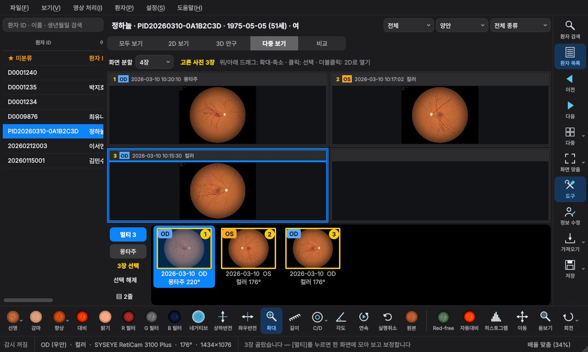 | 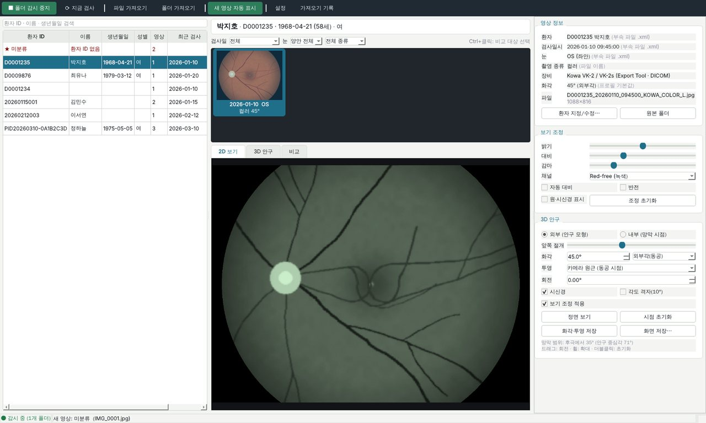 |

## 디스크 2장 (보험 청구용)

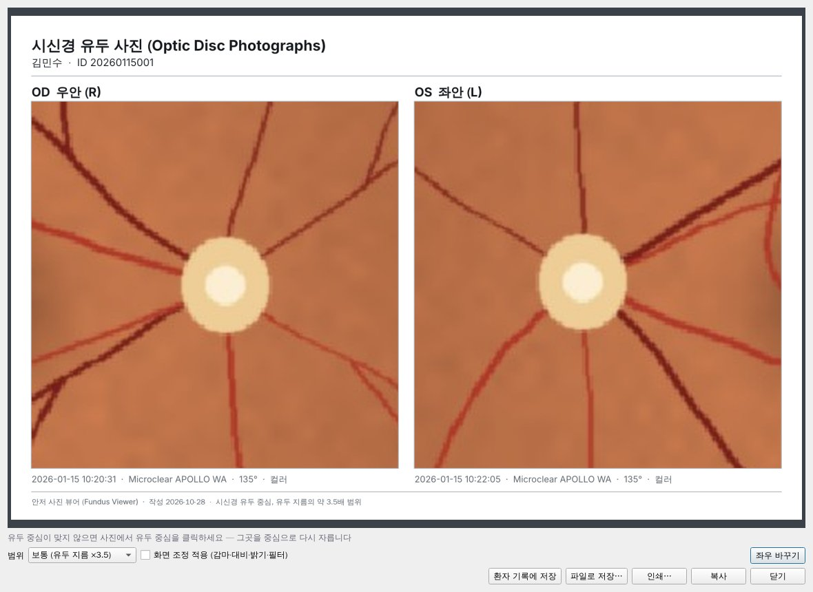

두 사진의 **시신경 유두 부분만 확대해 한 장**으로 만듭니다. 녹내장 등의 보험 청구에 붙이는 유두 사진용입니다.

1. 썸네일에서 사진 한 장을 더블클릭해 열고, 두 번째 사진을 **Ctrl+클릭**합니다. 두 번째 사진에는 **②** 표시와 주황색
   바탕이 붙고 비교 탭에 두 장이 나란히 나옵니다. ②를 다시 Ctrl+클릭하면 해제됩니다. ② 사진을 더블클릭하면
   두 사진의 역할만 바뀌고 둘 다 골라진 채로 있습니다.
2. 명령 툴바의 **[디스크 2장]**(또는 비교 탭 아래 버튼, 썸네일 오른쪽 클릭, 파일 메뉴)을 누릅니다.
3. 미리 보기 창에서 확인하고 **환자 기록에 저장**(사진 목록에 `디스크 2장` 종류로 추가, 원본은 그대로) ·
   **파일로 저장**(JPEG/PNG) · **인쇄**(A4 가로) · **복사** 중 하나를 고릅니다.

* **배치**: 우안 OD가 왼쪽, 좌안 OS가 오른쪽입니다(마주 본 환자 방향). 같은 눈 두 장은 먼저 찍은 사진이 왼쪽이며,
  **좌우 바꾸기**로 바꿀 수 있습니다.
* **머리말**에 환자 이름·ID·생년월일(검사일 기준 나이)·성별이 들어가고, 사진마다 눈, 아래에 검사 일시·장비·화각이
  들어갑니다.
* **유두 위치**: 가져올 때 검출했거나 2D 보기에서 오른쪽 클릭으로 지정한 위치를 씁니다. 찾지 못한 사진은 예상
  위치(중심와에서 코쪽 4.5 mm)로 자르고 경고를 보여 줍니다. 미리 보기에서 **유두 중심을 클릭하면** 그곳을 중심으로
  다시 자르며, 그 위치는 그 사진의 유두 위치로 저장됩니다(3D 시신경에도 반영).
* **범위**: 한 칸의 너비를 **유두 지름의 배수**로 정합니다 — 가깝게 ×2.5 · 보통 ×3.5(기본) · 넓게 ×5. 화소가 아니라
  각 사진의 화각·투영으로 유두 크기(1.8 mm)를 계산하므로 45° 사진과 초광각 사진도 같은 망막 범위로 잘립니다.
* 색은 **원본 그대로**입니다. **화면 조정 적용**을 켜면 2D 보기의 감마·대비·밝기·필터를 함께 적용합니다.
* 미분류 사진, 서로 다른 환자의 사진, 전안부 사진은 쓸 수 없습니다.

## 몽타주 (여러 장을 한 장으로 · 3D)

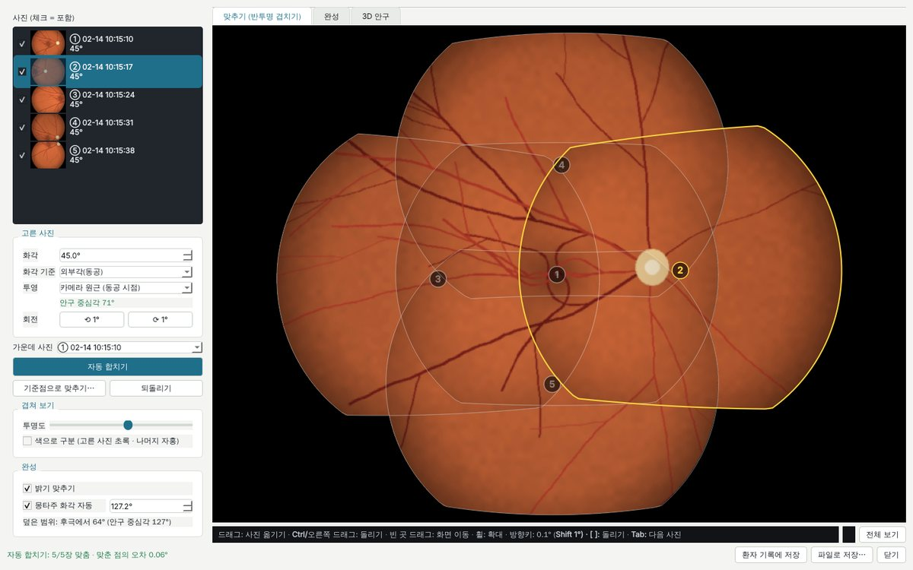

같은 눈을 시선을 바꿔 가며 찍은 사진(45° 5방향, 초광각 2장 등)을 **겹치는 혈관에 맞춰 한 장으로 합치고**,
그 결과를 **3D 안구**에 입혀 봅니다.

1. 사진 목록에서 같은 눈의 사진을 2장 이상 **클릭**해 번호를 붙이고, 왼쪽의 **[몽타주]** 를 누릅니다
   (또는 썸네일 오른쪽 클릭 · 파일 메뉴). 열리면 바로 **자동 합치기**가 실행됩니다.
2. **맞추기 (반투명 겹치기)** 탭에서 결과를 확인하고 필요하면 손으로 고칩니다.
3. **완성** 탭에서 합친 사진을, **3D 안구** 탭에서 안구 위의 모습을 보고 **환자 기록에 저장**(사진 목록에 `몽타주` 종류로
   추가, 원본은 그대로) 또는 **파일로 저장**(PNG/JPEG) 합니다.

**자동 합치기** — 사진마다 혈관이 잘 보이는 초록 채널에서 특징점(SIFT)을 찾아 사진 쌍마다 맞추고, 사진을 평면에서
옮기는 대신 **안구(구면) 위에서 회전**시켜 놓습니다. 그래서 초광각 사진처럼 가장자리가 휘는 사진도 정확히 겹칩니다.
겹치는 사진이 가장 많은 순서로 하나씩 놓은 뒤 모든 사진을 함께 다시 맞추며, 사진의 화각이 기기 설정과 조금(±15%)
다르면 그것도 고칩니다(목록에 `보정 ×0.90` 처럼 표시). 겹치는 곳을 찾지 못한 사진은 그 자리에 두고 알려 줍니다.

**수동으로 맞추기** — 고른 사진(노란 테두리)이 **반투명**하게 위에 놓입니다.

| 조작 | 동작 |
|---|---|
| 사진을 드래그 | 그 사진을 안구 위에서 옮기기 (잡은 곳이 마우스를 따라감) |
| Ctrl+드래그 · 오른쪽 드래그 | 사진 중심을 축으로 돌리기 (⟲ / ⟳ 1° 버튼도 있음) |
| 방향키 · Shift+방향키 | 0.1° · 1° 옮기기 |
| `[` `]` (Shift) | 0.2° (1°) 돌리기 |
| Tab | 다음 사진 고르기 |
| 빈 곳 드래그 · 휠 · 더블클릭 | 화면 이동 · 확대 · 전체 보기 |
| Ctrl+Z / 되돌리기 | 마지막 이동·회전·맞추기 취소 |

* **투명도** 슬라이더로 고른 사진의 비침을 조절하고, **색으로 구분**을 켜면 고른 사진은 초록, 나머지는 자홍으로 보여
  혈관이 정확히 겹친 곳은 회색, 어긋난 곳은 초록·자홍 테두리로 드러납니다.
* 사진마다 **화각 · 화각 기준(외부각/안구 중심각) · 투영**을 고칠 수 있고, 체크를 끄면 그 사진을 몽타주에서 뺍니다.
* **가운데 사진**은 몽타주의 중심(3D에서 각막 맞은편 후극)이 됩니다. 정하지 않으면 자동 합치기 뒤 가운데 있는 사진이
  골라집니다.

**기준점으로 맞추기** — 자동으로 못 맞춘 사진은 **[기준점으로 맞추기…]** 에서 고른 사진(왼쪽)과 이웃 사진(오른쪽)의
**같은 곳(혈관 갈림길·교차점)** 을 차례로 클릭합니다. 2쌍이면 위치와 회전, **4쌍 이상이면 화각까지** 맞춥니다.
왼쪽에 점을 찍으면 오른쪽에 지금 배치로 예상한 위치가 점선 원으로 나오고, 맞춘 뒤 가장 큰 어긋남(°)을 알려 줍니다.

**자연스럽게 합치기** — 겹친 부분의 밝기를 비교해 사진마다 밝기·색을 맞추고(**밝기 맞추기**), 두 대역으로 섞습니다.
넓은 밝기는 각 사진의 가장자리(촬영 원과 4:3 화면의 잘린 위·아래, 가린 글자까지)로 갈수록 부드럽게 줄어드는 가중치로
섞어 경계선이 보이지 않고, 혈관 같은 세밀한 부분은 그곳을 가장 가운데로 본 사진에서 가져와 혈관이 두 겹으로 겹치지
않습니다. 저장할 때는 원본 해상도 사진으로 다시 그립니다(최대 4000 × 4000).

**각도 · 3D** — 몽타주는 후극(가운데 사진의 중심)에서의 각도가 그대로 거리가 되는 **등거리 지도**로 그립니다. 그래서
사진들이 덮은 범위에서 **몽타주의 안구 중심각을 자동으로 계산**하고(예: 45° 5방향 → 약 127°), 3D 안구에 따로 보정
없이 정확히 입힙니다. **몽타주 화각 자동**을 끄면 각도를 직접 정할 수 있고, 저장한 뒤에도 3D 안구 탭의 화각·투영에서
바꿀 수 있습니다. 저장한 몽타주는 이 기하 정보를 함께 가지므로 2D 측정(° · mm)도 됩니다. 몽타주 썸네일을 오른쪽
클릭하면 **몽타주 다시 편집…** 으로 저장한 배치를 불러와 고칠 수 있습니다.

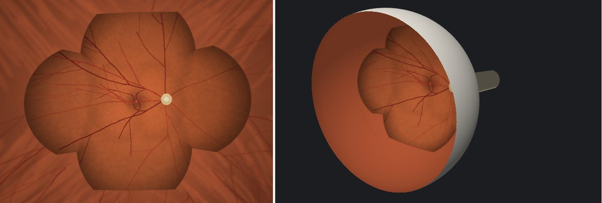

*왼쪽: 45° 사진 5장을 합친 몽타주를 안구 안에서 본 모습 · 오른쪽: 저장한 몽타주를 3D 안구 탭에서 (안구 중심각 127°, 등거리)*

`FundusViewer --demo` 로 실행하면 데모 환자 `D0001240`(VK-2, 45° 5방향)으로 바로 써 볼 수 있습니다.

## 장비별 폴더와 읽는 정보

| 장비 | 감시할 폴더 | 읽는 정보 |
|---|---|---|
| **SYSEYE RetiCam 3100 Plus** | 장비 PC의 저장 폴더, 예: `D:\reticam`(장비 PC에 설치) 또는 네트워크 공유 `\\<장비 IP>\D\reticam`(**폴링** 체크) | JPEG 안 APP15 JSON(`patientID`, `patientName`/`patientLastName`+`patientFirstName`, `patientBornDate`, `patientSex`, `eyeLaterality`, `modeID`, 몽타주 여부), 파일 이름 `<이름>-od-color-YYYYMMDD-HHMMSS-mmm` |
| **Microclear APOLLO** | 장비 공유 폴더 `…\PatientCapture` (SMB, **폴링** 체크) 또는 PC 뷰어 `MicroClearClient\ImageData` | 폴더 `<ID>_<이름>`, JPEG 주석 `Description:{JSON}`(검사 시각·Eye·FieldAngle·DevModel·ImgType), 케이스 내보내기 `<ID>.json`(생년월일·성별) |
| **Kowa VK-2 / VK-2s** | Kowa Export Tool 출력 폴더, VK-2 DICOM 로컬 저장 폴더 | 파일명 `ID_YYYYMMDD_HHMMSS_R_FUNDUS (COLOR)_1` (VK EXPORT / MDR / JOIA 형식), JOIA `.xml`, DICOM 태그 |
| VK-2 "폴더로 복사" | 그 폴더 (프로필: *파일명 = 환자 ID*) | 파일 이름 = 환자 ID |
| 기타 카메라 | 저장 폴더 | DICOM, EXIF/XMP/JPEG 주석, 같은 이름의 `.txt/.ini/.xml/.json/.csv`, 일반 파일명 규칙 |

**RetiCam 참고**
* 장비의 기본 환자(`#AnonymousID#` / Anonymous / 1980-01-01)로 찍은 사진은 등록되지 않은
  환자이므로 **미분류**로 들어옵니다.
* 촬영 시각은 파일 이름의 시각을 씁니다. JSON의 `dateTime`은 시간대만큼 몇 시간 어긋난 경우가
  있습니다.
* 확장자가 `.jpg`인데 내용이 TIFF인 내보내기 파일도 읽습니다(TIFF 태그에서 JSON을 찾음).
* VK-2와 연동해 "파일 이름 앞 6자리 = 환자 ID"로 내보내도록 설정한 병원은 **설정 → 파일명
  규칙**에 `^(?P<pid>\d{6})`을 추가하세요.
* 사진 왼쪽 위에 이름·ID가 글자로 찍혀 있습니다(장비가 넣는 것). 3D에서는 촬영 원 밖이라
  보이지 않습니다.

VK-2 원본 저장소(`vk_3x\-000512\vk000005.jpg`)의 파일은 이름에 환자 정보가 없어
(환자 연결은 `vk3x.mde` DB에만 있음) **미분류**로 들어옵니다. VK-2 사진은 Export Tool 또는
DICOM 내보내기 폴더를 감시하세요.

### 환자 정보 추출 순서

앞선 출처가 채운 값은 뒤에서 바꾸지 않습니다. 각 값의 출처는 상태 표시줄의 영상 정보에 마우스를 올리면 보입니다.

1. **DICOM 태그**: PatientID, PatientName(한글 이름 그룹 우선; `Specific Character Set`이 없는
   VK-2 파일은 CP949 / ISO 2022 이스케이프를 직접 해석), BirthDate, Sex, Acquisition/Content
   Date·Time, Image Laterality(0020,0062)→Laterality(0020,0060), Horizontal FOV(0022,000C)
2. **장비 데이터**: RetiCam APP15 JSON, APOLLO 폴더·JSON (`Eye` 1=OD 0=OS, `FieldAngle`
   60/90/112 → 90/135/165°)
3. **부속 파일**(sidecar): JOIA XML의 `ID / LastName / FirstName / DOB / Sex / ImageLaterality` 등
4. **이미지 내장 텍스트**: EXIF(Make/Model, DateTimeOriginal, UserComment, Windows XP 태그),
   JPEG 주석, PNG 텍스트, XMP에서 `PatientID=…; Name: …` 형태의 키·값
5. **파일·폴더 이름**: 프로필 규칙 → 사용자 규칙(설정 → 파일명 규칙, 정규식, 즉석 시험 가능)
   → 일반 규칙(`ID_이름_YYYYMMDD_OD`, `12345678_홍길동` …) → 상위 폴더(`12345_홍길동\20240305\`)
6. 그래도 없으면: 화각은 프로필 기본값, 검사일은 파일 시각, 눈은 시신경 유두 위치로 추정
   (OD는 유두가 오른쪽)

이미 등록된 환자의 이름·생년월일은 가져오기로 덮어쓰지 않습니다(빈 칸만 채움).

## 3D 안구 모델

반지름 1(≈12 mm)인 구를 안구로 봅니다. 사진은 메시에 붙이지 않고 프래그먼트 셰이더가
망막 표면의 점마다 **안구 중심에서 잰 후극으로부터의 각도 θ**와 방위각 φ를 구해 사진에서 색을
찾습니다. 그래서 화각·투영·회전을 바꾸면 바로 반영되고 확대해도 정확합니다.

* **화각 기준**: 광각 장비는 안구 중심각(내부각)으로, 일반 안저카메라(45°/50°)는 동공에서 잰
  외부각으로 표시합니다. 변환은 동공(절점) 위치 `d = 0.58`(안구 반지름 단위)인 원근 모델로 하며,
  이 값은 "내부 200° ≈ 외부 135°" 관례와 맞습니다. Microclear 규칙(외부각 × 1.5 = 안구 중심각)과도
  일치합니다.
* **투영**: 카메라마다 다음을 기본으로 씁니다. 스테레오그래픽과 정사영도 고를 수 있습니다.
  * **RetiCam 3100 Plus**: **광각 보정(중심 확대)**. 식은 `θ = θmax·((1−c)·ρ + c·ρ³)`,
    `c = 0.2545`, `θmax = 88°`입니다. 같은 176°라도 등거리로 펴면 실제 사진에서 시신경 유두
    (중심에서 영상 반경의 0.32)가 중심와에서 28°에 놓여, 해부학적 위치(약 22°)와 맞지 않습니다.
    이 식은 유두가 22°에 오도록 중심부를 확대합니다. 몽타주는 220°로 둡니다. 2023년형 50°급
    RetiCam 파일은 일반 카메라 원근으로 처리합니다.
  * **APOLLO**(SLO 스캔): 스캔각이 영상 반경에 비례하므로 **등거리(각도 비례)**를 씁니다.
  * **일반 카메라**: **카메라 원근(동공 시점)**, 즉 `tan α = sin θ / (cos θ + d)`를 씁니다.
  검증: 공급사 UWA 샘플에서 유두가 중심에서 약 250 px(반경 1023 px) 떨어져 있고, 등거리 165°로
  바꾸면 약 20°입니다. 이는 해부학적 중심와–유두 거리(약 4.5 mm / 12 mm)와 일치합니다.
* **보기 방식**: 3D 막대 맨 앞의 **[간단히 | 자세히]**.
  * **자세히**(기본): 아래 [해부학적 묘사](#해부학적-묘사)의 실제 해부 구조 모형입니다.
  * **간단히**: 가벼운 모형입니다. 흰 공막과 단순한 홍채·각막·시신경 위에 사진을 보여 주며,
    어느 PC에서나(소프트웨어 렌더링 포함) 빠릅니다.
  고른 방식은 저장되어 다음 실행에도 유지됩니다.
* **3D 탭의 구성**: 위에는 자주 쓰는 것만 있는 **막대 한 줄** — `간단히 | 자세히` · `외부 | 내부` · 배율 ·
  **▶ 슬릿 스캔 · 크게 보기 · 설정**. 나머지는 오른쪽 **설정 패널**(설정 버튼으로 열고 닫음)에
  묶음별로 있습니다.

  | 묶음 | 내용 |
  |---|---|
  | 망막 입체 | **표면 높낮이** · 높이 · 입체 조명 |
  | 시점 | 정면 · 처음 시점 · 화면 저장 |
  | 들어가며 보기 | ▶ 들어가기 · 위치 |
  | 안구 열기 | `앞쪽 절개 | 세로 단면`, 깊이, **공막 투명도**, 망막 투시 |
  | 슬릿 스캔 | 방향 `↓ | ↑ | → | ← | 상하좌우` |
  | 효과 | 자동 회전 · 화각 표시 · 사진 나란히 |
  | 표시 | **단순하게 보기** · 시신경 · 외안근 · 각도 격자 · 영상 처리 적용 |
  | 사진 맞춤 | **실제 위치에 맞춤** · 화각 · 화각 기준 · 투영 · 회전 · 황반–유두 거리로 크기 맞춤 · 화각·투영 저장 |
* **공막 투명도**(기본 80): 공막이 **유리처럼 비쳐** 보이고, **사진이 있는 망막은 진하게 그대로** 남습니다. 안구를
  돌리면 뒤에서도 옆에서도 망막의 사진이 안구 속 어디에 얼마나 넓게 놓여 있는지 보입니다(45° 사진은 후극의 작은
  부분, 초광각 사진은 안구 뒤쪽 대부분). 사진 밖으로는 홍채·수정체·섬모체가 은은하게 비칩니다. 낮추면 뿌연 유리,
  100으로 올리면 맑은 유리, 0으로 내리면 예전의 흰 공막입니다.

  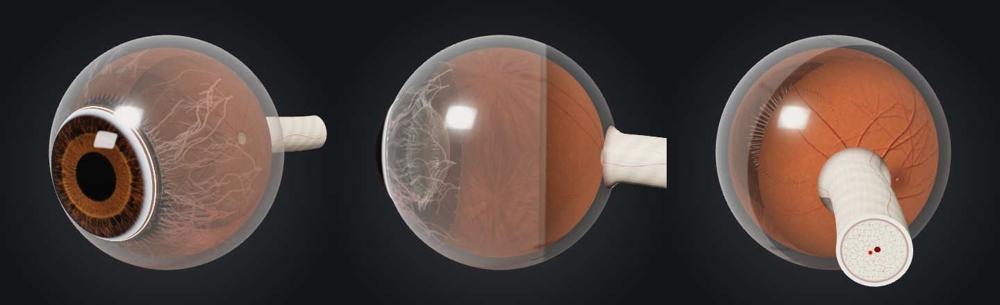

  *공막 투명도 80 — 앞, 옆, 뒤에서. 사진이 있는 망막은 진하게, 공막은 유리처럼*
* **3D 확대**: 휠을 돌리면 **커서가 가리키는 곳으로** 다가갑니다(절개한 안구 안의 망막도 그 점이 커서 아래에
  그대로 남음). 오른쪽 드래그도 확대, 가운데 버튼 또는 Shift+드래그로 이동, `+`/`−`, 더블클릭·`0`은 처음
  보기입니다. 내부 모드에서는 커서 쪽으로 시선을 돌리며 시야를 4°까지 좁힙니다. 배율은 막대에 `배율 ×2.2`처럼
  표시됩니다.
* **외부 모드**: 공막·각막·홍채와 시신경을 그립니다. 시신경은 검출된(또는 2D 화면에서 우클릭으로
  지정한) 유두 뒤에 붙습니다. "앞쪽 절개"를 고르면 슬라이더로 앞부분을 잘라 안쪽 망막을 봅니다.
  오른쪽 끝(100)으로 밀면 닫힌 안구가 됩니다. "세로 단면"은 [아래](#슬릿-스캔--세로-단면--망막-투시).
* **내부 모드**: 안구 안에서 망막을 바라봅니다. 드래그로 시선 이동, 휠로 시야를 넓히거나 좁힙니다.
* **각도 격자**: 후극에서 10°마다 링을 그립니다(30°마다 진하게).
* 사진 밖의 망막은 맥락막 무늬·주변부 혈관·톱니둘레까지 이어 그립니다. 45° 사진은 망막의 작은
  부분만, UWA 165° 사진은 대부분을 덮는 것이 정상입니다.
* "화각·투영 저장"을 누르면 그 영상의 매핑 값을 DB에 저장합니다.

### 황반과 시신경 유두를 실제 위치에

안구 모형이 기준입니다. 모형에서 **황반(중심와)은 안구 뒤쪽 한가운데(후극)**, **시신경 유두는 거기서 코쪽으로 21.5°
(망막 위 약 4.5 mm), 조금 위쪽**에 있습니다. 사진은 늘 황반이 가운데 오도록 찍히지 않으므로(유두 중심 촬영, 황반과 유두
사이를 중심에 두는 광각 장비, 주변부 촬영) 사진 중심을 무조건 후극에 붙이면 망막이 엉뚱한 곳에 놓입니다. 그래서 사진에서
황반과 유두를 찾아 **사진을 제자리로 돌려 얹습니다**.

| 사진에서 찾은 것 | 놓는 방법 |
|---|---|
| 황반 (+ 유두) | 황반을 후극에. 시신경은 사진의 유두 뒤에 붙습니다 |
| 유두만 (황반이 사진 밖) | 유두를 코쪽 제자리(21.5°, OD는 사진 오른쪽 · OS는 왼쪽)에 |
| 둘 다 없음 | 사진 중심을 후극에 (황반 중심 사진으로 봄) |

* **찾는 방법**: 유두는 가져올 때 찾고(혈관이 모이는 밝은 곳), 황반은 유두에서 귀쪽으로 약 4.5 mm, 조금 아래에 있는
  **혈관 없는 어두운 곳**의 중심입니다(중심와 반사 같은 작은 밝은 점은 지우고 찾습니다). 예전에 가져온 사진은 처음 열 때 찾습니다.
* **직접 지정**: 잘못 찾았거나 못 찾았으면 2D 사진에서 **오른쪽 클릭 → 여기를 황반으로 지정 / 시신경 유두로 지정**.
  보기 → 원·시신경 표시를 켜면 찾은 유두(노란 원)와 황반(하늘색 원)이 사진 위에 보입니다.
* **돌리는 방법**: 촬영 중 눈은 비틀림 없이 돌기 때문에(리스팅 법칙) 사진도 비틀지 않고 가장 짧게 돌립니다. 사진의 위쪽은
  그대로 위쪽이고, 기울기는 **회전**으로 따로 맞춥니다.
* **크기**: 사진이 망막을 얼마나 덮는지는 **화각**이 정합니다(45° 사진은 후극의 작은 부분, 176° 사진은 뒤쪽 대부분).
  설정 패널 아래에 사진에서 잰 **황반–유두 거리**(예: `21.2° · 4.4 mm`)가 나오는데, 보통 값(약 4.5 mm)과 20 % 넘게
  다르면 화각이 실제와 다를 수 있다고 알려 줍니다. 화각을 모르는 사진은 **황반–유두 거리로 크기 맞춤**을 누르면 이 거리가
  4.5 mm가 되도록 화각을 정합니다(사람마다 조금 다르므로 대략 맞춤).
* 사진 맞춤의 **실제 위치에 맞춤**을 끄면 예전처럼 사진 중심을 후극에 둡니다.
* 유두도 황반도 보이지 않는 주변부 사진은 위치를 알 수 없습니다. 같은 눈의 사진들과 **몽타주**로 합치면 겹치는 혈관으로
  서로의 위치가 정해지고, 합친 사진은 황반·유두로 다시 제자리에 놓입니다.

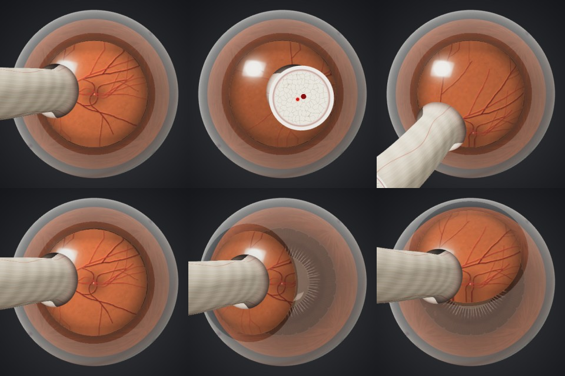

*45° 사진 세 장(황반 중심 · 코쪽 27° · 위쪽 24°)을 뒤에서 본 모습. 위: 사진 중심을 후극에 둔 경우 — 시신경이 엉뚱한 곳에
붙습니다. 아래: 실제 위치에 맞춤 — 망막이 찍힌 곳에 놓이고 시신경은 코쪽에*

### 부드러운 움직임과 3D 효과

스마트폰 화면처럼, 손을 떼도 움직임이 뚝 끊기지 않고 이어지다가 멎습니다.

| 어디서 | 움직임 |
|---|---|
| 3D 안구 | 돌리다 놓으면 **관성**으로 더 돌다가 멎음 · 휠 확대가 **미끄러지듯** 이어짐 · 정면 보기 / 시점 초기화 / 더블클릭이 **부드럽게 이동** |
| 2D 사진 | 휠 확대가 커서 아래 지점을 붙든 채 미끄러짐 · 끌다 놓으면 **관성으로 더 밀림**(가장자리에서 멈춤) · 화면 맞춤 / 100 % / 영역 확대가 부드럽게 · 다음 사진이 **겹쳐 넘어감** |
| 사진 목록 | 휠 스크롤이 미끄러지듯 |

움직임은 화면 주사율이 아니라 실제 흐른 시간으로 계산하므로 느린 PC에서도 속도가 같고, 화면을 누르면 진행 중이던
움직임은 그 자리에서 멈춥니다. **보기 → 부드러운 움직임**을 끄면 모든 전환이 예전처럼 바로 바뀝니다(원격 접속 등).

3D 안구의 효과(설정 패널의 **망막 입체 · 들어가며 보기 · 효과 · 표시** 묶음):

* **망막 입체 → 표면 높낮이**(기본 켜짐, 자세히): 사진이 얹힌 망막 표면을 실제로 올리고 내립니다 — 혈관은 솟고,
  시신경 유두 가운데의 함몰(cup)과 둘레의 테, 황반의 오목(fovea pit)은 파입니다(`fundusview/relief.py`: 혈관은 녹색
  채널의 가는 어두운 선, 함몰·오목은 찾은 유두·황반 자리). 촬영 범위 위에 촘촘한 망막 면을 따로 만들어 높낮이를
  주므로 안구를 돌리면 높낮이가 보입니다. **높이**로 얼마나 과장해서 보일지 정합니다.
* **입체 조명**(기본 켜짐): 그 높낮이(표면 높낮이를 끄면 사진의 밝기)에 비스듬한 빛을 비춥니다. 혈관 가장자리에
  밝은 면과 그늘이 생겨 도드라져 보이고, 안구를 돌리면 빛이 따라 움직입니다.
* 안구 안쪽은 고르게 밝습니다(절개 가장자리가 망막에 드리우던 그림자를 없앴습니다).
* **들어가며 보기 · 내부**: 안구 전체에서 각막 → 앞방 → 동공 → 수정체 → 유리체 → 망막까지 **어두워지지 않고**
  이어서 들어갑니다. 각막부터는 투명해져 동공으로 안쪽 망막이 보이고, 지나는 곳 이름이 안구 아래에 뜹니다.
  **▶ 들어가기**로 재생(다시 누르면 멈춤 · 끝에서 누르면 나오기), **위치** 막대로 원하는 곳에서 멈춥니다. 위 막대의
  `외부 | 내부`도 같은 길로 들어가고 나옵니다. (간단히 보기에서는 짧게 어두워졌다 바뀜)
* **단순하게 보기**(표시 묶음): 공막·홍채·수정체·섬모체·주변부·시신경을 단순한 모양과 색으로 그려 사진이 얹힌 망막과
  그 입체가 잘 보이게 합니다(망막은 그대로).
* **자동 회전**(기본 켜짐): 손을 떼고 있으면 천천히 돕니다. 만지면 멈췄다가 잠시 뒤 다시 돕니다(3D 안구 탭에서만).

(사진 펼치기는 들어가며 보기로 바뀌어 없어졌습니다. 이 기능들은 먼저 [3D 안구 미리보기](#3d-안구-미리보기-웹-페이지)
웹 페이지에서 확인한 뒤 넣었습니다.)

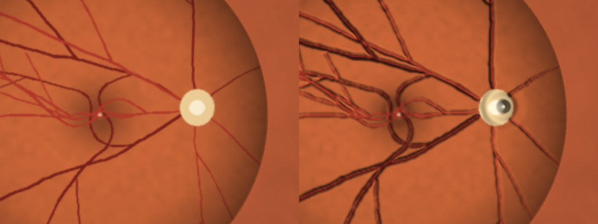

*망막 입체 — 표면 높낮이 끔(왼쪽) / 켬(오른쪽): 혈관이 솟고 시신경 유두 가운데가 파입니다*

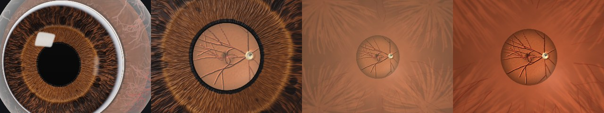

*들어가며 보기 — 각막 쪽으로 → 각막 앞(동공으로 망막이 보임) → 앞방 → 유리체*

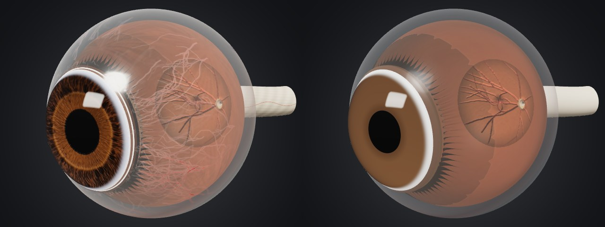

*단순하게 보기 끔 / 켬 — 공막의 혈관, 홍채 결이 사라지고 망막이 남습니다*

**속도** — 실제 장비 크기(RetiCam 5736 × 4304, 약 2,400만 화소) 사진으로 잰 값입니다.

| 작업 | 전 | 후 |
|---|---|---|
| 3D에 올릴 망막 영역 계산 | 1.5 s | 0.06 s |
| 밝기·대비·감마 조정 한 번 | 0.2 s | 0.01 s |
| 다음 사진으로 넘기기 | 0.4 s | 0.07 s (이웃 사진을 미리 읽어 둠) |
| 3D 한 장 그리기, 그래픽카드 없는 PC · 자세히 | 97 ms (10장/초) | 43 ms (23장/초) |
| 3D 한 장 그리기, 그래픽카드 없는 PC · 간단히 | 38 ms (26장/초) | 19 ms (53장/초) |

3D는 눈에 보이는 차이 없이 모형의 삼각형 수를 줄였고(그래픽카드가 없으면 삼각형 처리에 시간이 가장 많이 듭니다),
그래도 한 장이 22 ms를 넘는 PC에서는 **움직이는 동안만** 작은 해상도와 성긴 모형으로 그렸다가 멈추면 바로 선명하게
다시 그립니다. 화면 저장은 항상 선명합니다.

### 슬릿 스캔 · 세로 단면 · 망막 투시

| 단면에 화각 표시 | 슬릿 스캔 중 (창 전체) |
|---|---|
| 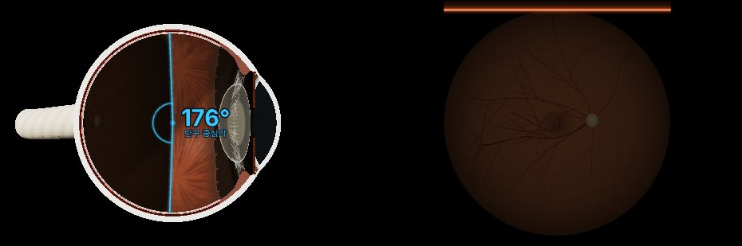 | 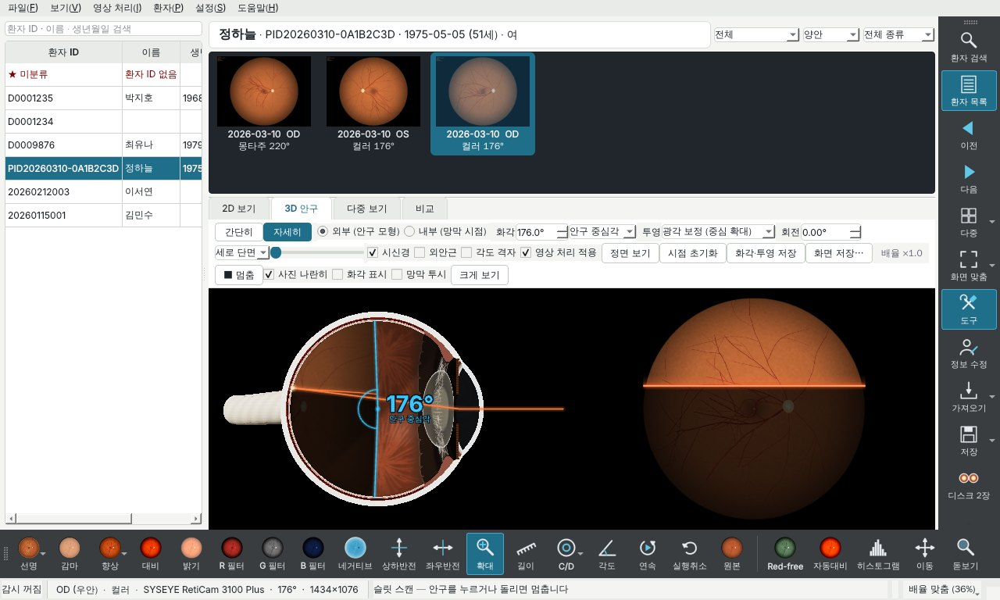 |
| **끝 화면 — 사진을 입힌 3D 안구** | |
| 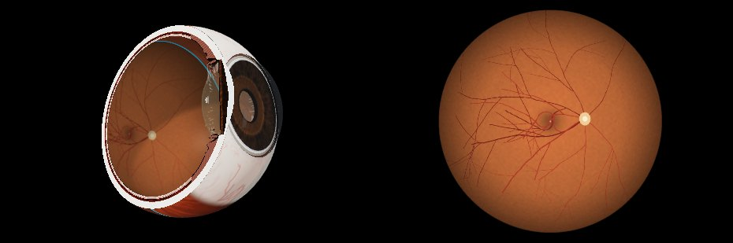 | |

* **세로 단면**: 사진의 세로 자오선(사진의 위·아래 방향)을 따라 안구를 잘라 옆에서 봅니다. 잘린 면은 실제
  해부 구조대로 공막(흰색) → 맥락막 → 망막 층, 톱니둘레 앞의 섬모체, 홍채, 투명한 수정체(노란 핵),
  각막을 그리고, 남은 반쪽의 망막에는 사진이 입혀져 있습니다. 시신경 유두가 있는 쪽이 남으므로 우안은
  각막이 오른쪽, 좌안은 왼쪽을 향합니다(귀쪽에서 본 모습). 슬라이더 왼쪽 끝(0)은 정확히 반(광축을
  지나는 면), 오른쪽으로 갈수록 덜 잘리고 100은 닫힌 안구입니다. 앞쪽 절개와 세로 단면은 각자 깊이를
  기억합니다.
* **화각 표시**: 세로 단면에서는 안구 중심에서 촬영 범위 양 끝까지 두 선과 각도(예: **176°**, 안구 중심각)를,
  다른 보기에서는 망막 위 촬영 범위의 경계를 하늘색으로 그립니다.
* **망막 투시**: 공막·맥락막을 투명하게 해 사진을 입힌 망막을 안구 바깥에서도 봅니다(바깥에서 보므로 좌우가
  뒤집혀 보이는 것이 맞습니다). 망막이 없는 톱니둘레 앞은 흰 공막·각막·홍채 그대로입니다.
  앞쪽 절개·세로 단면 어느 쪽과도 함께 씁니다.
* **사진 나란히**: 3D 안구 오른쪽에 사진을 평면으로 함께 보여 줍니다(검은 바탕). 촬영 원 밖은 검게 가리므로
  장비가 사진 구석에 찍는 이름·ID는 보이지 않습니다.
* **▶ 슬릿 스캔** (약 12초, 사진 나란히로 바뀌고 실제 해부 모형인 **자세히**로 그림). 방향은 설정 패널의
  **슬릿 스캔** 묶음에서 고릅니다: **↓ 위에서 아래로 · ↑ 아래에서 위로**(세로 단면을 옆에서), **→ 왼쪽에서 오른쪽으로 ·
  ← 오른쪽에서 왼쪽으로**(앞을 연 안구를 정면에서, 슬릿이 망막 위를 지나감), **상하좌우**(네 방향을 차례로 —
  위아래 다음 단면이 닫히며 앞이 열림). 위아래의 경우:
  1. 안구가 옆으로 돌며 세로로 반이 잘립니다.
  2. 안구 중심에서 화각 선이 열리고 각도가 나타납니다.
  3. 슬릿(주황 선)이 사진을 위에서 아래로(또는 아래에서 위로) 훑습니다. 훑기 전 부분은 어둡고, 단면에서는 슬릿 빛이
     동공을 지나 사진의 그 줄이 닿는 망막 위치로 갑니다(같은 투영식 사용). 망막 위에는 그 줄이 곡선으로 빛납니다.
  4. 자르는 면이 바깥으로 물러나 황반·시신경 유두가 보이고, 망막 투시가 켜지며, 앞에서 비스듬히 본
     3D 안구(흰 공막·홍채·각막과 안쪽 망막의 사진)로 돌아갑니다.
  5. 그 뒤로 천천히 돕니다. 안구를 누르거나 돌리면(휠·키 포함) 언제든 멈추고 그 자리에서 직접 조작합니다.
* **크게 보기**: 3D 안구와 사진을 화면 전체로 보여 줍니다(환자 설명용). Space = 슬릿 스캔, Esc = 돌아가기.
* **화면 저장…**은 사진 나란히일 때 안구와 사진을 화면 그대로 한 장으로, 화각 선·각도도 함께 저장합니다.

### 해부학적 묘사

치수는 성인 평균(`fundusview/ui/eye_model.py`, 1 = 12 mm)이고, 질감은 처음 실행할 때 한 번 만들어
설정 폴더의 `cache\`에 저장합니다(다음부터는 바로 열림).

* **공막**: 젖은 표면의 광택, 결막 혈관(검열 부위에 많음)과 윤부 혈관 고리, 곧은근 부착부에서
  나오는 앞섬모체동맥, 깊은 공막위 혈관, 적도 뒤의 소용돌이정맥 4개, 시신경 둘레의 짧은뒤섬모체동맥.
* **각막**: 화소마다 광선을 추적합니다. 앞면 반사(프레넬)로 조명 상자가 비치는 반사광, 굴절(n 1.336)로
  보는 각도에 따라 확대·이동해 보이는 홍채, 동공 안 수정체 앞면의 희미한 반사(푸르키녜 Ⅲ상),
  공막이 덮이는 윤부 경계.
* **홍채**(갈색): 방사상 섬유주, 동공 주름(ruff), 지그재그 홍채주름(collarette), 푹스 움(crypt),
  수축 고랑, 주근깨. 높낮이를 음영으로 표현합니다.
* **안구벽 두께**: 절개면에 공막 → 맥락막상강 → 맥락막(혈관 단면) → RPE → 망막층(시세포·핵층·망상층·
  신경섬유층)이 보이고, 톱니둘레 앞에서는 섬모체 단면이 됩니다.
* **안쪽**: 톱니 모양 톱니둘레(ora serrata), 섬모체 평면부, 섬모체 돌기 72개, 섬모소대, 수정체
  (단면에서 노란 핵·피질층·피막), 홍채 뒷면, 전방각(섬모체띠·공막돌기·섬유주·슈발베선).
  안쪽은 그림자 없이 고르게 비춥니다. 절개 슬라이더 70 전후가 섬모체·수정체,
  81~83이 홍채 단면, 88 이상이 각막만 뗀 상태입니다.
* **시신경**: 경막 싸개가 공막과 이어지고, 잘린 끝에 신경 다발·경막·거미막밑공간과 중심망막동맥·정맥이
  보입니다.
* **외안근**(선택): 네 곧은근(틸로 나선 거리대로 부착, 흰 힘줄 → 붉은 근육)과 두 빗근의 절단 부위.

3D는 OpenGL 2.1이 필요합니다. 그래픽 드라이버가 오래된 PC에서는 **설정 → 일반 → 3D 렌더링 →
소프트웨어 렌더링**을 고르고 다시 시작합니다(PySide6에 포함된 Mesa `opengl32sw.dll` 사용).

## 3D 안구 미리보기 (웹 페이지)

`web3d/eye3d.html`은 프로그램의 3D 안구를 웹 페이지 한 장에 담은 것입니다. 3D 기능을 설치 없이 빨리 확인하고,
확인(컨펌)된 것만 프로그램에 넣기 위한 시제품입니다.

* **프로그램과 같은 그림**: 프로그램의 셰이더(`fundusview/ui/eye3d.py`), 안구 모형의 치수·윤곽·질감
  (`eye_model.py`), 사진을 안구에 얹는 계산(`projection.py`·`placement.py`), 황반·유두 찾기(`imaging.py`)를
  그대로 옮겼습니다. 셰이더·모형·질감·데모 사진은 `web3d/build.py`가 프로그램에서 직접 꺼내 넣습니다.
* **되는 것**: 프로그램의 3D 안구와 같습니다 — 외부/내부와 **들어가며 보기**, 앞쪽 절개·세로 단면과 깊이, 공막
  투명도, 망막 투시, **망막 입체**(표면 높낮이 · 높이 · 입체 조명), 자동 회전, 화각 표시, 사진 나란히, **▶ 슬릿 스캔**
  (↓ ↑ → ← · 상하좌우), **단순하게 보기**, 크게 보기, 시신경·외안근·각도 격자, 실제 위치에 맞춤(황반 → 후극,
  유두 → 코쪽)과 황반–유두 거리, 화각·투영·회전, 황반–유두 거리로 크기 맞춤. 관성 회전, 커서 쪽 확대, 두 손가락
  확대(터치).
* **사진**: 데모 사진 6장(RetiCam 176°, 45° 황반 중심·코쪽·위쪽, 30° 유두 중심, APOLLO 135°)과 **내 사진 열기**
  (끌어다 놓기도 됨). 내 사진은 브라우저 안에서만 쓰이고 어디에도 올라가지 않습니다. **황반·유두 자동으로 찾기**가
  기본으로 켜져 있어, 사진을 열면 브라우저 안에서 프로그램과 같은 방법으로 시신경 유두와 황반을 찾아 안구의 제자리에
  맞춥니다(데모 사진도 매번 찾음, 눈을 정하지 않으면 황반이 있는 쪽으로 우안·좌안도 정함). 찾은 곳은 사진 아래에
  "자동으로 찾음 / 직접 지정"으로 표시되고, 틀렸을 때만 **황반 지정 / 유두 지정**으로 고치며 **다시 찾기**로 되돌립니다.
* **새 기능을 먼저 해 보는 곳**: 셰이더는 프로그램의 것(`fundusview/ui/eye3d.py`)을 그대로 쓰고, 페이지에서만 시험할
  줄은 `web3d/build.py`의 `WEB_PATCHES`에 넣었다가 확인되면 프로그램으로 옮깁니다(지금은 비어 있음 — 들어가며 보기,
  망막 입체, 단순하게 보기, 슬릿 방향 모두 프로그램에 들어갔습니다).
* **없는 것**: 2D 화면·측정·환자 목록(3D만 담았습니다).

다시 만들기: `python web3d/build.py` → `web3d/eye3d.html`. 페이지의 동작은 `web3d/app.js`, 모양은 `web3d/app.css`,
틀은 `web3d/page.html`입니다.

## 구조

```
fundusview/
  app.py            진입점 (OpenGL 모드, 테마, --demo / --home)
  config.py         설정 JSON (%APPDATA%\FundusViewer\settings.json)
  db.py             SQLite: patients / images / seen_files / import_log
  profiles.py       카메라 프로필 (RetiCam, APOLLO, VK-2, VK-2 ID 폴더, 일반)
  extract/          메타데이터 추출 (dicom / reticam / apollo / embedded+sidecar / filename / normalize)
  importer.py       안정화 대기 → 중복 검사 → 추출 → 분석 → 라이브러리 저장 → DB
  watcher.py        watchdog 감시(또는 폴링) + 재검사 + 가져오기 작업 스레드
  imaging.py        영상 읽기(DICOM 포함), 촬영 원·시신경 검출, 표시 조정(LUT)
  projection.py     안구 기하 (θ↔영상 반경, 내부각↔외부각) — 셰이더와 동일한 식
  placement.py      사진이 안구의 어디에 놓이는지: 황반 → 후극, 유두 → 코쪽 제자리 (비틀림 없는 회전), 황반–유두 거리
  demo.py           합성 안저 사진 + 장비별 형식 데모 폴더
  measure.py        측정 (화소 → 망막 각도·mm, 각도, 면적)
  discpair.py       디스크 2장: 유두 지름 기준 자르기, OD/OS 배치
  montage.py        몽타주: 사진별 구면 회전, 혈관 특징점 자동 맞춤(RANSAC · 화각 보정), 기준점, 밝기 맞춤,
                    두 대역 섞기, 등거리 지도
  autosetup.py      자동 가져오기: 가져오기 폴더 + 장비 폴더(RetiCam·APOLLO) 찾기
  ui/               main_window, toolbars(VK-2 명령·영상 처리 툴바), icons, eye3d(OpenGL 셰이더),
                    eye_model(안구 해부 치수·메시·절차적 질감), slit_scan(사진 나란히·슬릿 스캔 연출),
                    motion(관성 · 미끄러지는 확대 · 전환 애니메이션),
                    theme(어두운 화면: 색 · 글꼴 · 창 틀) + style.qss, widgets(스위치 · 나란한 단추 · 카드),
                    image_view(도구·사진 위 글자·황반/유두 표시),
                    multi_view, disc_pair(디스크 2장 미리 보기·저장·인쇄),
                    montage_dialog(몽타주 편집기: 반투명 겹치기·기준점·완성·3D), histogram, dialogs
tests/              pytest (추출·투영·영상·가져오기·감시·GUI·디자인·3D 안구 모델·OpenGL 렌더링·웹 미리보기)
web3d/              3D 안구 미리보기 웹 페이지 (build.py → eye3d.html)
```

라이브러리 폴더(기본: `문서\FundusViewerLibrary`)에는 `fundus.db`, `images\<환자ID>\<검사일>\`
사본, `thumbs\`, `display\`(DICOM을 PNG로 바꾼 사본)가 들어갑니다. 처리 방식은 폴더마다
**복사**(기본, 원본 유지) / 이동 / 원본 위치 참조 중에서 고릅니다. 장비 공유 폴더는 반드시 복사나
참조로 두세요.

## 테스트

```bash
QT_QPA_PLATFORM=offscreen python -m pytest -q tests
```

`offscreen`에는 OpenGL이 없어서 3D 렌더링 테스트(`tests/test_eye3d_gl.py`)는 건너뜁니다. 리눅스에서는
Xvfb와 Mesa로 셰이더 컴파일까지 확인할 수 있습니다(CI도 이렇게 돌립니다).

```bash
FUNDUSVIEW_REQUIRE_GL=1 QT_QPA_PLATFORM=xcb xvfb-run -a python -m pytest -q tests/test_eye3d_gl.py
```

## 알려진 한계와 다음 단계

* **RetiCam 투영 보정은 잠정값**입니다. 근거는 몽타주 샘플 한 장의 측정과 해부학적 유두 위치뿐입니다.
  보정을 확정하려면 둘 중 하나가 필요합니다.
  * SYSEYE에서 투영·왜곡 자료나 DICOM 적합성 문서를 받기
  * 격자 시험판을 찍은 사진으로 맞추기
  그때까지 3D 화면에서 투영을 "등거리"로 바꿔 비교할 수 있고, 영상별 "화각·투영 저장"도 됩니다.
  주변부 고정 촬영(fixation) 사진의 회전 정보는 아직 쓰지 않습니다(사진에서 찾은 황반·유두로 위치를 정합니다).
* **VK-2 원본 DB 연동**: `vk3x.mde`(Access) 스키마가 문서화되어 있지 않아, 원본 저장소
  사진의 환자 연결은 아직 하지 않습니다. 샘플 `.mde`로 테이블 구조를 확인한 뒤 읽기 전용
  커넥터를 추가할 수 있습니다. VK-2 전용 무손실 형식 `.dlt`는 읽지 못합니다.
* **APOLLO 단일 모드 파일**(IR / RF / FFA / AF / ICGA+FFA)의 JSON에는 환자 경로가 없습니다. 이런
  파일은 `PatientCapture\<ID>_<이름>` 폴더 구조에서 환자를 찾습니다. ICGA 단독의 `ImgType` 값은 아직
  확인하지 못했습니다. PNG 내보내기의 바이너리 헤더는 SKY 샘플 하나로만 확인했습니다.
* 3D 매핑은 1차 광학 모델입니다(카메라 왜곡과 안축장 차이는 반영하지 않음). 측정·진단용이 아닌
  시각화 용도입니다.
* 이 뷰어는 의료기기 인증을 받은 소프트웨어가 아닙니다. DB에는 환자 이름이 저장되므로 PC 접근
  권한을 관리하세요.
